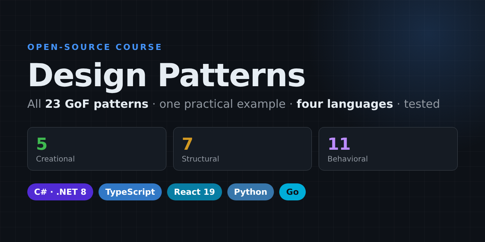

<a id="top"></a>

<p align="center">
  
</p>

# Design Patterns — One Example, Four Languages

[](https://github.com/danielfyo/design-patterns/actions/workflows/ci.yml)
[](https://github.com/danielfyo/design-patterns/actions/workflows/codeql.yml)
[](https://scorecard.dev/viewer/?uri=github.com/danielfyo/design-patterns)
[](https://github.com/danielfyo/design-patterns/releases)
[](LICENSE)
[](https://www.conventionalcommits.org/en/v1.0.0/)


An open-source, hands-on course on **all 23 classic design patterns** from the
"Gang of Four" (GoF) book — every **creational**, **structural** and **behavioral** pattern —
taught through **practical, real-world examples** instead of `Animal`/`Dog`/`Cat` toys.

What makes this repository different:

- 🧩 **The same example in four languages.** Every pattern is implemented in
  **C# / .NET**, **TypeScript** (with a **React** demo), **Python** and **Go**, using the *same*
  scenario and the *same* class names, so you can compare the languages side by side.
- ✅ **Verified to behave identically.** Each implementation prints exactly the same output,
  checked in CI against the pattern's `expected_output.txt`.
- 🧪 **Tested in every language.** Unit tests prove each pattern's guarantees with xUnit, pytest,
  `go test` and Vitest + Testing Library, under strict linters and type checkers.
- 📚 **A full lesson per pattern.** The problem it solves, the solution, a UML diagram, a code
  walkthrough, idioms per language, **when to use it, when *not* to use it**, pros and cons,
  where it appears in real frameworks, related patterns and exercises.
- ⚛️ **A React playground** where you can click through an interactive demo of every pattern.

---

## Table of contents

- [What are design patterns?](#what-are-design-patterns)
- [Quick start](#quick-start)
- [Repository layout](#repository-layout)
- [How each lesson is organized](#how-each-lesson-is-organized)
- [The catalog](#the-catalog)
  - [Creational patterns](#creational-patterns)
  - [Structural patterns](#structural-patterns)
  - [Behavioral patterns](#behavioral-patterns)
- [Pattern guide: intent, when to use, when to avoid](#pattern-guide-intent-when-to-use-when-to-avoid)
- [Which pattern do I need?](#which-pattern-do-i-need)
- [Commonly confused patterns](#commonly-confused-patterns)
- [The principles behind the patterns](#the-principles-behind-the-patterns)
- [Patterns in modern languages](#patterns-in-modern-languages)
- [Suggested learning path](#suggested-learning-path)
- [Anti-patterns: how to misuse design patterns](#anti-patterns-how-to-misuse-design-patterns)
- [Further reading](#further-reading)
- [Contributing](#contributing)
- [License](#license)
- [About the author](#about-the-author)

---

## What are design patterns?

A **design pattern** is a proven, reusable solution to a problem that keeps coming up when
designing software. It is not a library or a piece of code you copy and paste: it is a
**template for a design** — a named arrangement of classes, objects and responsibilities — that
you adapt to your own context.

The 23 patterns in this repository were catalogued in 1994 by Erich Gamma, Richard Helm,
Ralph Johnson and John Vlissides — the "Gang of Four" — in *Design Patterns: Elements of Reusable
Object-Oriented Software*. They are grouped in three families:

| Family | Question it answers | Patterns |
|---|---|---|
| **Creational** | *How are objects created?* They hide the creation logic so code depends on abstractions, not on concrete classes. | 5 |
| **Structural** | *How are objects composed?* They assemble classes and objects into larger structures while keeping them flexible. | 7 |
| **Behavioral** | *How do objects communicate?* They distribute responsibilities and define how objects talk to each other. | 11 |

Why learn them?

1. **Shared vocabulary.** Saying "wrap it in a *decorator*" or "this is a *state machine*"
   communicates a whole design in two words during code reviews and design discussions.
2. **Proven trade-offs.** Each pattern documents its consequences, so you know the cost before
   you pay it.
3. **Reading frameworks.** ASP.NET Core, React, Django or Go's standard library are full of
   patterns; recognizing them makes unfamiliar code much easier to understand.
4. **Better refactoring.** Many patterns are the *destination* of a refactoring: a growing
   `switch` becomes a Strategy or a State, a tangle of calls becomes a Facade or a Mediator.

> ⚠️ Patterns are tools, not goals. The best code uses a pattern when the problem calls for it —
> and a plain function or an `if` when it does not. Every lesson includes a **"When NOT to use
> it"** section for this reason.

---

## Quick start

### Prerequisites

| Language | Version | Check | Tests |
|---|---|---|---|
| 🟣 C# | [.NET SDK 8](https://dotnet.microsoft.com/download) or later | `dotnet --version` | xUnit |
| 🔷 TypeScript / ⚛️ React | [Node.js 20+](https://nodejs.org/) (then `npm ci`) | `node --version` | Vitest + Testing Library |
| 🐍 Python | 3.10 or later, standard library only | `python3 --version` | pytest + mypy `--strict` + ruff |
| 🐹 Go | 1.23 or later | `go version` | `go test` |

You only need the languages you want to study.

```bash
git clone https://github.com/danielfyo/design-patterns.git
cd design-patterns
npm ci                     # only needed for TypeScript / React
pip install -e ".[dev]"    # only needed to lint and test the Python examples
```

### Run one pattern

Every command runs from the **repository root**. Replace `behavioral/strategy` with any pattern.

```bash
dotnet run --project patterns/behavioral/strategy/csharp     # C#
npx tsx patterns/behavioral/strategy/typescript/main.ts      # TypeScript
python3 patterns/behavioral/strategy/python/main.py          # Python
go run ./patterns/behavioral/strategy/go                     # Go
```

### Open the React playground

```bash
npm run dev          # then open the URL Vite prints (http://localhost:5173 by default)
```

The playground discovers every `*Demo.tsx` component automatically and lists them by family.

### Run the tests

```bash
dotnet test DesignPatterns.sln            # C#: xUnit (the build enforces analyzers and code style)
npm test                                  # TypeScript + React: Vitest and Testing Library
bash scripts/check-python.sh              # Python: ruff, mypy --strict and pytest
go test ./...                             # Go
```

### Verify everything

```bash
make all                                  # exactly what CI runs: docs, C#, Python, Go, TypeScript, examples
make csharp                               # ...or one area: csharp | python | go | typescript | examples | docs
bash scripts/verify.sh                    # runs all 23 patterns × 4 languages and diffs the output
bash scripts/verify.sh structural/decorator  # a single pattern
LANGS="python go" bash scripts/verify.sh  # a subset of languages
npm run typecheck                         # type-check all TypeScript and React code
python3 scripts/sync_readme.py --check    # lesson output blocks match expected_output.txt
python3 scripts/check_links.py            # every relative link and anchor resolves
```

### Quality gates

The same checks run locally (`make all`) and in CI on every pull request:

| Area | Checks |
| --- | --- |
| C# / .NET | NuGet lock files restored in locked mode, .NET analyzers `latest-recommended`, code style enforced in the build, warnings as errors, xUnit with coverage |
| TypeScript + React | `npm audit`, strict TypeScript, Vitest + Testing Library with coverage, production build of the playground |
| Python | Ruff (lint + format), mypy `--strict`, pytest with branch coverage, on Python 3.10 and 3.13 |
| Go | `gofmt`, `go vet`, `go test -race` with coverage |
| Examples | all 23 patterns × 4 languages print exactly their `expected_output.txt` |
| Docs | lesson output blocks generated from `expected_output.txt`, every relative link and anchor resolves |
| Security | CodeQL (C#, Python, Go, JS/TS and workflows), OpenSSF Scorecard, Dependabot, SHA-pinned actions, least-privilege tokens |

Formatting is shared through [`.editorconfig`](.editorconfig) and line endings through
[`.gitattributes`](.gitattributes). The full set of conventions is in
[docs/CONVENTIONS.md](docs/CONVENTIONS.md).

---

## Repository layout

```
.
├── README.md                     ← you are here: the course index and guides
├── patterns/
│   ├── creational/<pattern>/     ← 5 patterns
│   ├── structural/<pattern>/     ← 7 patterns
│   └── behavioral/<pattern>/     ← 11 patterns
│       ├── README.md             ← the full lesson
│       ├── expected_output.txt   ← output all four implementations must print
│       ├── csharp/               ← <Pattern>.csproj, Program.cs, ...
│       ├── typescript/           ← core (.ts), main.ts, <Pattern>Demo.tsx (React) + *.test.ts(x)
│       ├── python/               ← main.py + test_main.py
│       └── go/                   ← main.go + main_test.go
├── tests/csharp/                 ← xUnit project with one test class per pattern
├── playground/                   ← Vite + React app that renders every *Demo.tsx
├── docs/
│   ├── CONVENTIONS.md            ← naming, layout, quality gates and commit conventions
│   └── PATTERN_TEMPLATE.md       ← the structure every lesson follows
├── scripts/
│   ├── verify.sh                 ← runs and diffs every example in every language
│   ├── check-python.sh           ← ruff + mypy --strict + pytest
│   ├── sync_readme.py            ← regenerates the output blocks of the lessons
│   ├── check_links.py            ← validates relative links and anchors
│   └── setup-repo.{sh,ps1}       ← apply the GitHub settings (rulesets, security, Actions)
├── .github/                      ← CI, CodeQL, Scorecard, releases, Dependabot, templates
├── DesignPatterns.sln            ← all C# projects in one solution
├── Directory.Build.props         ← shared C# settings (analyzers, code style, warnings as errors)
├── Directory.Packages.props      ← central NuGet package versions
├── package.json / tsconfig.json  ← TypeScript, React and Vitest tooling
├── pyproject.toml / conftest.py  ← ruff, mypy, pytest and coverage settings
├── go.mod                        ← one Go module; each pattern is a `package main`
├── Makefile                      ← `make all` runs every quality gate, like CI
└── .editorconfig / .gitattributes← formatting and line endings for every editor and OS
```

---

## How each lesson is organized

Every `patterns/<family>/<pattern>/README.md` follows the same structure, so you always know
where to look:

1. **Intent** — the pattern in one or two sentences.
2. **The problem** — a realistic scenario and the "naive" code that hurts.
3. **The solution** — the idea, a **Mermaid UML class diagram** and the participants.
4. **The example** — what the shared example does, with links and run commands for each language.
5. **Expected output** — what every implementation prints.
6. **Code walkthrough** — the key lines, explained.
7. **Language notes** — how the pattern looks in idiomatic C#, TypeScript/React, Python and Go,
   and which built-in features replace or simplify it.
8. **When to use it / When NOT to use it.**
9. **Pros and cons.**
10. **Real-world usages** — where you already use this pattern in .NET, React, Python and Go.
11. **Related patterns.**
12. **Exercises** to practice.

---

## The catalog

Legend: ⭐ beginner · ⭐⭐ intermediate · ⭐⭐⭐ advanced. Links go to the lesson and to each
implementation.

### Creational patterns

| Pattern | Intent | Practical example | Level | Code |
|---|---|---|---|---|
| [Factory Method](patterns/creational/factory-method/README.md) | Let subclasses decide which class to instantiate. | Notification service (email / SMS / push) | ⭐ | [C#](patterns/creational/factory-method/csharp) · [TS/React](patterns/creational/factory-method/typescript) · [Python](patterns/creational/factory-method/python) · [Go](patterns/creational/factory-method/go) |
| [Abstract Factory](patterns/creational/abstract-factory/README.md) | Create families of related objects without naming their concrete classes. | UI theme kit (light / dark) | ⭐⭐ | [C#](patterns/creational/abstract-factory/csharp) · [TS/React](patterns/creational/abstract-factory/typescript) · [Python](patterns/creational/abstract-factory/python) · [Go](patterns/creational/abstract-factory/go) |
| [Builder](patterns/creational/builder/README.md) | Construct complex objects step by step. | HTTP request builder | ⭐ | [C#](patterns/creational/builder/csharp) · [TS/React](patterns/creational/builder/typescript) · [Python](patterns/creational/builder/python) · [Go](patterns/creational/builder/go) |
| [Prototype](patterns/creational/prototype/README.md) | Create new objects by cloning an existing one. | Document templates | ⭐⭐ | [C#](patterns/creational/prototype/csharp) · [TS/React](patterns/creational/prototype/typescript) · [Python](patterns/creational/prototype/python) · [Go](patterns/creational/prototype/go) |
| [Singleton](patterns/creational/singleton/README.md) | Ensure a class has one instance with a global access point. | Application configuration | ⭐ | [C#](patterns/creational/singleton/csharp) · [TS/React](patterns/creational/singleton/typescript) · [Python](patterns/creational/singleton/python) · [Go](patterns/creational/singleton/go) |

### Structural patterns

| Pattern | Intent | Practical example | Level | Code |
|---|---|---|---|---|
| [Adapter](patterns/structural/adapter/README.md) | Make incompatible interfaces work together. | Third-party payment gateway | ⭐ | [C#](patterns/structural/adapter/csharp) · [TS/React](patterns/structural/adapter/typescript) · [Python](patterns/structural/adapter/python) · [Go](patterns/structural/adapter/go) |
| [Bridge](patterns/structural/bridge/README.md) | Split an abstraction from its implementation so both can vary. | Reports × renderers (Markdown / HTML / CSV) | ⭐⭐⭐ | [C#](patterns/structural/bridge/csharp) · [TS/React](patterns/structural/bridge/typescript) · [Python](patterns/structural/bridge/python) · [Go](patterns/structural/bridge/go) |
| [Composite](patterns/structural/composite/README.md) | Treat individual objects and groups uniformly as a tree. | File system (files & folders) | ⭐⭐ | [C#](patterns/structural/composite/csharp) · [TS/React](patterns/structural/composite/typescript) · [Python](patterns/structural/composite/python) · [Go](patterns/structural/composite/go) |
| [Decorator](patterns/structural/decorator/README.md) | Add responsibilities to an object dynamically by wrapping it. | Data fetcher with logging, caching, retries | ⭐⭐ | [C#](patterns/structural/decorator/csharp) · [TS/React](patterns/structural/decorator/typescript) · [Python](patterns/structural/decorator/python) · [Go](patterns/structural/decorator/go) |
| [Facade](patterns/structural/facade/README.md) | Provide a simple interface to a complex subsystem. | E-commerce order placement | ⭐ | [C#](patterns/structural/facade/csharp) · [TS/React](patterns/structural/facade/typescript) · [Python](patterns/structural/facade/python) · [Go](patterns/structural/facade/go) |
| [Flyweight](patterns/structural/flyweight/README.md) | Share common state between many fine-grained objects. | 10,000 map markers | ⭐⭐⭐ | [C#](patterns/structural/flyweight/csharp) · [TS/React](patterns/structural/flyweight/typescript) · [Python](patterns/structural/flyweight/python) · [Go](patterns/structural/flyweight/go) |
| [Proxy](patterns/structural/proxy/README.md) | Provide a stand-in that controls access to another object. | Lazy, cached, access-controlled document store | ⭐⭐ | [C#](patterns/structural/proxy/csharp) · [TS/React](patterns/structural/proxy/typescript) · [Python](patterns/structural/proxy/python) · [Go](patterns/structural/proxy/go) |

### Behavioral patterns

| Pattern | Intent | Practical example | Level | Code |
|---|---|---|---|---|
| [Chain of Responsibility](patterns/behavioral/chain-of-responsibility/README.md) | Pass a request along a chain of handlers. | HTTP middleware pipeline | ⭐⭐ | [C#](patterns/behavioral/chain-of-responsibility/csharp) · [TS/React](patterns/behavioral/chain-of-responsibility/typescript) · [Python](patterns/behavioral/chain-of-responsibility/python) · [Go](patterns/behavioral/chain-of-responsibility/go) |
| [Command](patterns/behavioral/command/README.md) | Turn a request into an object (queue, log, undo). | Text editor with undo / redo | ⭐⭐ | [C#](patterns/behavioral/command/csharp) · [TS/React](patterns/behavioral/command/typescript) · [Python](patterns/behavioral/command/python) · [Go](patterns/behavioral/command/go) |
| [Interpreter](patterns/behavioral/interpreter/README.md) | Represent a grammar as classes and evaluate sentences. | Pricing-rule expression language | ⭐⭐⭐ | [C#](patterns/behavioral/interpreter/csharp) · [TS/React](patterns/behavioral/interpreter/typescript) · [Python](patterns/behavioral/interpreter/python) · [Go](patterns/behavioral/interpreter/go) |
| [Iterator](patterns/behavioral/iterator/README.md) | Traverse a collection without exposing its internals. | Lazily paginated API results | ⭐ | [C#](patterns/behavioral/iterator/csharp) · [TS/React](patterns/behavioral/iterator/typescript) · [Python](patterns/behavioral/iterator/python) · [Go](patterns/behavioral/iterator/go) |
| [Mediator](patterns/behavioral/mediator/README.md) | Centralize communication between objects. | Chat room | ⭐⭐ | [C#](patterns/behavioral/mediator/csharp) · [TS/React](patterns/behavioral/mediator/typescript) · [Python](patterns/behavioral/mediator/python) · [Go](patterns/behavioral/mediator/go) |
| [Memento](patterns/behavioral/memento/README.md) | Capture and restore an object's state without breaking encapsulation. | Editor snapshots | ⭐⭐ | [C#](patterns/behavioral/memento/csharp) · [TS/React](patterns/behavioral/memento/typescript) · [Python](patterns/behavioral/memento/python) · [Go](patterns/behavioral/memento/go) |
| [Observer](patterns/behavioral/observer/README.md) | Notify dependents automatically when state changes. | Stock price ticker | ⭐ | [C#](patterns/behavioral/observer/csharp) · [TS/React](patterns/behavioral/observer/typescript) · [Python](patterns/behavioral/observer/python) · [Go](patterns/behavioral/observer/go) |
| [State](patterns/behavioral/state/README.md) | Change behavior when internal state changes. | Order lifecycle | ⭐⭐ | [C#](patterns/behavioral/state/csharp) · [TS/React](patterns/behavioral/state/typescript) · [Python](patterns/behavioral/state/python) · [Go](patterns/behavioral/state/go) |
| [Strategy](patterns/behavioral/strategy/README.md) | Make a family of algorithms interchangeable. | Shipping cost calculator | ⭐ | [C#](patterns/behavioral/strategy/csharp) · [TS/React](patterns/behavioral/strategy/typescript) · [Python](patterns/behavioral/strategy/python) · [Go](patterns/behavioral/strategy/go) |
| [Template Method](patterns/behavioral/template-method/README.md) | Define an algorithm's skeleton; let subclasses fill in steps. | CSV / JSON data importer | ⭐ | [C#](patterns/behavioral/template-method/csharp) · [TS/React](patterns/behavioral/template-method/typescript) · [Python](patterns/behavioral/template-method/python) · [Go](patterns/behavioral/template-method/go) |
| [Visitor](patterns/behavioral/visitor/README.md) | Add operations to an object structure without changing its classes. | Shopping cart tax & shipping | ⭐⭐⭐ | [C#](patterns/behavioral/visitor/csharp) · [TS/React](patterns/behavioral/visitor/typescript) · [Python](patterns/behavioral/visitor/python) · [Go](patterns/behavioral/visitor/go) |

---

## Pattern guide: intent, when to use, when to avoid

A condensed version of every lesson. Open the lesson for the full explanation, diagram and code.

### Creational

#### [Factory Method](patterns/creational/factory-method/README.md)
- **Intent:** define an interface for creating an object, but let subclasses decide which
  concrete class to instantiate.
- **Example:** a `NotificationService` whose `notify()` logic is shared, while `EmailService`,
  `SmsService` and `PushService` each override `createNotifier()` to produce the right `Notifier`.
- **Use it when:** a class can't know in advance which concrete objects it must create; you want
  to give users of a framework a hook to plug in their own products; creation logic is
  duplicated across the code base.
- **Avoid it when:** there is only one product type, or a simple function/static factory
  (`Notifier.For("email")`) is enough — don't create a class hierarchy just to call `new`.

#### [Abstract Factory](patterns/creational/abstract-factory/README.md)
- **Intent:** provide an interface for creating **families** of related objects without
  specifying their concrete classes.
- **Example:** a `ThemeFactory` that creates matching `Button` and `Checkbox` components;
  `LightTheme` and `DarkTheme` guarantee that you never mix a dark button with a light checkbox.
- **Use it when:** your code must work with several families of products (themes, database
  providers, cloud vendors, OS widgets) and products from different families must not be mixed.
- **Avoid it when:** you only have one family, or new *kinds* of products are added often — every
  new product type forces a change to every factory.

#### [Builder](patterns/creational/builder/README.md)
- **Intent:** separate the construction of a complex object from its representation, building it
  step by step.
- **Example:** an `HttpRequestBuilder` with a fluent API (`.method().url().header().body().timeout()`)
  that validates the request in `build()`, plus a director with presets like `jsonPost()`.
- **Use it when:** an object has many optional parameters (telescoping constructors), must be
  validated as a whole before it exists, or must be immutable once built.
- **Avoid it when:** the object has two or three required fields — a constructor, named arguments
  or an object literal is clearer.

#### [Prototype](patterns/creational/prototype/README.md)
- **Intent:** create new objects by **copying** an existing instance (the prototype).
- **Example:** a `TemplateRegistry` of pre-configured documents ("invoice", "report") that are
  **deep-cloned** and customized, without affecting the original templates.
- **Use it when:** creating an object is expensive or complex and many objects differ only
  slightly; you need copies of objects whose concrete classes you don't know.
- **Avoid it when:** objects have circular references or own unclonable resources (sockets, file
  handles), or when a factory with parameters would be simpler. Beware of shallow copies.

#### [Singleton](patterns/creational/singleton/README.md)
- **Intent:** ensure a class has exactly **one instance** and provide a global point of access to it.
- **Example:** an `AppConfig` loaded once and shared by the database and API modules.
- **Use it when:** exactly one instance must exist (configuration, a hardware gateway, a process-wide
  cache) and lazy, thread-safe initialization matters.
- **Avoid it when:** you can let a **dependency injection container** manage the lifetime
  (`AddSingleton` in .NET, React context, passing the dependency explicitly). Singletons are global
  state: they hide dependencies and make tests harder.

### Structural

#### [Adapter](patterns/structural/adapter/README.md)
- **Intent:** convert the interface of a class into another interface that clients expect.
- **Example:** a `PayProAdapter` that lets the checkout use a third-party SDK which works in
  cents and status codes through the app's own `PaymentProcessor` interface.
- **Use it when:** integrating third-party libraries, legacy code or external APIs whose
  interface you can't (or shouldn't) change; building an anti-corruption layer.
- **Avoid it when:** you own both sides and can simply make the interfaces match.

#### [Bridge](patterns/structural/bridge/README.md)
- **Intent:** decouple an abstraction from its implementation so the two can vary independently.
- **Example:** `SalesReport` and `InventoryReport` (abstractions) rendered by `MarkdownRenderer`,
  `HtmlRenderer` or `CsvRenderer` (implementations): 2 + 3 classes instead of 2 × 3.
- **Use it when:** a class hierarchy grows in two independent dimensions (shape × color,
  report × format, device × remote) and you see a "class explosion".
- **Avoid it when:** there is only one dimension of variation — Bridge adds indirection that you
  won't benefit from.

#### [Composite](patterns/structural/composite/README.md)
- **Intent:** compose objects into **tree structures** and let clients treat individual objects
  and compositions uniformly.
- **Example:** `File` and `Directory` share the `FileSystemNode` interface, so `size()` and
  `print()` work the same on a single file or a whole folder tree.
- **Use it when:** you model part–whole hierarchies: file systems, menus, UI component trees,
  organization charts, product bundles, expression trees.
- **Avoid it when:** leaves and containers have very different interfaces — forcing a common one
  leads to methods that make no sense on leaves (`file.add()`).

#### [Decorator](patterns/structural/decorator/README.md)
- **Intent:** attach additional responsibilities to an object **dynamically**, by wrapping it in
  objects with the same interface.
- **Example:** an `HttpFetcher` wrapped in `RetryFetcher`, `CachingFetcher` and `LoggingFetcher`,
  stacked in any order.
- **Use it when:** you need to add cross-cutting behavior (logging, caching, retries, metrics,
  authorization, compression) without modifying the class or creating a subclass per combination.
- **Avoid it when:** the order of wrappers is hard to reason about, or you need to remove a
  specific wrapper from the middle of the stack; deep stacks are hard to debug.

#### [Facade](patterns/structural/facade/README.md)
- **Intent:** provide a single, simplified interface to a complex subsystem.
- **Example:** `OrderFacade.placeOrder()` coordinates inventory, payment, shipping and
  notification services, including rollback when something fails.
- **Use it when:** clients only need a common subset of a complex subsystem; you want to layer
  your system (an application service over domain services); you want to reduce coupling to a
  library.
- **Avoid it when:** it turns into a "god object" that knows everything — keep facades thin and
  focused on orchestration.

#### [Flyweight](patterns/structural/flyweight/README.md)
- **Intent:** use sharing to support **large numbers** of fine-grained objects efficiently.
- **Example:** 10,000 map markers share 3 `MarkerStyle` objects (icon, color, size) and only keep
  their own coordinates and label.
- **Use it when:** you have a huge number of similar objects, memory is a real constraint, and most
  of the object state can be made **intrinsic** (shared and immutable).
- **Avoid it when:** you don't have a measured memory problem — it complicates code and trades
  memory for CPU.

#### [Proxy](patterns/structural/proxy/README.md)
- **Intent:** provide a surrogate or placeholder for another object to control access to it.
- **Example:** a `DocumentStoreProxy` that lazily connects to the remote store (virtual proxy),
  checks user roles (protection proxy) and caches documents (caching proxy).
- **Use it when:** you need lazy initialization of an expensive object, access control, caching,
  logging, or a local representative of a remote object.
- **Avoid it when:** the extra indirection adds latency or complexity without a clear need; if you
  are *adding features* rather than *controlling access*, you probably want a Decorator.

### Behavioral

#### [Chain of Responsibility](patterns/behavioral/chain-of-responsibility/README.md)
- **Intent:** pass a request along a chain of handlers; each one either handles it or passes it on.
- **Example:** an HTTP pipeline: `AuthenticationHandler` → `RateLimitHandler` →
  `ValidationHandler` → `OrderController`, where any handler can short-circuit with 401/429/400.
- **Use it when:** several objects may handle a request and the handler isn't known in advance;
  you want to compose processing steps (middleware, approval workflows, event bubbling).
- **Avoid it when:** every request must be handled and there's a risk it falls off the end of
  the chain unnoticed, or when the chain gets so long that debugging becomes difficult.

#### [Command](patterns/behavioral/command/README.md)
- **Intent:** encapsulate a request as an object, so you can parameterize, queue, log and **undo** it.
- **Example:** a text editor where `InsertTextCommand` and `DeleteTextCommand` know how to
  `execute()` and `undo()`, managed by a history with undo/redo stacks and macros.
- **Use it when:** you need undo/redo, job queues, scheduled or remote execution, transactional
  behavior, or to decouple UI elements (buttons, shortcuts, menus) from the actions they trigger.
- **Avoid it when:** actions are simple direct calls with no need to store, queue or reverse them.

#### [Interpreter](patterns/behavioral/interpreter/README.md)
- **Intent:** define a representation of a grammar and an interpreter that evaluates sentences in it.
- **Example:** pricing rules like `(price + shipping) * (1 + taxRate)` parsed into an AST of
  `NumberLiteral`, `Variable`, `Add`, `Multiply`... nodes that `interpret()` themselves.
- **Use it when:** you have a **small**, stable language (business rules, filters, feature-flag
  conditions, simple query or template languages) that non-developers write.
- **Avoid it when:** the grammar is large or performance-critical — use a parser generator or an
  existing expression engine instead.

#### [Iterator](patterns/behavioral/iterator/README.md)
- **Intent:** access elements of a collection sequentially without exposing its representation.
- **Example:** a `ProductCatalog` that lazily fetches API pages and yields products one by one;
  stopping early avoids fetching the remaining pages.
- **Use it when:** you want a uniform way to traverse different structures (trees, pages, streams)
  or need lazy, on-demand traversal.
- **Avoid it when:** a plain array or list is enough — every modern language has built-in
  iteration (`IEnumerable`, generators, `iter.Seq`) that you should use instead of hand-rolling it.

#### [Mediator](patterns/behavioral/mediator/README.md)
- **Intent:** define an object that encapsulates how a set of objects interact, so they don't
  refer to each other directly.
- **Example:** a `ChatRoom` that routes messages between `User`s and a `Bot`; users never hold
  references to each other.
- **Use it when:** many objects communicate in complex ways (form fields that depend on each
  other, chat systems, air-traffic control, UI dialogs) and the web of references is unmanageable.
- **Avoid it when:** the mediator becomes a god object that contains all the business logic.

#### [Memento](patterns/behavioral/memento/README.md)
- **Intent:** capture and externalize an object's internal state so it can be restored later,
  **without violating encapsulation**.
- **Example:** an `Editor` produces opaque `EditorSnapshot`s that a `History` stores and hands back
  to restore content and cursor position.
- **Use it when:** you need snapshots, checkpoints, "undo" by state restoration, or drafts.
- **Avoid it when:** state is large and snapshots are frequent (memory!) — consider storing diffs
  or using Command-based undo.

#### [Observer](patterns/behavioral/observer/README.md)
- **Intent:** define a one-to-many dependency so that when one object changes state, all its
  dependents are notified automatically.
- **Example:** a `StockTicker` notifies a `PriceDisplay`, a `PriceAlert` and a
  `PortfolioTracker` whenever a price changes.
- **Use it when:** changes in one object must trigger updates in others you don't know in
  advance: UI updates, event systems, domain events, pub/sub, reactive streams.
- **Avoid it when:** update order matters or cascades of notifications become hard to follow;
  remember to unsubscribe to avoid memory leaks.

#### [State](patterns/behavioral/state/README.md)
- **Intent:** let an object alter its behavior when its internal state changes, as if it changed
  its class.
- **Example:** an `Order` moving through `Pending → Paid → Shipped → Delivered` (or `Cancelled`),
  where each state class decides which actions are valid.
- **Use it when:** an object's behavior depends on its state and you see the same
  `switch (status)` repeated in many methods; workflows and finite state machines.
- **Avoid it when:** there are only a couple of states with trivial transitions — an enum and a
  `switch` are fine.

#### [Strategy](patterns/behavioral/strategy/README.md)
- **Intent:** define a family of algorithms, encapsulate each one and make them interchangeable.
- **Example:** a `ShippingCalculator` that can use `StandardShipping`, `ExpressShipping`,
  `FreeOverThresholdShipping` or `StorePickup`.
- **Use it when:** you have several variants of an algorithm (pricing, sorting, validation,
  compression) chosen at runtime, or a big conditional that selects behavior.
- **Avoid it when:** there are only two variants that never change, or a simple function
  parameter does the job.

#### [Template Method](patterns/behavioral/template-method/README.md)
- **Intent:** define the skeleton of an algorithm in a base class and let subclasses override
  specific steps without changing its structure.
- **Example:** a `DataImporter` with a fixed `parse → validate → transform → save` pipeline;
  `CsvImporter` and `JsonImporter` only implement parsing (and optional hooks).
- **Use it when:** several classes share the same algorithm with small variations, and you want
  to enforce the order of the steps (frameworks, lifecycles, test fixtures).
- **Avoid it when:** variations are large or need to be combined at runtime — prefer Strategy
  (composition) over inheritance.

#### [Visitor](patterns/behavioral/visitor/README.md)
- **Intent:** represent an operation to be performed on the elements of an object structure,
  letting you add new operations without changing the element classes.
- **Example:** `TaxCalculator` and `ShippingCostCalculator` visit `Book`, `Electronics` and
  `Food` items in a cart using **double dispatch**.
- **Use it when:** the set of element types is stable but you keep adding operations (compilers
  and ASTs, document exporters, reporting over a domain model).
- **Avoid it when:** element types change often — every new type requires changing every visitor.
  Modern pattern matching is often a simpler alternative.

---

## Which pattern do I need?

| I want to... | Consider |
|---|---|
| Choose between several algorithms at runtime | [Strategy](patterns/behavioral/strategy/README.md) |
| Replace a `switch (status)` repeated in many methods | [State](patterns/behavioral/state/README.md) |
| Hide which concrete class gets created | [Factory Method](patterns/creational/factory-method/README.md) |
| Create families of objects that must be used together | [Abstract Factory](patterns/creational/abstract-factory/README.md) |
| Build an object with many optional parts | [Builder](patterns/creational/builder/README.md) |
| Create objects by copying a pre-configured one | [Prototype](patterns/creational/prototype/README.md) |
| Share a single instance across the application | [Singleton](patterns/creational/singleton/README.md) (or a DI singleton lifetime) |
| Use a class whose interface doesn't match mine | [Adapter](patterns/structural/adapter/README.md) |
| Avoid a class explosion with two dimensions of variation | [Bridge](patterns/structural/bridge/README.md) |
| Work with trees as if they were single objects | [Composite](patterns/structural/composite/README.md) |
| Add logging / caching / retries without touching a class | [Decorator](patterns/structural/decorator/README.md) |
| Give a simple entry point to a complicated subsystem | [Facade](patterns/structural/facade/README.md) |
| Reduce memory used by thousands of similar objects | [Flyweight](patterns/structural/flyweight/README.md) |
| Load something lazily, cache it or guard access to it | [Proxy](patterns/structural/proxy/README.md) |
| Run a request through a pipeline of optional handlers | [Chain of Responsibility](patterns/behavioral/chain-of-responsibility/README.md) |
| Support undo/redo, queues or macros of actions | [Command](patterns/behavioral/command/README.md) |
| Evaluate user-written rules or expressions | [Interpreter](patterns/behavioral/interpreter/README.md) |
| Traverse a collection lazily without exposing its internals | [Iterator](patterns/behavioral/iterator/README.md) |
| Stop many objects from talking directly to each other | [Mediator](patterns/behavioral/mediator/README.md) |
| Save and restore an object's state | [Memento](patterns/behavioral/memento/README.md) |
| React automatically when something changes | [Observer](patterns/behavioral/observer/README.md) |
| Reuse an algorithm skeleton with a few customizable steps | [Template Method](patterns/behavioral/template-method/README.md) |
| Add new operations over a stable set of types | [Visitor](patterns/behavioral/visitor/README.md) |

---

## Commonly confused patterns

| Patterns | Same... | But different because... |
|---|---|---|
| **Strategy vs State** | Structure: a context delegates to an interchangeable object. | In **Strategy** the *client* picks the algorithm and strategies don't know each other. In **State** the *states* trigger transitions to other states and the context's behavior changes as it moves through its lifecycle. |
| **Decorator vs Proxy** | Both wrap an object that has the same interface. | **Decorator** *adds* behavior and is usually composed by the client, often stacked. **Proxy** *controls access* (lazy loading, permissions, caching, remoting) and usually manages the real object's lifecycle itself. |
| **Adapter vs Facade** | Both wrap other code behind a new interface. | **Adapter** makes *one* existing interface match *an interface the client expects*. **Facade** defines a *new, simpler* interface over a *whole subsystem*. |
| **Adapter vs Decorator vs Proxy** | All are wrappers. | Adapter *changes* the interface; Decorator *keeps* it and *enhances* behavior; Proxy *keeps* it and *controls access*. |
| **Bridge vs Adapter** | Both connect an abstraction with an implementation. | **Bridge** is designed *up-front* so two hierarchies evolve independently. **Adapter** is applied *after the fact* to make existing, incompatible classes work together. |
| **Factory Method vs Abstract Factory** | Both hide concrete classes from clients. | **Factory Method** is *one method* overridden by subclasses to create *one product*. **Abstract Factory** is an *object* with several creation methods for a *family* of products. |
| **Builder vs Abstract Factory** | Both create complex things. | **Builder** creates *one* complex object *step by step*. **Abstract Factory** creates *families* of objects, each *in one call*. |
| **Prototype vs Factory Method** | Both create objects without naming concrete classes. | **Prototype** *clones* an existing configured instance; **Factory Method** *instantiates* via inheritance. |
| **Command vs Strategy** | Both turn behavior into objects. | **Command** represents *an action to perform* (what to do, often with undo, queued for later). **Strategy** represents *how* to do something that is already going to happen. |
| **Command vs Memento (for undo)** | Both enable undo. | **Command** undoes by running the *inverse operation* (cheap, but each command needs an `undo`). **Memento** undoes by *restoring a snapshot* (simple, but snapshots cost memory). |
| **Mediator vs Observer** | Both decouple senders from receivers. | **Observer** is a one-to-many *notification* mechanism; subscribers are independent. **Mediator** *coordinates* many-to-many interactions with logic of its own. A mediator is often *implemented with* observer. |
| **Mediator vs Facade** | Both sit in the middle of a group of objects. | **Facade** is a one-way simplification: the subsystem doesn't know the facade exists. In **Mediator**, colleagues *actively talk to* the mediator. |
| **Composite vs Decorator** | Both rely on recursive composition. | **Composite** has *many* children and *aggregates* their results. **Decorator** has *one* wrapped component and *adds* behavior to it. |
| **Template Method vs Strategy** | Both let you vary parts of an algorithm. | **Template Method** uses *inheritance* (static, the skeleton is fixed). **Strategy** uses *composition* (dynamic, swappable at runtime). |
| **Chain of Responsibility vs Decorator** | Both form chains of objects with the same interface. | A **Decorator** *always* delegates to the wrapped object. A **Chain of Responsibility** handler *may stop* the chain. |
| **Iterator vs Visitor** | Both traverse structures. | **Iterator** gives you elements one at a time; *you* decide what to do. **Visitor** brings an *operation* to each element type via double dispatch. |
| **Flyweight vs Singleton** | Both share instances. | **Singleton** has *one* instance of a class. **Flyweight** has *one instance per intrinsic state* (many, but shared), and flyweights must be immutable. |

---

## The principles behind the patterns

Design patterns are concrete applications of a few general principles. If you understand these,
you can often *derive* the pattern yourself.

| Principle | Meaning | Patterns that embody it |
|---|---|---|
| **Encapsulate what varies** | Identify the parts that change and isolate them from the parts that stay the same. | Strategy, State, Template Method, Bridge, Iterator |
| **Program to an interface, not an implementation** | Depend on abstractions so implementations can be swapped. | Almost all of them: Factory Method, Abstract Factory, Adapter, Proxy, Observer... |
| **Favor composition over inheritance** | Assemble behavior from objects instead of growing deep class hierarchies. | Strategy, Decorator, Bridge, Composite, State |
| **Single Responsibility (S of SOLID)** | A class should have one reason to change. | Command, Visitor, Facade, Builder |
| **Open/Closed (O)** | Open for extension, closed for modification. | Strategy, Decorator, Observer, Visitor, Factory Method, Chain of Responsibility |
| **Liskov Substitution (L)** | Subtypes must be usable through their base type without surprises. | Composite, Template Method, Proxy, Decorator |
| **Interface Segregation (I)** | Prefer small, focused interfaces. | Adapter, Observer, Iterator |
| **Dependency Inversion (D)** | High-level modules depend on abstractions, not on low-level details. | Abstract Factory, Factory Method, Bridge, Adapter |
| **Loose coupling** | Objects that interact should know as little as possible about each other. | Observer, Mediator, Chain of Responsibility, Facade |
| **Least knowledge (Law of Demeter)** | Talk only to your immediate friends. | Facade, Mediator |

---

## Patterns in modern languages

The GoF book was written for C++ and Smalltalk in 1994. Modern languages have features that make
some patterns simpler, or even invisible. Each lesson's *Language notes* covers this in detail;
here is the big picture:

| Language feature | Simplifies | Where you see it |
|---|---|---|
| **First-class functions / lambdas** | Strategy, Command, Observer, Template Method | `Func<T>` / delegates in C#, functions as props in React, `key=` in Python, `func` types in Go |
| **Generators / `yield`** | Iterator | `IEnumerable` + `yield return` (C#), `function*` (TS), generators (Python), `iter.Seq` (Go 1.23) |
| **Built-in events** | Observer | C# `event`, DOM `EventTarget`, React `useSyncExternalStore`, Go channels |
| **Dependency injection containers** | Singleton, Factory | `IServiceCollection` (.NET), React context, FastAPI `Depends` |
| **Records, `with` expressions, `structuredClone`, `copy.deepcopy`** | Prototype, Memento | C# records, JavaScript `structuredClone`, Python `copy` module |
| **Named / optional arguments, object literals** | Builder (for simple cases) | C# object initializers, TS object literals, Python keyword arguments, Go functional options |
| **Pattern matching / discriminated unions** | Visitor, Interpreter, State | C# `switch` expressions, TS discriminated unions, Python `match`, Go type switches |
| **Decorator syntax and middleware** | Decorator, Chain of Responsibility | Python `@decorator`, ASP.NET Core middleware, Express middleware, Go `func(http.Handler) http.Handler` |
| **Modules** | Singleton, Facade | ES modules and Python modules are evaluated once; a module's public API is a facade |
| **Implicit interfaces / structural typing** | Adapter, Strategy | Go interfaces, TypeScript structural types, Python `Protocol` |

**React note:** React favors composition and functions over class hierarchies, so many patterns
appear in a functional form: components composed in trees (Composite), higher-order components
and custom hooks (Decorator), context providers (Abstract Factory / dependency injection),
`useReducer` actions (Command / State), stores consumed with `useSyncExternalStore` (Observer),
and render props or callback props (Strategy, Template Method). Each React demo in this repository
shows how the pattern fits a real UI.

---

## Suggested learning path

If you are new to design patterns, follow this order — each step builds on the previous ones:

1. **Foundations (polymorphism and composition):** [Strategy](patterns/behavioral/strategy/README.md)
   → [Template Method](patterns/behavioral/template-method/README.md)
   → [Observer](patterns/behavioral/observer/README.md)
   → [Iterator](patterns/behavioral/iterator/README.md)
2. **Creating objects:** [Factory Method](patterns/creational/factory-method/README.md)
   → [Builder](patterns/creational/builder/README.md)
   → [Singleton](patterns/creational/singleton/README.md)
   → [Abstract Factory](patterns/creational/abstract-factory/README.md)
   → [Prototype](patterns/creational/prototype/README.md)
3. **Wrapping objects:** [Adapter](patterns/structural/adapter/README.md)
   → [Facade](patterns/structural/facade/README.md)
   → [Decorator](patterns/structural/decorator/README.md)
   → [Proxy](patterns/structural/proxy/README.md)
4. **Structures and coordination:** [Composite](patterns/structural/composite/README.md)
   → [Command](patterns/behavioral/command/README.md)
   → [State](patterns/behavioral/state/README.md)
   → [Chain of Responsibility](patterns/behavioral/chain-of-responsibility/README.md)
   → [Mediator](patterns/behavioral/mediator/README.md)
   → [Memento](patterns/behavioral/memento/README.md)
5. **Advanced:** [Bridge](patterns/structural/bridge/README.md)
   → [Flyweight](patterns/structural/flyweight/README.md)
   → [Visitor](patterns/behavioral/visitor/README.md)
   → [Interpreter](patterns/behavioral/interpreter/README.md)

For each pattern: read the lesson, run the example in your favorite language, read the
implementation in a **second** language and compare, play with the React demo, and then do the
exercises.

---

## Anti-patterns: how to misuse design patterns

- **Pattern fever.** Applying patterns because you can, not because the problem requires them.
  A `StrategyFactoryProviderSingleton` for two `if` branches is worse than the `if`.
- **Speculative generality.** Adding extension points "for the future" that never come. Introduce
  a pattern when the second or third variation actually appears (*rule of three*).
- **Singleton as a global variable.** Using singletons to avoid passing dependencies. Prefer
  dependency injection.
- **God facade / god mediator.** A facade or mediator that accumulates all the business logic.
- **Deep decorator or chain stacks** that nobody can debug. Keep them short and well named.
- **Ignoring the language.** Re-implementing Iterator in Python instead of writing a generator,
  or Observer in C# instead of using events. Use the language's native tools first.

---

## Further reading

- Erich Gamma, Richard Helm, Ralph Johnson, John Vlissides — *Design Patterns: Elements of
  Reusable Object-Oriented Software* (Addison-Wesley, 1994). The original catalog.
- Eric Freeman, Elisabeth Robson — *Head First Design Patterns* (O'Reilly, 2nd ed. 2020). A
  friendly introduction.
- Martin Fowler — *Refactoring: Improving the Design of Existing Code* (2nd ed. 2018). Many
  refactorings lead to patterns.
- Joshua Kerievsky — *Refactoring to Patterns* (Addison-Wesley, 2004).
- Robert C. Martin — *Agile Software Development, Principles, Patterns, and Practices* (2002).
  The SOLID principles.

---

## Contributing

Contributions are very welcome — fixes, clearer explanations, new exercises or new languages.
Please read [CONTRIBUTING.md](CONTRIBUTING.md) first: every example must stay equivalent across the
four languages and print the same output, commits follow
[Conventional Commits](https://www.conventionalcommits.org/en/v1.0.0/), and CI must be green.
Security issues: see [SECURITY.md](SECURITY.md). Everyone taking part follows the
[Code of Conduct](CODE_OF_CONDUCT.md). Release notes are in the [CHANGELOG](CHANGELOG.md), generated
by release-please from Conventional Commits.

### How this repository is run

The repository applies the engineering practices it teaches:

| Practice | How |
| --- | --- |
| **Quality gates** | CI builds and tests four toolchains with strict settings: .NET analyzers and code style with warnings as errors, ruff + mypy `--strict`, `gofmt` + `go vet` + the race detector, strict TypeScript. Coverage is published on every pull request. |
| **Behavioural equivalence** | Every example runs in all four languages and must print its `expected_output.txt` byte for byte. |
| **Protected `main`** | Every change — including the maintainer's — goes through a pull request with green CI, a CodeQL gate, code-owner review and signed commits. Force pushes and deletion are blocked. |
| **Open to contributions** | Anyone can fork and open a pull request. Workflows from outside contributors run only after a maintainer approves them. |
| **Supply-chain security** | Actions pinned to commit SHAs, least-privilege tokens, no persisted credentials, an allow-list of actions, protected release tags and an [OpenSSF Scorecard](https://scorecard.dev/viewer/?uri=github.com/danielfyo/design-patterns). |
| **Security scanning** | CodeQL for C#, Python, Go, TypeScript and workflows; Dependabot alerts and updates; secret scanning with push protection; private vulnerability reporting. |
| **Traceable history** | Conventional Commits, enforced on pull request titles; signed, verified commits. |
| **Automated releases** | release-please derives the next version and the [CHANGELOG](CHANGELOG.md) from the commit history. |
| **Docs as code** | The lessons' output blocks are generated from the tested files, and every relative link is checked in CI. |
| **Consistent formatting** | `.editorconfig` and `.gitattributes` keep indentation, encodings and line endings identical on every editor and OS. |

<a id="license"></a>

## License

Released under the [MIT License](LICENSE) — free to use for learning, teaching, workshops and courses.

<a id="author"></a>

## About the author

Created and maintained by **Daniel F Yepes O** ([@danielfyo](https://github.com/danielfyo)).

If this course helped you, consider giving it a ⭐ and sharing it with your team.

---

<p align="center"><a href="#top">⬆ Back to top</a></p>
