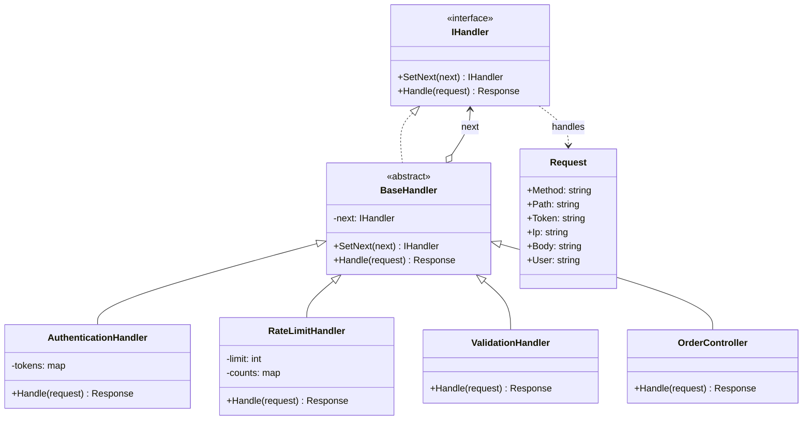

# Chain of Responsibility

> **Category:** Behavioral · **Also known as:** CoR, Chain of Command, Middleware pipeline
> **Difficulty:** ⭐⭐ Intermediate · **Frequency of use:** High

[← Back to the catalog](../../../README.md#the-catalog)

## Intent

Avoid coupling the sender of a request to its receiver by giving **more than one object a chance
to handle it**. Chain the receiving objects and pass the request along the chain until one of them
handles it (or decides to stop it).

## The problem

You are building the order API of an online shop. Before the endpoint can create an order, the
request must be authenticated, rate limited and validated. The first version puts every check in
the endpoint itself:

```csharp
Response CreateOrder(Request request)
{
    if (request.Token is null) return new Response(401, "Missing token");
    if (!tokens.TryGetValue(request.Token, out var user)) return new Response(401, "Invalid token");
    if (++counts[request.Ip] > 2) return new Response(429, "Rate limit exceeded");
    if (string.IsNullOrWhiteSpace(request.Body)) return new Response(400, "Body must not be empty");
    // ... finally, the actual business logic
}
```

Now the invoices endpoint needs the same checks (copy-paste), the admin endpoint needs
authentication but not rate limiting, and ops want to add request logging in front of
everything. Each cross-cutting concern is tangled into every endpoint, the order of the checks is
hard-coded, and you cannot add, remove or reorder a step without editing business code.

## The solution

Turn each check into its own **handler** object with a common interface. Every handler keeps a
reference to the **next** handler and decides, for each request, whether to **handle it and stop**
(short-circuit with a response) or **pass it on**. The client sends the request to the head of the
chain and does not know which handler will finally answer.



### Participants

| Participant | In our example | Responsibility |
|---|---|---|
| **Handler** | `IHandler` | Declares how to handle a request and how to link the next handler. |
| **Base Handler** (optional) | `BaseHandler` | Stores the successor and implements the default "pass it on" behavior (here: 404 at the end of the chain). |
| **Concrete Handler** | `AuthenticationHandler`, `RateLimitHandler`, `ValidationHandler`, `OrderController` | Handles the request it is responsible for, or forwards it. |
| **Client** | `Program` / `main` | Assembles the chain and sends requests to its head. |

## The example: HTTP request middleware pipeline

All four implementations model exactly the same pipeline and print exactly the same output:

- `AuthenticationHandler`: no token → **401** "Missing token"; unknown token → **401** "Invalid
  token"; otherwise it stores the user on the request and passes it on.
- `RateLimitHandler(2)`: counts requests per IP in memory (deterministic, no clock); the third
  request from the same IP → **429**.
- `ValidationHandler`: empty body → **400**.
- `OrderController`: the endpoint. It answers **200** for `/orders` and passes any other path on;
  since it is the last link, the `BaseHandler` default answers **404**.

The client builds the chain fluently (`SetNext` returns its argument) and sends seven requests,
each showing a different place where the chain stops. The `[...]` lines show how far each request
travelled.

### Implementations

| Language | Source | Run it (from the repo root) |
|---|---|---|
| C# / .NET 8 | [`csharp/`](csharp/) | `dotnet run --project patterns/behavioral/chain-of-responsibility/csharp` |
| TypeScript | [`typescript/middleware.ts`](typescript/middleware.ts), [`main.ts`](typescript/main.ts) | `npx tsx patterns/behavioral/chain-of-responsibility/typescript/main.ts` |
| React (TSX) | [`typescript/ChainOfResponsibilityDemo.tsx`](typescript/ChainOfResponsibilityDemo.tsx) | `npm run dev` → open the playground |
| Python 3.10+ | [`python/main.py`](python/main.py) | `python3 patterns/behavioral/chain-of-responsibility/python/main.py` |
| Go 1.23+ | [`go/main.go`](go/main.go) | `go run ./patterns/behavioral/chain-of-responsibility/go` |

### Expected output

```text
=== Chain of Responsibility Pattern: HTTP request middleware pipeline ===
Pipeline: Authentication -> RateLimit(2 per IP) -> Validation -> OrderController
Request 1: POST /orders ip=10.0.0.1 token=token-alice body="2x coffee"
  [Authentication] ok, user=alice
  [RateLimit] 10.0.0.1 request 1/2
  [Validation] ok
  [OrderController] order accepted
  => 200 OK - Order accepted for alice: 2x coffee
Request 2: POST /orders ip=10.0.0.2 token=(none) body="1x tea"
  [Authentication] rejected: missing token
  => 401 Unauthorized - Missing token
Request 3: POST /orders ip=10.0.0.2 token=forged-token body="1x tea"
  [Authentication] rejected: invalid token
  => 401 Unauthorized - Invalid token
Request 4: POST /orders ip=10.0.0.1 token=token-alice body=""
  [Authentication] ok, user=alice
  [RateLimit] 10.0.0.1 request 2/2
  [Validation] rejected: empty body
  => 400 Bad Request - Body must not be empty
Request 5: POST /orders ip=10.0.0.1 token=token-alice body="1x tea"
  [Authentication] ok, user=alice
  [RateLimit] rejected: 10.0.0.1 exceeded 2 requests
  => 429 Too Many Requests - Rate limit exceeded
Request 6: POST /orders ip=10.0.0.3 token=token-bob body="3x muffin"
  [Authentication] ok, user=bob
  [RateLimit] 10.0.0.3 request 1/2
  [Validation] ok
  [OrderController] order accepted
  => 200 OK - Order accepted for bob: 3x muffin
Request 7: POST /invoices ip=10.0.0.3 token=token-bob body="invoice #42"
  [Authentication] ok, user=bob
  [RateLimit] 10.0.0.3 request 2/2
  [Validation] ok
  [OrderController] not my route, passing on
  => 404 Not Found - No handler for /invoices
```

## Code walkthrough

The base handler holds the link and the default "pass it on" behavior. `SetNext` returns the
handler it receives, which is what makes fluent chaining possible:

```csharp
public abstract class BaseHandler : IHandler
{
    private IHandler? _next;

    public IHandler SetNext(IHandler next)
    {
        _next = next;
        return next;
    }

    public virtual Response Handle(Request request) =>
        _next?.Handle(request) ?? new Response(404, $"No handler for {request.Path}");
}
```

A concrete handler either **short-circuits** by returning its own response, or calls
`base.Handle` to forward the request:

```csharp
public override Response Handle(Request request)
{
    if (string.IsNullOrWhiteSpace(request.Body))
        return new Response(400, "Body must not be empty");   // stop here
    return base.Handle(request);                              // pass it on
}
```

The client assembles the chain once and only talks to its head:

```csharp
var pipeline = new AuthenticationHandler(tokens);
pipeline.SetNext(new RateLimitHandler(2))
        .SetNext(new ValidationHandler())
        .SetNext(new OrderController());

var response = pipeline.Handle(request);
```

Reordering the steps, or inserting a new one (logging, CORS, caching), only changes these three
lines — no handler and no endpoint is modified.

### Language notes

- **C#:** ASP.NET Core's request pipeline *is* this pattern: each middleware receives the
  `RequestDelegate next` and decides whether to call `await next(context)` or to write the
  response itself (`app.UseAuthentication()`, `app.UseRateLimiter()`, custom `app.Use(...)`).
  `HttpClient` uses the same idea on the client side with `DelegatingHandler.InnerHandler`.
- **TypeScript / React:** Express and Koa middleware are chains of functions with a `next`
  callback (`(req, res, next) => ...` / `async (ctx, next) => ...`); not calling `next()`
  short-circuits. In the browser, DOM **event bubbling** is a chain of responsibility (any element
  may handle the event or call `stopPropagation()`), and in React an **error boundary** handles
  errors thrown by any descendant that did not handle them. The React demo keeps the chain in a
  `useRef` so the rate limiter's state survives re-renders, and injects a logger to show the trace.
- **Python:** WSGI middleware wraps the next application (`def __call__(self, environ,
  start_response)`), and Django middleware is a callable that receives `get_response` and may return
  a response without calling it. The `logging` module propagates records up the logger hierarchy,
  another chain.
- **Go:** the idiomatic chain is `http.Handler` wrapping: `func Auth(next http.Handler)
  http.Handler { return http.HandlerFunc(func(w, r) { ...; next.ServeHTTP(w, r) }) }`. The example
  uses struct **embedding** of `BaseHandler` to share the `next` link, and calls
  `h.BaseHandler.Handle(r)` to forward explicitly (Go has no `super`).

## When to use it

- More than one object may handle a request, and the handler is not known in advance or should be
  chosen dynamically (event handling, help systems, approval workflows by amount).
- You want to apply a **sequence of cross-cutting checks or transformations** (auth, rate limiting,
  validation, logging, compression) whose order and composition must be configurable.
- You want to decouple senders from receivers so that handlers can be added, removed or reordered
  without touching the client.

## When NOT to use it

- There is always exactly one, well-known receiver — a direct call is simpler.
- Every request **must** be handled: nothing guarantees that a request reaches a handler that deals
  with it, so you need a sensible terminal default (like the 404 here).
- The chain is long and performance-critical; each hop adds a call, and debugging "who answered?"
  gets harder without tracing.

## Pros and cons

| ✅ Pros | ❌ Cons |
|---|---|
| Single Responsibility: each handler does one thing. | No guarantee that a request is handled. |
| Open/Closed: add or reorder handlers without changing existing ones. | Harder to debug: the path a request takes is decided at runtime. |
| Sender and receivers are decoupled. | Order matters, and mistakes (e.g. validating before authenticating) are subtle. |
| Handlers are reusable across pipelines. | Long chains add latency and stack depth. |

## Real-world usages

- **.NET:** ASP.NET Core middleware (`IApplicationBuilder.Use`, `IMiddleware`),
  `System.Net.Http.DelegatingHandler` chains for `HttpClient`, MediatR pipeline behaviors.
- **JavaScript / React:** Express/Koa middleware, DOM event bubbling and `stopPropagation()`,
  Redux middleware (`store => next => action => ...`), React error boundaries.
- **Python:** WSGI/ASGI middleware, Django middleware (`MIDDLEWARE` setting), `logging` handler
  propagation up the logger hierarchy.
- **Go:** `net/http` handler wrapping (`http.StripPrefix`, `http.TimeoutHandler`,
  `http.MaxBytesHandler`), gRPC interceptors (`grpc.ChainUnaryInterceptor`).

## Related patterns

- **[Decorator](../../structural/decorator/README.md):** same recursive structure (each object wraps
  the next). A decorator always forwards and *adds* behavior; a CoR handler may *stop* the request.
  Real middleware is usually a mix of both.
- **[Composite](../../structural/composite/README.md):** a chain often follows the parent links of a
  composite tree (e.g. events bubbling up from child to parent).
- **[Command](../command/README.md):** requests passed along a chain are often command objects.
- **[Mediator](../mediator/README.md) / [Observer](../observer/README.md):** other ways to connect
  senders and receivers. Mediator centralizes routing; Observer notifies *all* subscribers, whereas
  CoR stops at the first handler that takes responsibility.

## Exercises

1. Add a `LoggingHandler` at the head of the chain that prints the final status of every request
   (hint: it must call the next handler and then look at the response — Decorator-style).
2. Replace the classes with plain functions of type `(request, next) => Response`, Express style.
   How do you build the chain without `setNext`?
3. Make the `RateLimitHandler` time-based (N requests per minute) while keeping the demo
   deterministic. What would you inject instead of reading the real clock?
