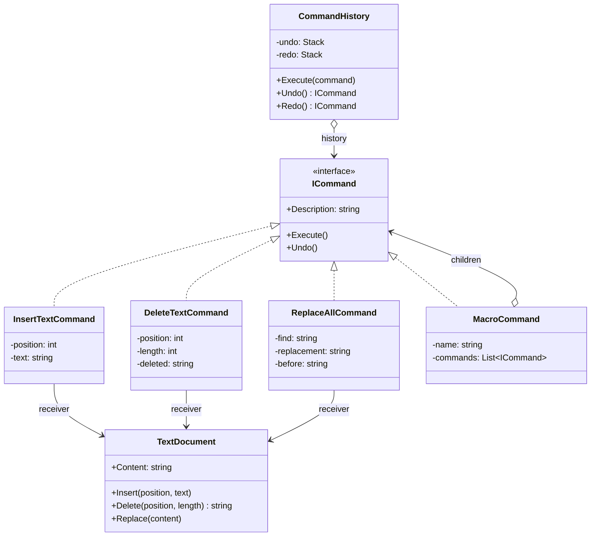

# Command

> **Category:** Behavioral · **Also known as:** Action, Transaction
> **Difficulty:** ⭐⭐ Intermediate · **Frequency of use:** High

[← Back to the catalog](../../../README.md#the-catalog)

## Intent

Encapsulate a request as an **object**, thereby letting you parameterize clients with different
requests, queue or log requests, and support **undoable** operations.

## The problem

You are building a small text editor. The toolbar buttons, the keyboard shortcuts and the menu all
call the document directly, and now the product owner wants **undo and redo**:

```csharp
void OnInsertClicked(int pos, string text) => document.Insert(pos, text);
void OnDeleteClicked(int pos, int len)    => document.Delete(pos, len);

void OnUndoClicked()
{
    // Undo *what*? The last operation is gone; we only see its effect.
    // Was it an insert (remove the text) or a delete (but which text was deleted)?
    switch (lastOperationType) { /* ...grows with every new operation... */ }
}
```

An operation is just a method call: once it has happened, nothing remembers *what* was done, with
*which arguments*, or *how to reverse it*. Every UI element duplicates the same calls, and the undo
logic becomes a giant switch that must know every operation in the editor.

## The solution

Turn every operation into a **command object** that captures the receiver, the arguments and
whatever state it needs to reverse itself, behind a common `Execute()`/`Undo()` interface. An
**invoker** (`CommandHistory`) executes commands and stores them on an undo stack; undoing pops the
last command, calls its `Undo()`, and moves it to a redo stack. The invoker never needs to know what
any command does.



### Participants

| Participant | In our example | Responsibility |
|---|---|---|
| **Command** | `ICommand` | Declares `Execute()` (and here `Undo()`). |
| **Concrete Command** | `InsertTextCommand`, `DeleteTextCommand`, `ReplaceAllCommand` | Binds a receiver to an action and its arguments; stores what it needs to undo. |
| **Macro Command** | `MacroCommand` | A composite command that runs several commands as one step. |
| **Receiver** | `TextDocument` | Knows how to perform the real work. Unaware of commands. |
| **Invoker** | `CommandHistory` | Executes commands and keeps the undo/redo stacks. |
| **Client** | `Program` / `main` | Creates concrete commands and configures them with their receiver. |

## The example: text editor with undo/redo

All four implementations run the same editing session and print exactly the same output:

- `InsertTextCommand(position, text)`: undo deletes the same number of characters.
- `DeleteTextCommand(position, length)`: remembers the deleted text during `Execute()`, because the
  document cannot bring it back on its own.
- `ReplaceAllCommand(find, replacement)`: undo restores a snapshot of the previous content.
- `MacroCommand("Shout", [...])`: replaces "world" with "WORLD" and appends "!" — executed and
  undone as **one** step (children are undone in reverse order).

The session shows undo, redo, that a **new command clears the redo stack** ("nothing to redo"),
and that the macro is undone with a single undo. Each line shows the document after the operation.

### Implementations

| Language | Source | Run it (from the repo root) |
|---|---|---|
| C# / .NET 8 | [`csharp/`](csharp/) | `dotnet run --project patterns/behavioral/command/csharp` |
| TypeScript | [`typescript/editor.ts`](typescript/editor.ts), [`main.ts`](typescript/main.ts) | `npx tsx patterns/behavioral/command/typescript/main.ts` |
| React (TSX) | [`typescript/CommandDemo.tsx`](typescript/CommandDemo.tsx) | `npm run dev` → open the playground |
| Python 3.10+ | [`python/main.py`](python/main.py) | `python3 patterns/behavioral/command/python/main.py` |
| Go 1.23+ | [`go/main.go`](go/main.go) | `go run ./patterns/behavioral/command/go` |

### Expected output

<!-- output: expected_output.txt -->
```text
=== Command Pattern: Text editor with undo/redo ===
execute Insert "Hello" at 0            -> "Hello"
execute Insert " world" at 5           -> "Hello world"
execute Insert "," at 5                -> "Hello, world"
undo    Insert "," at 5                -> "Hello world"
redo    Insert "," at 5                -> "Hello, world"
execute Delete 7 chars at 5            -> "Hello"
undo    Delete 7 chars at 5            -> "Hello, world"
execute Insert " big" at 6             -> "Hello, big world"
redo    (nothing to redo)              -> "Hello, big world"
execute Macro "Shout" (2 steps)        -> "Hello, big WORLD!"
undo    Macro "Shout" (2 steps)        -> "Hello, big world"
undo    Insert " big" at 6             -> "Hello, world"
History: undo=3, redo=2
```
<!-- /output -->

## Code walkthrough

A command captures everything it needs — including the state required to reverse itself:

```csharp
public sealed class DeleteTextCommand(TextDocument document, int position, int length) : ICommand
{
    private string _deleted = "";

    public string Description => $"Delete {length} chars at {position}";
    public void Execute() => _deleted = document.Delete(position, length);
    public void Undo() => document.Insert(position, _deleted);
}
```

The invoker only knows the `ICommand` interface. Note how executing a new command invalidates the
redo stack:

```csharp
public void Execute(ICommand command)
{
    command.Execute();
    _undo.Push(command);
    _redo.Clear();
}

public ICommand? Undo()
{
    if (!_undo.TryPop(out var command)) return null;
    command.Undo();
    _redo.Push(command);
    return command;
}
```

A macro is a command made of commands (a Composite), so the invoker treats it like any other:

```csharp
public void Undo()
{
    for (var i = commands.Count - 1; i >= 0; i--) commands[i].Undo();
}
```

### Language notes

- **C#:** WPF/MAUI expose `System.Windows.Input.ICommand` (`Execute`, `CanExecute`,
  `CanExecuteChanged`) for binding buttons to view-model commands (`RelayCommand` in the
  CommunityToolkit.Mvvm). For fire-and-forget commands without undo, an `Action` delegate is often
  enough. CQRS libraries such as MediatR model each write operation as a command object handled by a
  dedicated handler.
- **TypeScript / React:** `useReducer` and Redux are the Command pattern in functional form: an
  action (`{ type: "insert", position, text }`) is a serializable command object, `dispatch` is the
  invoker and the reducer is the receiver logic. Because actions are plain data, they can be logged,
  replayed and time-travelled (Redux DevTools). The React demo uses the class-based commands from
  `editor.ts` with buttons for insert, delete, a macro, undo and redo.
- **Python:** functions and `functools.partial` are first-class, so a command without undo can be
  just a callable. Commands with undo are typically small classes (a `Protocol` here, so they do not
  have to inherit from anything). Tkinter's `Button(command=...)` takes a callable as its command.
- **Go:** an interface with `Execute()`/`Undo()` is the idiomatic form; a command without undo is
  often just a `func()` value. The undo/redo stacks are plain slices.

## When to use it

- You need **undo/redo**, or a history of operations (editors, drawing tools, form wizards).
- You want to **queue, schedule, retry or log** operations, or send them to another process (job
  queues, message buses, event sourcing).
- You want to decouple the object that triggers an operation (button, menu, shortcut, API) from the
  object that performs it, and reuse the same operation from several triggers.
- You want to compose simple operations into **macros** or transactions.

## When NOT to use it

- Operations are simple, never undone, queued or logged — calling a method (or passing a lambda) is
  clearer than creating a class per action.
- Undo can be implemented more simply by **snapshotting** the whole state (see Memento), e.g. when
  the state is small and immutable.
- The number of command classes would explode for trivial variations; parameterize instead.

## Pros and cons

| ✅ Pros | ❌ Cons |
|---|---|
| Decouples invokers from receivers. | One class per operation adds boilerplate. |
| Enables undo/redo, queuing, logging, retries and macros. | Undo logic must be written (and tested) for every command. |
| Open/Closed: new commands without changing the invoker. | Commands that store state (e.g. deleted text) use memory over long histories. |
| Commands can be composed (Macro Command). | Indirection makes simple flows harder to follow. |

## Real-world usages

- **.NET:** `System.Windows.Input.ICommand` in WPF/MAUI, `RelayCommand`/`AsyncRelayCommand` in
  CommunityToolkit.Mvvm, MediatR `IRequest` commands, `DbCommand` in ADO.NET.
- **JavaScript / React:** Redux actions and `useReducer`, `document.execCommand` (legacy) in
  browsers, VS Code commands (`vscode.commands.registerCommand`), ProseMirror/Lexical editor
  commands and transactions.
- **Python:** Tkinter `command=` callbacks, Celery tasks (serialized commands sent to a queue),
  `concurrent.futures.Executor.submit(fn, *args)` (a callable plus its arguments).
- **Go:** `exec.Cmd` (a command object built first and run later), job/worker queues of `func()`
  values, `database/sql` prepared statements (`*sql.Stmt`).

## Related patterns

- **[Memento](../memento/README.md):** commands can use mementos to store the state needed for undo
  (as `ReplaceAllCommand` does with its snapshot).
- **[Composite](../../structural/composite/README.md):** `MacroCommand` is a composite of commands.
- **[Chain of Responsibility](../chain-of-responsibility/README.md):** a request passed along a chain
  is often a command object.
- **[Strategy](../strategy/README.md):** both wrap behavior in an object; a strategy describes *how*
  to do something, a command describes *what* to do (and can be undone or queued).
- **[Prototype](../../creational/prototype/README.md):** useful when commands must be copied before
  being stored in the history.

## Exercises

1. Add an `UppercaseSelectionCommand(position, length)`. What must it remember to be undoable?
2. Merge consecutive single-character inserts into one undo step (like real editors do when you
   type a word). Where should that logic live: in the command or in the invoker?
3. Make the commands serializable (e.g. to JSON) so a session can be saved and replayed. Which
   field cannot be serialized as-is, and how do you reconnect commands to the receiver?
