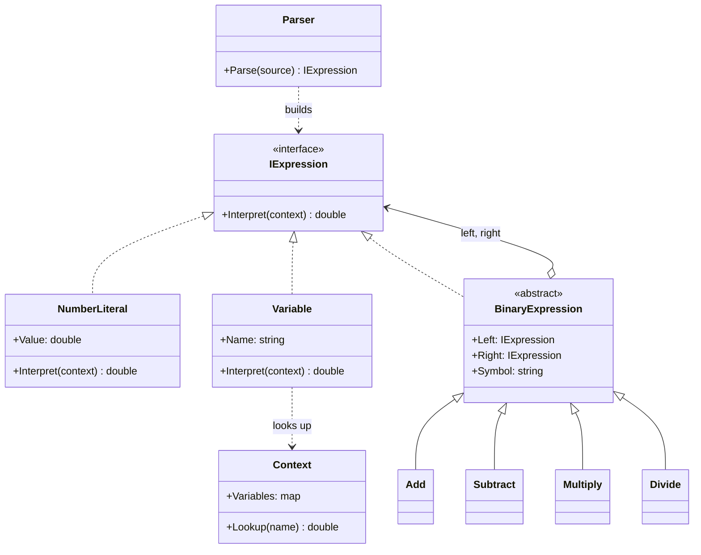

# Interpreter

> **Category:** Behavioral · **Also known as:** —
> **Difficulty:** ⭐⭐⭐ Advanced · **Frequency of use:** Low

[← Back to the catalog](../../../README.md#the-catalog)

## Intent

Given a language, define a representation for its grammar — **one class per grammar rule** — along
with an interpreter that uses that representation to evaluate sentences in the language. A sentence
becomes a tree of objects (an **abstract syntax tree**, AST), and evaluating it is a recursive
`Interpret(context)` call on the root.

## The problem

The pricing team of an online shop keeps asking developers for new formulas: "unit price times
quantity minus the discount", "price plus shipping, plus tax", "bulk orders get half the shipping
cost"... Every change means a code change and a deployment. They would like to type the rules
themselves, as text, and have the system evaluate them against each order.

The first attempt hard-codes a handful of shapes and grows with every new request:

```csharp
decimal Evaluate(string rule, Order o) => rule switch
{
    "price * quantity - discount"        => o.Price * o.Quantity - o.Discount,
    "(price + shipping) * (1 + taxRate)" => (o.Price + o.Shipping) * (1 + o.TaxRate),
    // ...one branch per formula anyone ever asked for
    _ => throw new NotSupportedException(rule),
};
```

This is not a language, it is a lookup table. What the team really needs is a tiny **expression
language** with numbers, variables, `+ - * /` and parentheses, whose sentences can be combined
freely.

## The solution

Describe the language with a grammar and map **each rule to a class**. Terminals (numbers,
variables) become leaf classes; each operator becomes a non-terminal class that holds its
sub-expressions. A formula is then a tree of these objects, and every class knows how to
`Interpret` itself given a **context** (the variable values). Parsing text into that tree is a
separate concern — a helper — and the pattern does not prescribe how to do it.

```text
expression := term (('+' | '-') term)*
term       := factor (('*' | '/') factor)*
factor     := NUMBER | IDENTIFIER | '(' expression ')'
```



### Participants

| Participant | In our example | Responsibility |
|---|---|---|
| **Abstract Expression** | `IExpression` | Declares `Interpret(context)`, common to every node of the AST. |
| **Terminal Expression** | `NumberLiteral`, `Variable` | Leaves of the tree; interpret themselves directly. |
| **Nonterminal Expression** | `Add`, `Subtract`, `Multiply`, `Divide` (sharing `BinaryExpression`) | One class per grammar rule; holds sub-expressions and interprets them recursively. |
| **Context** | `Context` | Global information for the interpretation (variable values). |
| **Client** | `Program` / `main` | Builds (or asks a parser to build) the AST and calls `Interpret`. |
| *(helper, not part of the pattern)* | `Parser` | Turns text into an AST. |

> **Interpreter is about the AST classes, not about parsing.** GoF explicitly leaves parsing out of
> the pattern: the tree can be built by hand, by a parser like ours, or by a generated parser. The
> demo proves it by building `price * 0.9` directly with `new Multiply(new Variable("price"), new
> NumberLiteral(0.9))` before using the parser at all.

## The example: pricing rule expression language

All four implementations print exactly the same output:

- Two **contexts** (a regular order and a bulk order) provide the variables `price`, `quantity`,
  `discount`, `shipping` and `taxRate`.
- A hand-built AST is evaluated first (no parser involved).
- Then five rules are parsed **once** and each AST is interpreted against **both** contexts. Each
  rule prints its AST in a canonical, fully parenthesized form, so you can see that the parser
  respects **precedence** (`*` before `-`) and **left associativity**
  (`a - b - c` is `((a - b) - c)`).
- `price * coupon` parses fine but fails at interpretation time: `coupon` is not in the context.
- `(price + 1` fails at parse time with a syntax error.

### Implementations

| Language | Source | Run it (from the repo root) |
|---|---|---|
| C# / .NET 8 | [`csharp/`](csharp/) | `dotnet run --project patterns/behavioral/interpreter/csharp` |
| TypeScript | [`typescript/expressions.ts`](typescript/expressions.ts), [`parser.ts`](typescript/parser.ts), [`main.ts`](typescript/main.ts) | `npx tsx patterns/behavioral/interpreter/typescript/main.ts` |
| React (TSX) | [`typescript/InterpreterDemo.tsx`](typescript/InterpreterDemo.tsx) | `npm run dev` → open the playground |
| Python 3.10+ | [`python/main.py`](python/main.py) | `python3 patterns/behavioral/interpreter/python/main.py` |
| Go 1.23+ | [`go/`](go/) (`expressions.go`, `parser.go`, `main.go`) | `go run ./patterns/behavioral/interpreter/go` |

### Expected output

<!-- output: expected_output.txt -->
```text
=== Interpreter Pattern: Pricing rule expression language ===
Context regular: price=20, quantity=3, discount=5, shipping=6, taxRate=0.21
Context bulk:    price=12.5, quantity=10, discount=15, shipping=8, taxRate=0.1
Hand-built AST (no parser): price * 0.9
  AST:     (price * 0.9)
  regular: 18.00
  bulk:    11.25
Rule: price * quantity - discount
  AST:     ((price * quantity) - discount)
  regular: 55.00
  bulk:    110.00
Rule: (price + shipping) * (1 + taxRate)
  AST:     ((price + shipping) * (1 + taxRate))
  regular: 31.46
  bulk:    22.55
Rule: price * quantity - discount - shipping / 2
  AST:     (((price * quantity) - discount) - (shipping / 2))
  regular: 52.00
  bulk:    106.00
Rule: price * coupon
  AST:     (price * coupon)
  regular: error: unknown variable 'coupon'
  bulk:    error: unknown variable 'coupon'
Rule: (price + 1
  syntax error: expected ')' but found end of input
```
<!-- /output -->

## Code walkthrough

Each grammar rule is a small class. Terminals answer directly; non-terminals interpret their
children and combine the results:

```csharp
public sealed record Variable(string Name) : IExpression
{
    public double Interpret(Context context) => context.Lookup(Name);
}

public sealed record Multiply(IExpression Left, IExpression Right) : BinaryExpression(Left, Right, "*")
{
    public override double Interpret(Context context) => Left.Interpret(context) * Right.Interpret(context);
}
```

The parser is a helper. Each precedence level is one method, and the `while` loop that keeps
wrapping `left` in a new node is what makes the operators **left-associative**:

```csharp
// expression := term (('+' | '-') term)*
private IExpression ParseExpression()
{
    var left = ParseTerm();
    while (true)
    {
        if (Accept("+")) left = new Add(left, ParseTerm());
        else if (Accept("-")) left = new Subtract(left, ParseTerm());
        else return left;
    }
}
```

The client parses once and interprets many times — the AST is a reusable, compiled form of the rule:

```csharp
IExpression ast = Parser.Parse("(price + shipping) * (1 + taxRate)");
double regular = ast.Interpret(regularContext);   // 31.46
double bulk    = ast.Interpret(bulkContext);      // 22.55
```

### Language notes

- **C#:** records make AST nodes concise and immutable, and `switch` expressions with type patterns
  are a popular alternative to virtual `Interpret` methods (that is the Visitor-like, "functions over
  data" style). For real work, `System.Linq.Expressions` already provides an AST
  (`Expression.Add`, `Expression.Parameter`, ...) that can even be compiled to IL with `Compile()`;
  Roslyn exposes the C# syntax tree itself.
- **TypeScript / React:** a discriminated union (`type Expr = { kind: "add"; left: Expr; right: Expr } | ...`)
  plus a `switch` is the idiomatic functional alternative to classes. The React demo memoizes the
  parsed AST on the rule text (`useMemo`) and re-interprets the same tree whenever a variable changes,
  and renders the tree as nested lists. Never use `eval`/`new Function` to evaluate user formulas.
- **Python:** frozen dataclasses make tidy AST nodes, and `match` statements (3.10+) with class
  patterns are a functional alternative to `interpret` methods. The standard `ast` module parses
  Python syntax into a tree you can walk safely (`ast.parse(source, mode="eval")`) — never `eval()`
  untrusted input.
- **Go:** small structs implementing an interface, plus embedding (`binary`) to share the two
  children. Errors are returned, not thrown, so every `Interpret` returns `(float64, error)`. The
  standard library's `go/ast` and `go/parser` are a full-scale example of the same idea for Go
  source code. `text/template` is a small interpreted language too.

## When to use it

- You have a **simple, stable grammar** and need to evaluate sentences in it many times: business
  rules, pricing or discount formulas, feature-flag conditions, filters, search queries, unit
  conversions.
- You want rules to be **data** (stored in a database, edited by non-developers) instead of code.
- You need to analyze or transform sentences, not only evaluate them (pretty-printing, validation,
  simplification): an object tree makes that easy.

## When NOT to use it

- **The grammar is large or evolving.** A class per rule explodes quickly; use a **parser generator**
  (ANTLR, which targets C#, TypeScript/JavaScript, Python and Go) or a parser-combinator library, and
  keep only the AST evaluation hand-written.
- **An existing language or library already does it.** Prefer an embedded, sandboxed language or an
  established expression engine (for example `System.Linq.Expressions` or `DataTable.Compute` in .NET,
  JSONLogic-style rules, regular expressions for pattern matching, SQL for queries) over inventing
  a new one.
- **Performance is critical.** Walking a tree of virtual calls is slow compared with compiling to
  bytecode/IL or using a dedicated engine.
- You only need two or three fixed formulas — the Strategy pattern is enough.

## Pros and cons

| ✅ Pros | ❌ Cons |
|---|---|
| Each grammar rule is a small, testable class. | Complex grammars lead to many classes and are hard to maintain. |
| Easy to extend the language: add a class (e.g. `Modulo`). | Adding a new *operation* over the tree (pretty-print, optimize) touches every class — consider Visitor. |
| Sentences can be built, stored, combined and reused as objects. | Tree-walking evaluation is slow for heavy workloads. |
| The AST can be analyzed and transformed, not only evaluated. | You must still write (or generate) a parser, with good error messages. |

## Real-world usages

- **.NET:** `System.Linq.Expressions` expression trees (what LINQ providers like Entity Framework
  Core translate into SQL), `System.Text.RegularExpressions` (regex patterns are parsed into a tree
  before matching), Roslyn syntax trees.
- **JavaScript / React:** template engines and JSX tooling build ASTs (Babel, the TypeScript
  compiler API); the `estree` AST format used by ESLint rules; GraphQL query documents parsed by
  `graphql-js` into an AST before execution.
- **Python:** the `ast` module, the `re` module (patterns compiled from a parsed representation),
  SQLAlchemy expression objects (`column("price") * column("quantity")` builds a tree rendered as SQL).
- **Go:** `go/ast` + `go/parser`, `text/template` and `html/template`, `regexp/syntax`
  (parses a regex into a `*syntax.Regexp` tree).

## Related patterns

- **[Composite](../../structural/composite/README.md):** an AST *is* a composite; Interpreter adds
  the `Interpret` operation and ties the classes to a grammar.
- **[Visitor](../visitor/README.md):** move operations (evaluate, pretty-print, type-check) out of the
  node classes when you need many operations over a stable set of node types.
- **[Flyweight](../../structural/flyweight/README.md):** terminal symbols (e.g. the same variable or
  literal) can be shared between trees.
- **[Iterator](../iterator/README.md):** can traverse the tree.
- **[Strategy](../strategy/README.md):** for a fixed set of formulas, plain strategies are simpler
  than a language.

## Exercises

1. Add **unary minus** (`-price + 10`). Which grammar rule changes, and do you need a new class?
2. Add a function call `max(a, b)` to the grammar: a new `FunctionCall` non-terminal plus changes in
   the tokenizer (`,`) and the parser.
3. Add a second operation, `Simplify()`, that folds constant sub-trees (`(2 * 3) + price` →
   `(6 + price)`). Then implement it again as a Visitor and compare.
