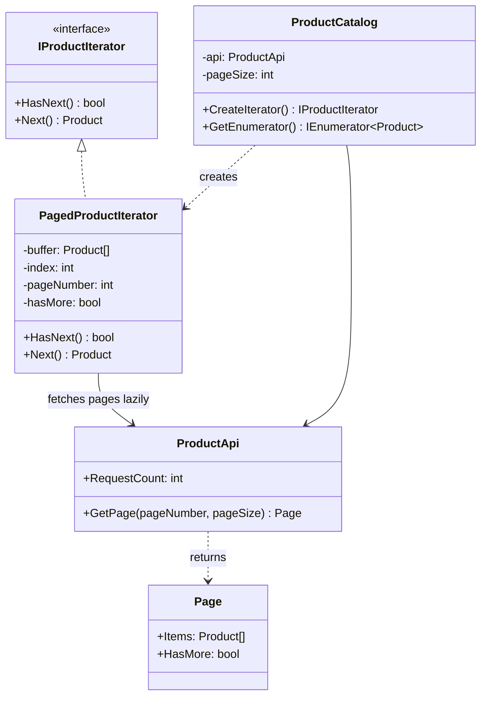

# Iterator

> **Category:** Behavioral · **Also known as:** Cursor
> **Difficulty:** ⭐ Beginner · **Frequency of use:** Very high (mostly through built-in language support)

[← Back to the catalog](../../../README.md#the-catalog)

## Intent

Provide a way to access the elements of an aggregate object **sequentially** without exposing
its underlying representation (array, tree, linked list, remote pages...).

## The problem

Your shop talks to a product service that returns results in **pages** (`GET /products?page=2&size=3`
→ `{ items: [...], hasMore: true }`). Every screen, report and export that needs "all the
products" ends up re-implementing the paging loop:

```csharp
var pageNumber = 1;
while (true)
{
    var page = api.GetPage(pageNumber++, 3);
    foreach (var product in page.Items)
    {
        if (product.Price > 100) Console.WriteLine(product.Name);   // the actual business logic
    }
    if (!page.HasMore) break;
}
```

The business logic is buried in transport details. Every caller must know the page size, the
`hasMore` flag and the 1-based numbering; a change in the API's paging scheme (cursor tokens
instead of page numbers, say) ripples through the whole codebase. And it is easy to get wrong:
forget the `break` and you loop forever, fetch everything up front and you waste requests the
caller never needed.

## The solution

Move the traversal into a separate **iterator** object with a tiny interface (`HasNext()` /
`Next()`). The **aggregate** (`ProductCatalog`) creates iterators but keeps its internals hidden.
The concrete iterator remembers *where it is* (current page, index in the buffer) and fetches the
next page **lazily**, only when the current one runs out. Clients just ask for "the next product".



### Participants

| Participant | In our example | Responsibility |
|---|---|---|
| **Iterator** | `IProductIterator` | Interface for traversing: `HasNext()` / `Next()`. |
| **Concrete Iterator** | `PagedProductIterator` (and the compiler-generated iterator behind `yield`) | Tracks the current position and fetches pages on demand. |
| **Aggregate** | `IEnumerable<Product>` / `Iterable<Product>` | Interface for creating iterators. |
| **Concrete Aggregate** | `ProductCatalog` | Creates iterators over the paginated `ProductApi`. |
| **Client** | `Program` / `main` | Loops over products without knowing pages exist. |

## The example: paginated API results

All four implementations model exactly the same thing and print exactly the same output:

- `ProductApi` is an in-memory fake of a remote service with 7 products. `GetPage(n, size)`
  prints `[api] fetching page n` and returns the items plus a `hasMore` flag.
- `ProductCatalog(api, pageSize: 3)` is the aggregate. It offers the **explicit GoF iterator**
  (`CreateIterator()`) and the **idiomatic language form** (C# `IEnumerable<T>` + `yield return`,
  TypeScript generator under `Symbol.iterator`, Python generator `__iter__`, Go 1.23 `iter.Seq`).
- Part 1 walks the whole catalog with `hasNext()/next()`: 7 products, 3 requests.
- Part 2 uses the idiomatic loop and **stops after 4 products**. Because iteration is lazy,
  page 3 is never requested.

### Implementations

| Language | Source | Run it (from the repo root) |
|---|---|---|
| C# / .NET 8 | [`csharp/`](csharp/) | `dotnet run --project patterns/behavioral/iterator/csharp` |
| TypeScript | [`typescript/catalog.ts`](typescript/catalog.ts), [`main.ts`](typescript/main.ts) | `npx tsx patterns/behavioral/iterator/typescript/main.ts` |
| React (TSX) | [`typescript/IteratorDemo.tsx`](typescript/IteratorDemo.tsx) | `npm run dev` → open the playground |
| Python 3.10+ | [`python/main.py`](python/main.py) | `python3 patterns/behavioral/iterator/python/main.py` |
| Go 1.23+ | [`go/main.go`](go/main.go) | `go run ./patterns/behavioral/iterator/go` |

### Expected output

<!-- output: expected_output.txt -->
```text
=== Iterator Pattern: Paginated API results ===
1) Explicit iterator: hasNext() / next()
[api] fetching page 1
  #1 Keyboard   $49.99
  #2 Mouse      $19.99
  #3 Monitor    $189.00
[api] fetching page 2
  #4 Webcam     $59.50
  #5 Headset    $79.90
  #6 USB hub    $24.00
[api] fetching page 3
  #7 Desk lamp  $34.75
Done: 7 products, 3 requests
2) Idiomatic loop, stopping after 4 products
[api] fetching page 1
  #1 Keyboard   $49.99
  #2 Mouse      $19.99
  #3 Monitor    $189.00
[api] fetching page 2
  #4 Webcam     $59.50
Done: 4 products, 2 requests (page 3 was never fetched)
```
<!-- /output -->

## Code walkthrough

The explicit iterator keeps the cursor state and fetches a page only when its buffer is empty:

```csharp
public bool HasNext()
{
    if (_index < _buffer.Count) return true;
    if (!_hasMore) return false;

    var page = api.GetPage(++_pageNumber, pageSize);
    _buffer = page.Items;
    _hasMore = page.HasMore;
    _index = 0;
    return _buffer.Count > 0;
}
```

The client is now pure business logic:

```csharp
var iterator = catalog.CreateIterator();
while (iterator.HasNext()) Print(iterator.Next());
```

Modern languages build the pattern in. With `yield return`, the compiler writes the iterator
class (the state machine) for you, and the same laziness comes for free:

```csharp
public IEnumerator<Product> GetEnumerator()
{
    var pageNumber = 1;
    while (true)
    {
        var page = api.GetPage(pageNumber++, pageSize);
        foreach (var product in page.Items) yield return product;
        if (!page.HasMore) yield break;
    }
}

foreach (var product in catalog.Take(4)) Print(product);   // page 3 is never fetched
```

### Language notes

- **C#:** `IEnumerable<T>`/`IEnumerator<T>` *are* the Aggregate and Iterator interfaces
  (`MoveNext()` + `Current` instead of `HasNext()` + `Next()`). `yield return` generates the
  iterator, and LINQ operators (`Where`, `Select`, `Take`) are lazy iterators that wrap other
  iterators. For real HTTP calls, use `IAsyncEnumerable<T>` with `yield return` inside an `async`
  method and consume it with `await foreach`.
- **TypeScript / React:** Any object with a `[Symbol.iterator]()` method is iterable and works
  with `for...of`, spread and `Array.from`. Generator functions (`function*`) produce iterators;
  `yield*` delegates to another iterable. For network calls use async generators
  (`async *[Symbol.asyncIterator]()`) and `for await...of`. In React, a live iterator can be kept
  in a `useRef` and pulled on demand ("Load more"), see [`IteratorDemo.tsx`](typescript/IteratorDemo.tsx).
- **Python:** The iterator protocol is `__iter__()` + `__next__()` raising `StopIteration`. A
  generator method (`yield` / `yield from`) is the idiomatic way to implement `__iter__`, and
  `itertools` (`islice`, `takewhile`, `chain`) composes lazy iterators. The explicit
  `has_next()/next()` class is shown only to illustrate the GoF shape.
- **Go:** Since Go 1.23, range-over-func iterators are idiomatic: a method returning
  `iter.Seq[T]` (a `func(yield func(T) bool)`) can be used directly in `for ... range`. When the
  loop breaks, `yield` returns `false` and the producer must stop. Before 1.23, Go code used the
  explicit style (`for rows.Next() { rows.Scan(...) }`, `bufio.Scanner`). For pull-style use,
  `iter.Pull` turns an `iter.Seq` into `next()`/`stop()` functions.

## When to use it

- You want to traverse a collection **without exposing its structure** (tree, graph, remote
  pages, database cursor).
- You want **lazy** traversal: produce items on demand, stop early, handle infinite or huge
  sequences.
- You need several independent traversals at once (each iterator has its own position), or
  several traversal orders (in-order vs. pre-order on a tree).
- You want a uniform interface so the same client code (`foreach`, LINQ, `itertools`) works on
  many kinds of collections.

## When NOT to use it

- The collection is a plain array or list and the language already iterates it — don't wrap it in
  a hand-written iterator class.
- You need random access or the total count up front; an iterator only moves forward.
- The data must be consumed many times: a lazy iterator re-runs (and re-fetches) on every loop;
  materialize it once (`ToList()`, `list(...)`) instead.

## Pros and cons

| ✅ Pros | ❌ Cons |
|---|---|
| Single Responsibility: traversal logic lives outside the collection and the client. | Overkill for simple collections the language already iterates. |
| Open/Closed: new collections and traversals plug into existing client code. | Lazy evaluation can surprise: side effects (requests) happen during the loop, and re-iterating repeats them. |
| Lazy: items are produced on demand, early exit saves work. | Modifying the collection while iterating is usually unsafe. |
| Multiple independent iterations over the same collection. | Less efficient than direct indexing for some specialized collections. |

## Real-world usages

- **.NET:** `IEnumerable<T>` / `IEnumerator<T>` everywhere, `yield return`, LINQ,
  `IAsyncEnumerable<T>` (e.g. streaming results from EF Core with `AsAsyncEnumerable()`),
  `Directory.EnumerateFiles` (lazy, unlike `GetFiles`).
- **JavaScript / React:** the iterable protocol behind `for...of`, `Map.prototype.entries()`,
  generators, async iterators over `ReadableStream` in modern runtimes; "infinite scroll" lists
  that pull the next page on demand.
- **Python:** every `for` loop, `range`, `dict.items()`, file objects (iterate lines lazily),
  `itertools`, `os.scandir`.
- **Go:** `iter.Seq` and `maps.Keys`/`slices.Values` (Go 1.23), `database/sql`'s `rows.Next()`,
  `bufio.Scanner`'s `Scan()`.

## Related patterns

- **[Composite](../../structural/composite/README.md):** iterators are often used to traverse composite trees.
- **[Factory Method](../../creational/factory-method/README.md):** `CreateIterator()` /
  `GetEnumerator()` is a factory method that lets each collection return its own iterator type.
- **[Memento](../memento/README.md):** an iterator can capture its position in a memento to
  resume a traversal later (like a pagination cursor token).
- **[Visitor](../visitor/README.md):** an iterator walks the elements; a visitor performs an
  operation on each of them. They are frequently combined.

## Exercises

1. Change `ProductApi` to use **cursor tokens** (`getPage(cursor) → { items, nextCursor }`)
   instead of page numbers. How many files does the client code need to change?
2. Add a `Filtered(predicate)` method to the catalog that returns another lazy iterable
   (hint: it is just another generator wrapping the first one). Does it fetch more pages?
3. Make the API asynchronous and convert the idiomatic iterator to `IAsyncEnumerable<T>` /
   `async *[Symbol.asyncIterator]` / `async def __aiter__`. What changes in the client loop?
