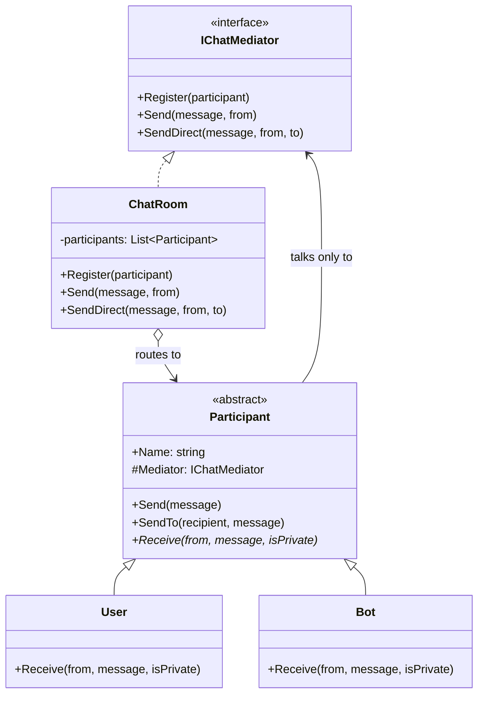

# Mediator

> **Category:** Behavioral · **Also known as:** Controller, Intermediary
> **Difficulty:** ⭐⭐ Intermediate · **Frequency of use:** Medium

[← Back to the catalog](../../../README.md#the-catalog)

## Intent

Define an object that **encapsulates how a set of objects interact**. Mediator promotes loose
coupling by keeping objects from referring to each other explicitly, and lets you vary their
interaction independently.

## The problem

You are building a team chat. In the first version every user kept a list of the other users and
delivered messages to them directly:

```csharp
public class User(string name)
{
    public List<User> Contacts { get; } = [];

    public void Send(string message)
    {
        foreach (var contact in Contacts)
            if (contact != this) contact.Receive(name, message);
    }

    public void SendTo(User other, string message) => other.Receive(name, message);
}
```

Now every user holds references to every other user: *N* users means up to *N×(N−1)*
connections to keep in sync when someone joins or leaves. Where do you add "users muted by an
admin", "a bot that answers `!help`", "log every message", or "tell the sender the recipient is
offline"? In *every* `User`. The routing rules are smeared across all participants, and you cannot
reuse a `User` outside this exact web of objects.

## The solution

Introduce a **mediator** (`ChatRoom`) that every participant talks to instead of talking to each
other. Participants (the **colleagues**) only hold a reference to the mediator interface; they
address others by *name*, and the mediator decides who actually receives what. The many-to-many
web becomes a star: all interaction rules live in one place.



### Participants

| Participant | In our example | Responsibility |
|---|---|---|
| **Mediator** | `IChatMediator` | Interface colleagues use to communicate. |
| **Concrete Mediator** | `ChatRoom` | Knows all colleagues and implements the routing rules (broadcast, direct, unknown recipient). |
| **Colleague** | `Participant` | Knows its mediator, never the other colleagues. |
| **Concrete Colleagues** | `User`, `Bot` | Send through the mediator and react to what it delivers. |

## The example: chat room

All four implementations model exactly the same thing and print exactly the same output:

- `alice`, `bob`, `carol` (`User`) and `HelpBot` (`Bot`) register with a `ChatRoom`.
- Public messages go to everyone except the sender; direct messages go to one participant,
  addressed by name.
- `HelpBot` listens silently and answers `!help` with a private message — through the room, like
  everyone else. Adding the bot required **no change** to `User`.
- A direct message to `dave`, who is not in the room, is handled by the mediator, not the sender.

### Implementations

| Language | Source | Run it (from the repo root) |
|---|---|---|
| C# / .NET 8 | [`csharp/`](csharp/) | `dotnet run --project patterns/behavioral/mediator/csharp` |
| TypeScript | [`typescript/chat.ts`](typescript/chat.ts), [`main.ts`](typescript/main.ts) | `npx tsx patterns/behavioral/mediator/typescript/main.ts` |
| React (TSX) | [`typescript/MediatorDemo.tsx`](typescript/MediatorDemo.tsx) | `npm run dev` → open the playground |
| Python 3.10+ | [`python/main.py`](python/main.py) | `python3 patterns/behavioral/mediator/python/main.py` |
| Go 1.23+ | [`go/main.go`](go/main.go) | `go run ./patterns/behavioral/mediator/go` |

### Expected output

<!-- output: expected_output.txt -->
```text
=== Mediator Pattern: Chat room ===
[room] alice joined
[room] bob joined
[room] carol joined
[room] HelpBot joined
alice -> everyone: Hi everyone!
  [bob] alice: Hi everyone!
  [carol] alice: Hi everyone!
bob -> everyone: Welcome, alice!
  [alice] bob: Welcome, alice!
  [carol] bob: Welcome, alice!
carol -> everyone: !help
  [alice] carol: !help
  [bob] carol: !help
HelpBot -> carol (private): Hi carol! Commands: !help. Private messages reach one person only.
  [carol] HelpBot (private): Hi carol! Commands: !help. Private messages reach one person only.
bob -> carol (private): Lunch at 1pm?
  [carol] bob (private): Lunch at 1pm?
carol -> bob (private): Sure!
  [bob] carol (private): Sure!
alice -> dave (private): Are you there?
[room] dave is not in this room
```
<!-- /output -->

## Code walkthrough

A colleague only knows the mediator. Sending is delegation; there is no list of contacts:

```csharp
public abstract class Participant(string name)
{
    public string Name { get; } = name;
    protected internal IChatMediator? Mediator { get; set; }

    public void Send(string message) => Room.Send(message, this);
    public void SendTo(string recipient, string message) => Room.SendDirect(message, this, recipient);
    public abstract void Receive(string from, string message, bool isPrivate);
}
```

All the interaction rules live in the concrete mediator:

```csharp
public void SendDirect(string message, Participant from, string to)
{
    Console.WriteLine($"{from.Name} -> {to} (private): {message}");
    var recipient = _participants.Find(p => p.Name == to);
    if (recipient is null)
    {
        Console.WriteLine($"[room] {to} is not in this room");
        return;
    }
    recipient.Receive(from.Name, message, isPrivate: true);
}
```

A new kind of colleague is just a new subclass that reacts to messages through the same room:

```csharp
public sealed class Bot(string name) : Participant(name)
{
    public override void Receive(string from, string message, bool isPrivate)
    {
        if (message.Trim() == "!help")
            SendTo(from, $"Hi {from}! Commands: !help. Private messages reach one person only.");
    }
}
```

Note that the bot's reply is delivered *while* the room is still broadcasting carol's message
(a nested call). That is why `ChatRoom.Send` iterates over a copy of the participant list: a
colleague's reaction could register or remove participants mid-broadcast.

### Language notes

- **C#:** In ASP.NET Core apps "mediator" usually means the **MediatR** library (by Jimmy Bogard):
  `IMediator.Send` dispatches a request (`IRequest<TResponse>`) to exactly one
  `IRequestHandler<,>`, and `IMediator.Publish` dispatches a notification (`INotification`) to all
  `INotificationHandler<>`s, with pipeline behaviors (`IPipelineBehavior<,>`) for cross-cutting
  concerns. It decouples controllers from handlers — closer to an in-process command/event bus
  than to the GoF chat-room example, but the same idea: senders don't know receivers. Note that
  recent MediatR versions are distributed under a commercial license; check the terms before
  adopting it. `protected internal` on `Mediator` lets only the mediator (same assembly) and
  subclasses set it.
- **TypeScript / React:** In React, the **parent component is a mediator** when you *lift state
  up*: siblings don't talk to each other, they call callbacks the parent passes down and the
  parent decides what each child receives as props. Context, `useReducer` + `dispatch`, and stores
  such as Redux generalize this: components dispatch actions to one central place that coordinates
  the result. See [`MediatorDemo.tsx`](typescript/MediatorDemo.tsx).
- **Python:** `typing.Protocol` describes the mediator, so `ChatRoom` doesn't need to inherit
  anything; `Participant` is an `ABC` because it carries shared behavior (`send`, `send_to`).
  Event-bus libraries (e.g. blinker signals) and `asyncio.Queue`-based dispatchers are common
  mediator-like tools.
- **Go:** Colleagues embed a `member` struct that provides `Send`/`SendTo`; because Go has no
  virtual dispatch through embedding, `member` keeps a `self Participant` field so it can pass the
  *embedding* colleague to the mediator. A goroutine reading from a channel (a "hub", as in the
  classic gorilla/websocket chat example) is the concurrent Go flavor of a chat mediator.

## When to use it

- A set of objects communicate in **well-defined but complex ways**, and the dependencies between
  them are a tangled web (form widgets enabling/disabling each other, chat users, aircraft and a
  control tower).
- You cannot reuse a component because it refers to too many other components.
- You want to change *how* components interact (routing, filtering, logging, permissions)
  without subclassing every component.
- In application architecture: you want controllers/UI to send requests without knowing which
  handler serves them (MediatR-style in-process messaging).

## When NOT to use it

- Only two or three objects talk in a simple way — direct calls are clearer.
- The mediator would become a **god object** that knows every detail of every colleague. If the
  "routing rules" keep growing, split the mediator or use events instead.
- You just need one-to-many notifications with no coordination logic — that is
  [Observer](../observer/README.md).
- Adding an indirection hides control flow: "who handles this?" becomes harder to answer when
  stepping through code (a common critique of overusing MediatR for trivial calls).

## Pros and cons

| ✅ Pros | ❌ Cons |
|---|---|
| Colleagues are decoupled: they can be reused and tested with a fake mediator. | The mediator can grow into a god object. |
| Single Responsibility: interaction rules live in one place. | Extra indirection makes the call flow less obvious. |
| Open/Closed: new colleagues (the bot) or new mediators without changing existing colleagues. | The mediator becomes a single point of failure / bottleneck. |
| Replaces many-to-many relationships with one-to-many. | Re-entrant calls (a colleague reacting during a broadcast) need care. |

## Real-world usages

- **.NET:** MediatR's `IMediator` (`Send`/`Publish`) in ASP.NET Core applications; SignalR hubs,
  which route messages between connected clients and groups.
- **JavaScript / React:** a parent component that lifts state up; React Context with
  `useReducer`; Redux's store and `dispatch`; event buses / pub-sub hubs coordinating
  micro-frontends.
- **Python:** Django signals and blinker act as central dispatchers between decoupled senders and
  receivers; GUI toolkits where a dialog coordinates its widgets.
- **Go:** the "hub" goroutine in websocket chat servers that owns the set of clients and
  broadcasts messages over channels.

## Related patterns

- **[Observer](../observer/README.md):** Observer distributes notifications one-to-many and the
  subject does not care what observers do; Mediator *coordinates* colleagues and encapsulates the
  rules of their interaction. A mediator is often implemented with observer-style subscriptions,
  and an event bus sits between the two.
- **[Facade](../../structural/facade/README.md):** both sit in front of a group of objects. A
  facade gives *clients* a simpler interface to a subsystem, and the subsystem doesn't know the
  facade exists (communication is one-way). A mediator is known by its colleagues and
  communication is two-way.
- **[Chain of Responsibility](../chain-of-responsibility/README.md):** also decouples senders from
  receivers, but by passing a request along a chain rather than through a central hub.
- **[Command](../command/README.md):** MediatR-style mediators dispatch request objects that are
  essentially commands to their handlers.

## Exercises

1. Add `Leave()`: a participant leaves the room and the others get `[room] bob left`. Which
   classes change?
2. Add a muting rule: `room.Mute("bob")` makes the room drop bob's public messages. Did `User` change?
3. Make the bot answer a second command, `!who`, with the list of participants. What does the bot
   need from the mediator, and how can you expose it without letting the bot reach other
   participants directly?
