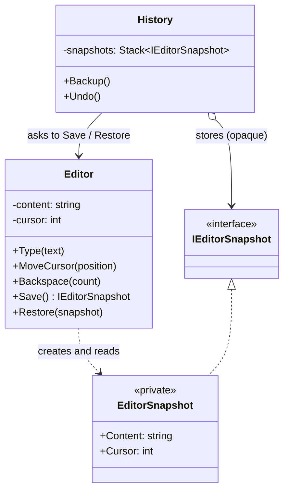

# Memento

> **Category:** Behavioral · **Also known as:** Snapshot, Token
> **Difficulty:** ⭐⭐ Intermediate · **Frequency of use:** Medium

[← Back to the catalog](../../../README.md#the-catalog)

## Intent

Without violating encapsulation, **capture and externalize an object's internal state** so that
the object can be restored to this state later.

## The problem

You are building a text editor and need "undo". The obvious approach is to let some `History`
class copy the editor's fields before each change:

```csharp
public class History
{
    private readonly Stack<(string Content, int Cursor)> _states = new();

    public void Backup(Editor editor) => _states.Push((editor.Content, editor.Cursor));

    public void Undo(Editor editor)
    {
        var (content, cursor) = _states.Pop();
        editor.Content = content;   // Editor must expose public setters...
        editor.Cursor = cursor;     // ...for everything it wants to be restorable
    }
}
```

To do this, the editor has to make its whole state publicly readable **and writable**. Anyone
can now put it into an inconsistent state (a cursor beyond the end of the text). Worse, `History`
is coupled to every field: add a `Selection` or a `ScrollOffset` to the editor and you must update
`History` too, and probably every other place that copies editor state.

## The solution

Let the object that owns the state (the **originator**, `Editor`) produce a **memento**
(`EditorSnapshot`): an immutable object holding a copy of its state. The memento is **opaque** to
everybody else. A **caretaker** (`History`) stores mementos and hands them back to the
originator, but it cannot read or modify them. Only the originator knows how to create and
restore from a snapshot, so its encapsulation stays intact.



### Participants

| Participant | In our example | Responsibility |
|---|---|---|
| **Originator** | `Editor` | Owns the state; creates a memento of it and restores itself from one. |
| **Memento** | `EditorSnapshot` (seen as `IEditorSnapshot` in C#) | Immutable copy of the originator's state, opaque to everyone but the originator. |
| **Caretaker** | `History` | Decides *when* to save and restore; keeps mementos but never looks inside. |

## The example: editor snapshots

All four implementations model exactly the same thing and print exactly the same output:

- `Editor` holds the text and the cursor position (rendered as `|`). It supports `Type`,
  `MoveCursor` and `Backspace`.
- `History.Backup()` pushes a snapshot onto a stack; `History.Undo()` pops the latest one and
  restores the editor from it (or prints `nothing to undo`).
- The demo types, saves, edits, and undoes several times. Note that undo restores the **cursor
  position too**: after moving the cursor to 5 and typing, undo puts it back at 11. And undo
  goes back to the latest *backup*, not the latest keystroke.

### Implementations

| Language | Source | Run it (from the repo root) |
|---|---|---|
| C# / .NET 8 | [`csharp/`](csharp/) | `dotnet run --project patterns/behavioral/memento/csharp` |
| TypeScript | [`typescript/editor.ts`](typescript/editor.ts), [`main.ts`](typescript/main.ts) | `npx tsx patterns/behavioral/memento/typescript/main.ts` |
| React (TSX) | [`typescript/MementoDemo.tsx`](typescript/MementoDemo.tsx) | `npm run dev` → open the playground |
| Python 3.10+ | [`python/main.py`](python/main.py) | `python3 patterns/behavioral/memento/python/main.py` |
| Go 1.23+ | [`go/main.go`](go/main.go) | `go run ./patterns/behavioral/memento/go` |

### Expected output

```text
=== Memento Pattern: Editor snapshots ===
type "Hello"         "Hello|" (cursor 5)
[history] backup saved (1 in stack)
type " world"        "Hello world|" (cursor 11)
[history] backup saved (2 in stack)
move cursor to 5     "Hello| world" (cursor 5)
type " cruel"        "Hello cruel| world" (cursor 11)
[history] restored latest backup (1 left)
undo                 "Hello world|" (cursor 11)
type "!"             "Hello world!|" (cursor 12)
[history] backup saved (2 in stack)
backspace 7          "Hello|" (cursor 5)
[history] restored latest backup (1 left)
undo                 "Hello world!|" (cursor 12)
[history] restored latest backup (0 left)
undo                 "Hello|" (cursor 5)
[history] nothing to undo
undo                 "Hello|" (cursor 5)
```

## Code walkthrough

In C#, the concrete memento is a **private nested record** of the originator. The outside world
only sees an empty marker interface, so the caretaker literally cannot name the type that holds
the data:

```csharp
public interface IEditorSnapshot;

public sealed class Editor
{
    public string Content { get; private set; } = "";
    public int Cursor { get; private set; }

    public IEditorSnapshot Save() => new EditorSnapshot(Content, Cursor);

    public void Restore(IEditorSnapshot snapshot)
    {
        if (snapshot is not EditorSnapshot s)
            throw new ArgumentException("Not a snapshot created by an Editor.", nameof(snapshot));
        Content = s.Content;
        Cursor = s.Cursor;
    }

    private sealed record EditorSnapshot(string Content, int Cursor) : IEditorSnapshot;
}
```

The caretaker just stacks opaque tokens:

```csharp
public sealed class History(Editor editor)
{
    private readonly Stack<IEditorSnapshot> _snapshots = new();

    public void Backup() => _snapshots.Push(editor.Save());

    public void Undo()
    {
        if (_snapshots.TryPop(out var snapshot)) editor.Restore(snapshot);
    }
}
```

### Language notes

How each language keeps the memento opaque is the interesting part:

- **C#:** a `private` nested type plus a public marker interface (above). The compiler
  enforces it: no code outside `Editor` can access `EditorSnapshot`'s members. Records give
  immutability and value equality for free. An alternative is `internal` members, which only
  hides the state from other assemblies.
- **TypeScript / React:** ECMAScript private fields (`#content`) are enforced at runtime, not just
  by the type checker (unlike TypeScript's `private`). Since only `EditorSnapshot`'s own code can
  read its `#` fields, a `static { ... }` block hands two module-private functions
  (`createSnapshot` / `readSnapshot`) to the `Editor`, which lives in the same module; they are
  never exported. In React, the memento idea is everywhere: immutable state objects mean every
  previous state *is* a snapshot, so undo is "keep the old state objects in an array" (the
  classic Redux undo recipe). See [`MementoDemo.tsx`](typescript/MementoDemo.tsx).
- **Python:** there is no real privacy. The snapshot is a `@dataclass(frozen=True)` (immutable)
  whose fields start with `_`, which by convention means "do not touch" — linters flag access from
  outside the owning class. `repr=False` keeps the state out of logs. For snapshots of complex
  objects, `copy.deepcopy` or `pickle` are common tools (pickle's `__getstate__`/`__setstate__`
  hooks are literally the originator's save/restore).
- **Go:** visibility is per **package**: lowercase (unexported) fields cannot be read outside the
  package that defines the struct. In a real project `Editor` and `EditorSnapshot` would live in
  their own `editor` package, and callers could only hold a `*editor.EditorSnapshot`. (This demo
  keeps everything in `package main` for simplicity, so the compiler cannot enforce it here.)

## When to use it

- You need **undo/redo**, checkpoints, or "restore to last saved" for an object.
- You want transactional behavior: snapshot, try an operation, roll back if it fails.
- Directly exposing the object's state through getters/setters would break its encapsulation
  or invariants.
- You want to save/restore state that the object should stay in control of (game saves,
  form drafts, wizard steps, a pagination cursor token that only the server can interpret).

## When NOT to use it

- The state is **large** and changes often: full snapshots eat memory. Store diffs, or use
  Command-based undo (below).
- The object's state is already immutable — then the old instances already are your snapshots.
- The language cannot hide the memento's contents and you don't trust callers; then the
  "opaque" guarantee is just documentation.

### Memento vs. Command-based undo

There are two classic ways to implement undo:

| | **Memento** (this pattern) | **[Command](../command/README.md)** with `Undo()` |
|---|---|---|
| What is stored | A full copy of the state | The operation and enough data to reverse it |
| How undo works | Restore the old snapshot | Run the inverse operation |
| Memory | Grows with the state size | Small per operation |
| Complexity | Trivial: no inverse logic needed | Every command needs a correct inverse |
| Good for | Small states, hard-to-invert operations | Large documents, many small edits |

They are often combined: a command stores a memento of the receiver before executing, and its
`Undo()` simply restores that memento.

## Pros and cons

| ✅ Pros | ❌ Cons |
|---|---|
| Snapshots without breaking the originator's encapsulation. | Memory-hungry if snapshots are large or frequent. |
| Simplifies the originator: the caretaker manages history. | Caretakers must manage the lifecycle (how many snapshots to keep). |
| Undo needs no inverse logic: just restore. | Some languages (Python, Go in one package) can't truly hide the memento's state. |
| Immutable snapshots are safe to share and store. | Snapshots of objects with references (deep graphs) need careful copying. |

## Real-world usages

- **.NET:** `DbContext` change tracking keeps original values of entities (`entry.OriginalValues`)
  so changes can be detected and reverted; `IEditableObject` (`BeginEdit`/`CancelEdit`) in data
  binding; serializing view state for later restoration.
- **JavaScript / React:** undo/redo with immutable state (Redux's documented undo history
  recipe of `past`/`present`/`future`); the browser's `history.pushState(state)`; editor libraries
  that store immutable document snapshots.
- **Python:** `pickle`'s `__getstate__`/`__setstate__`; `copy.deepcopy`; database transactions
  with savepoints (`SAVEPOINT` / rollback).
- **Go:** opaque cursor/page tokens returned by APIs (e.g. Google Cloud client libraries'
  `NextPageToken`), which callers store and pass back without interpreting.

## Related patterns

- **[Command](../command/README.md):** the alternative way to implement undo (see the table
  above); commands can also store mementos to undo themselves.
- **[Iterator](../iterator/README.md):** a memento can capture an iterator's position so a
  traversal can be resumed later.
- **[Prototype](../../creational/prototype/README.md):** cloning the whole object is a simpler
  "snapshot" when the object has no complex external references.
- **[State](../state/README.md):** saving and restoring which state an object is in is a typical
  use of a memento.

## Exercises

1. Add **redo**: when undoing, push the current state onto a second stack. When must that redo
   stack be cleared?
2. Add a `Selection` (start, length) to the editor. Which classes did you have to change? Did
   `History` change?
3. Limit the history to the last 3 snapshots. Then reimplement undo with Command objects that
   store only the inserted/deleted text, and compare the memory usage.
