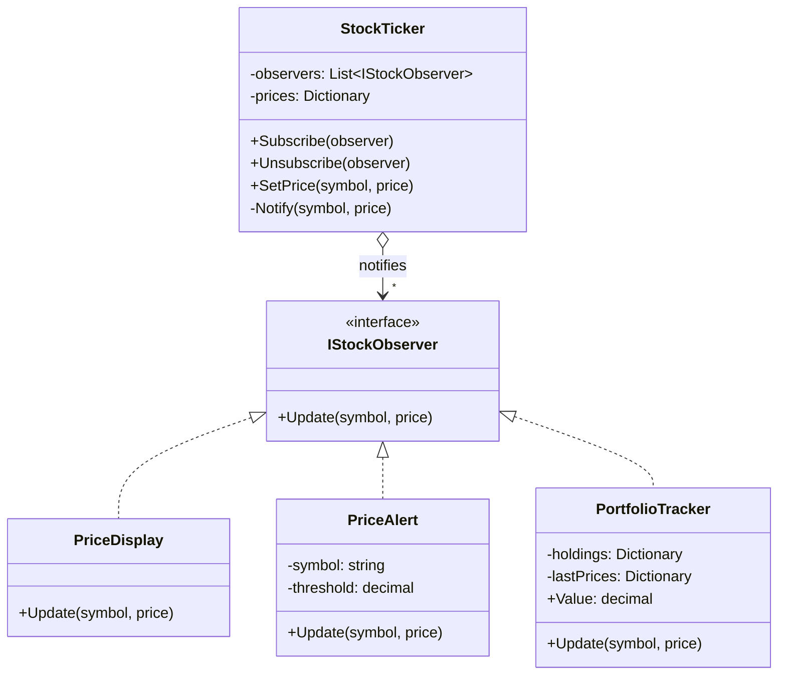

# Observer

> **Category:** Behavioral · **Also known as:** Publish–Subscribe, Dependents, Event listener
> **Difficulty:** ⭐ Beginner · **Frequency of use:** Very high

[← Back to the catalog](../../../README.md#the-catalog)

## Intent

Define a **one-to-many dependency** between objects so that when one object (the subject)
changes state, all its dependents (observers) are **notified and updated automatically** — without
the subject knowing who they are or what they do.

## The problem

You are building a trading dashboard. The class that receives price updates started by updating
the price label. Then someone needed alerts, then a portfolio value, then a log for compliance:

```csharp
public class StockTicker(PriceLabel label, AlertService alerts, Portfolio portfolio, AuditLog log)
{
    public void SetPrice(string symbol, decimal price)
    {
        label.Show(symbol, price);
        if (symbol == "AAPL" && price > 200) alerts.Raise("AAPL above 200");
        portfolio.Recalculate(symbol, price);
        log.Write(symbol, price);
        // ...and one more line for every new feature
    }
}
```

The ticker depends on every consumer of prices. Each new feature means editing (and re-testing)
it; you can't turn a consumer on or off at runtime (hide the panel, mute alerts); and you can't
reuse the ticker in another app with different widgets. The **source of the data** is coupled to
**everyone who uses it**.

## The solution

Invert the dependency. The ticker (the **subject**) keeps a list of objects that implement a tiny
**observer** interface (`Update(symbol, price)`) and offers `Subscribe` / `Unsubscribe`. When a price
changes it **notifies** every subscriber. Observers decide for themselves what to do; new ones can
be added (or removed) at runtime without touching the subject.



### Participants

| Participant | In our example | Responsibility |
|---|---|---|
| **Subject** | `StockTicker` | Knows its observers (only through the interface), lets them subscribe/unsubscribe, notifies them on change. |
| **Observer** | `IStockObserver` | The update interface. |
| **Concrete Observers** | `PriceDisplay`, `PriceAlert`, `PortfolioTracker` | React to notifications; may keep their own state (the portfolio's last prices). |
| **Client** | `Program` / `main` | Wires observers to the subject. |

## The example: stock price ticker

All four implementations model exactly the same thing and print exactly the same output:

- `StockTicker.SetPrice(symbol, price)` stores the price, prints how many observers it is
  notifying, and notifies them in subscription order.
- `PriceDisplay` prints every price; `PriceAlert("AAPL", 200.00)` only prints when AAPL is above
  the threshold; `PortfolioTracker` (10 AAPL, 5 MSFT) recomputes the portfolio value when one of
  its holdings changes and ignores other symbols (GOOG).
- Midway, the display **unsubscribes**: later updates notify only 2 observers.

### Implementations

| Language | Source | Run it (from the repo root) |
|---|---|---|
| C# / .NET 8 | [`csharp/`](csharp/) | `dotnet run --project patterns/behavioral/observer/csharp` |
| TypeScript | [`typescript/ticker.ts`](typescript/ticker.ts), [`main.ts`](typescript/main.ts) | `npx tsx patterns/behavioral/observer/typescript/main.ts` |
| React (TSX) | [`typescript/ObserverDemo.tsx`](typescript/ObserverDemo.tsx) | `npm run dev` → open the playground |
| Python 3.10+ | [`python/main.py`](python/main.py) | `python3 patterns/behavioral/observer/python/main.py` |
| Go 1.23+ | [`go/main.go`](go/main.go) | `go run ./patterns/behavioral/observer/go` |

### Expected output

<!-- output: expected_output.txt -->
```text
=== Observer Pattern: Stock price ticker ===
[ticker] AAPL = $195.50 (notifying 3 observers)
  [display] AAPL: $195.50
  [portfolio] value: $1955.00
[ticker] MSFT = $410.20 (notifying 3 observers)
  [display] MSFT: $410.20
  [portfolio] value: $4006.00
[ticker] AAPL = $201.25 (notifying 3 observers)
  [display] AAPL: $201.25
  [alert] AAPL is above $200.00: now $201.25
  [portfolio] value: $4063.50
-- display unsubscribed --
[ticker] AAPL = $203.10 (notifying 2 observers)
  [alert] AAPL is above $200.00: now $203.10
  [portfolio] value: $4082.00
[ticker] GOOG = $172.40 (notifying 2 observers)
[ticker] MSFT = $398.00 (notifying 2 observers)
  [portfolio] value: $4021.00
```
<!-- /output -->

## Code walkthrough

The subject only knows the interface. Notifying iterates over a **copy** of the list, so an
observer can safely unsubscribe itself while being notified:

```csharp
public sealed class StockTicker
{
    private readonly List<IStockObserver> _observers = [];

    public void Subscribe(IStockObserver observer) => _observers.Add(observer);
    public void Unsubscribe(IStockObserver observer) => _observers.Remove(observer);

    public void SetPrice(string symbol, decimal price)
    {
        _prices[symbol] = price;
        foreach (var observer in _observers.ToArray())
            observer.Update(symbol, price);
    }
}
```

Each observer filters and reacts on its own; the ticker never changes when you add one:

```csharp
public sealed class PriceAlert(string watchedSymbol, decimal threshold) : IStockObserver
{
    public void Update(string symbol, decimal price)
    {
        if (symbol == watchedSymbol && price > threshold)
            Console.WriteLine($"  [alert] {symbol} is above ${threshold:0.00}: now ${price:0.00}");
    }
}
```

In TypeScript, Python and Go, `subscribe` returns an **unsubscribe function** — the idiomatic shape
in those ecosystems (and exactly what React's `useSyncExternalStore` expects).

### Language notes

- **C#:** The language has Observer built in: **events and delegates**
  (`public event EventHandler<PriceChangedEventArgs>? PriceChanged;`, subscribe with `+=`,
  unsubscribe with `-=`). The BCL also defines `IObservable<T>` / `IObserver<T>`
  (`OnNext`, `OnError`, `OnCompleted`), where `Subscribe` returns an `IDisposable` to unsubscribe;
  Reactive Extensions (System.Reactive) builds LINQ-style operators on top. Beware of the classic
  leak: a subscribed handler keeps the subscriber alive, so always unsubscribe (or dispose).
  `INotifyPropertyChanged` is the observer contract behind WPF/MAUI data binding.
- **TypeScript / React:** The DOM's `EventTarget` (`addEventListener` / `removeEventListener`,
  usable directly via `new EventTarget()`) and Node's `EventEmitter` are built-in subjects. In
  React, **`useSyncExternalStore(subscribe, getSnapshot)`** is the official way to observe an
  external subject: React subscribes on mount, unsubscribes on unmount, and re-renders when the
  snapshot changes. The demo uses it for prices, and mounting/unmounting the display panel is
  literally subscribe/unsubscribe. See [`ObserverDemo.tsx`](typescript/ObserverDemo.tsx).
- **Python:** Since functions are first-class, observers are often plain **callbacks**
  (`ticker.subscribe(lambda symbol, price: ...)`); a `Protocol` lets objects and callables
  coexist. Use `weakref.WeakMethod`/`WeakSet` if observers should not be kept alive by the subject.
  Django signals and blinker are popular observer libraries.
- **Go:** Two idioms. **Callback lists** (as here, or a `[]func(symbol string, price int64)`) are
  synchronous and simple. **Channels** decouple in time: each subscriber gets its own
  `chan PriceUpdate` and reads it in its own goroutine — great for concurrency, but you must
  decide what to do with slow consumers (buffer, drop, or block) and close channels on
  unsubscribe. Interface values compare by identity only for pointer types, so observers are
  subscribed as pointers to make `Unsubscribe` work.

## When to use it

- Changes to one object must be reflected in others, and you don't know in advance how many or
  which ones (UI widgets showing the same data, caches to invalidate, audit logs).
- Consumers should be able to **subscribe and unsubscribe at runtime**.
- You want the data source to be reusable and testable without its consumers (dependency
  inversion: the subject depends only on the observer interface).
- Event-driven designs: domain events, UI events, message notifications.

## When NOT to use it

- There is exactly one consumer that will never change — a direct call is clearer.
- The order of reactions matters and observers depend on each other's side effects; observer
  order is usually an implementation detail. You may need a [Mediator](../mediator/README.md).
- Cascading updates (an observer changes another subject, which notifies others...) become hard to
  follow and can loop. Consider batching or a unidirectional data flow.
- High-frequency streams where you need back-pressure, buffering or combining streams — reach for
  reactive streams (Rx, async iterators, channels) instead of a hand-rolled list.

## Pros and cons

| ✅ Pros | ❌ Cons |
|---|---|
| Open/Closed: add observers without changing the subject. | Notification order is not obvious; observers shouldn't rely on it. |
| Loose coupling: subject only knows an interface. | Memory leaks when observers forget to unsubscribe ("lapsed listener"). |
| Subscriptions can change at runtime. | Cascading or redundant updates can hurt performance and readability. |
| Broadcast: one change reaches any number of observers. | Debugging is harder: "who reacted to this change?" is implicit. |

## Real-world usages

- **.NET:** C# `event`s throughout the BCL, WinForms and WPF; `INotifyPropertyChanged` /
  `INotifyCollectionChanged` (data binding, `ObservableCollection<T>`); `IObservable<T>` and
  System.Reactive; `IOptionsMonitor<T>.OnChange` for configuration reloads.
- **JavaScript / React:** `addEventListener` on DOM elements, Node's `EventEmitter`,
  `MutationObserver` / `IntersectionObserver` / `ResizeObserver`, RxJS; React's
  `useSyncExternalStore`, and state libraries (Redux `store.subscribe`, Zustand) built on it.
- **Python:** Django signals (`post_save.connect(...)`), blinker (used by Flask's signals),
  tkinter variable traces (`var.trace_add`).
- **Go:** `signal.Notify` delivers OS signals on channels you register; `context.Context`'s
  `Done()` channel notifies all goroutines observing a cancellation; `sync.Cond` broadcasts.

## Related patterns

- **[Mediator](../mediator/README.md):** observers are independent and the subject doesn't care
  what they do; a mediator actively coordinates its colleagues. Mediators are often implemented
  with observer-style subscriptions.
- **[Singleton](../../creational/singleton/README.md):** a global event bus/subject is often a
  singleton (with all the usual caveats).
- **[Command](../command/README.md):** notifications can carry command objects that observers execute.
- **[Iterator](../iterator/README.md):** pull vs. push. An iterator lets the consumer *pull* the
  next value; an observer has values *pushed* to it (Rx's `IObservable<T>` is the push-based dual
  of `IEnumerable<T>`).

## Exercises

1. Add an `AuditLog` observer that records every price change in a list. Did `StockTicker` change?
2. Make `PriceAlert` fire only when the price **crosses** the threshold (from below to above), not
   on every update above it. Where does the extra state live?
3. In Go, rewrite the subject so each subscriber receives updates on its own channel and runs in
   its own goroutine. How do you keep the console output deterministic?
