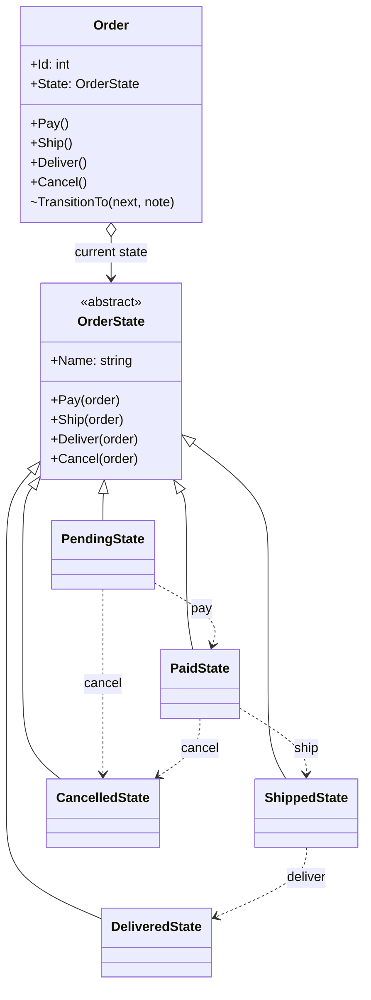

# State

> **Category:** Behavioral · **Also known as:** Objects for States
> **Difficulty:** ⭐⭐ Intermediate · **Frequency of use:** Medium

[← Back to the catalog](../../../README.md#the-catalog)

## Intent

Allow an object to **alter its behavior when its internal state changes**. The object will
appear to change its class: each state is its own object, and the context delegates to whichever
state is current.

## The problem

An online shop's `Order` can be paid, shipped, delivered or cancelled. The first version stored a
`Status` enum and checked it in every method:

```csharp
void Ship()
{
    if (Status == OrderStatus.Pending) Console.WriteLine("Cannot ship an order that has not been paid");
    else if (Status == OrderStatus.Paid) Status = OrderStatus.Shipped;
    else if (Status == OrderStatus.Shipped) Console.WriteLine("Order has already been shipped");
    else if (Status == OrderStatus.Delivered) Console.WriteLine("Order has already been delivered");
    else if (Status == OrderStatus.Cancelled) Console.WriteLine("Cannot ship a cancelled order");
}
// ...and the same five-way switch again in Pay(), Deliver() and Cancel()
```

Every action repeats the same `switch` over the status. The rules for a single state ("what can a
shipped order do?") are scattered across four methods. Adding a state such as `Returned` means
editing every method, and it is easy to forget one branch and allow an illegal transition.

## The solution

Turn each status into a class that implements a common `OrderState` interface with one method per
action. The `Order` (the **context**) keeps a reference to its current state and forwards each
action to it. A state performs valid actions by telling the context to **transition** to the
next state, and rejects invalid ones. All the rules of one state live in one place.



### Participants

| Participant | In our example | Responsibility |
|---|---|---|
| **Context** | `Order` | Exposes the actions, holds the current state and delegates every action to it. |
| **State** | `OrderState` | Declares one method per action of the context. |
| **Concrete State** | `PendingState`, `PaidState`, `ShippedState`, `DeliveredState`, `CancelledState` | Implements the behavior for one state and decides the next state. |
| **Client** | `Program` / `main` | Calls actions on the context; never touches states directly. |

## The example: order lifecycle

All four implementations model exactly the same thing and print exactly the same output. The
valid transitions form a small finite state machine:

```text
Pending --pay--> Paid --ship--> Shipped --deliver--> Delivered
   |               |
   +----cancel-----+----cancel--> Cancelled
```

Any other action is rejected by the current state with an explanation (for example, *"Cannot
ship an order that has not been paid"* or *"Cannot cancel a delivered order"*), and the state
does not change.

The client runs two orders: `#1001` follows the happy path (and tries to cancel too late, twice),
`#1002` tries to ship before paying, then pays, cancels (with a refund) and tries to deliver.

### Implementations

| Language | Source | Run it (from the repo root) |
|---|---|---|
| C# / .NET 8 | [`csharp/`](csharp/) | `dotnet run --project patterns/behavioral/state/csharp` |
| TypeScript | [`typescript/order.ts`](typescript/order.ts), [`main.ts`](typescript/main.ts) | `npx tsx patterns/behavioral/state/typescript/main.ts` |
| React (TSX) | [`typescript/StateDemo.tsx`](typescript/StateDemo.tsx) | `npm run dev` → open the playground |
| Python 3.10+ | [`python/main.py`](python/main.py) | `python3 patterns/behavioral/state/python/main.py` |
| Go 1.23+ | [`go/main.go`](go/main.go) | `go run ./patterns/behavioral/state/go` |

**Tests:** [C# (xUnit)](../../../tests/csharp/DesignPatterns.Tests/Behavioral/StateTests.cs) · [TypeScript (Vitest)](typescript/order.test.ts) · [React (Testing Library)](typescript/StateDemo.test.tsx) · [Python (pytest)](python/test_main.py) · [Go (`go test`)](go/main_test.go)

### Expected output

<!-- output: expected_output.txt -->
```text
=== State Pattern: Order lifecycle ===
--- Order #1001: happy path ---
Order #1001 created [Pending]
> pay()
  Payment accepted: Pending -> Paid
> ship()
  Order handed to the carrier: Paid -> Shipped
> cancel()
  ERROR: Cannot cancel an order that has already been shipped
> deliver()
  Order delivered to the customer: Shipped -> Delivered
> cancel()
  ERROR: Cannot cancel a delivered order
Order #1001 final state: Delivered
--- Order #1002: cancellation ---
Order #1002 created [Pending]
> ship()
  ERROR: Cannot ship an order that has not been paid
> pay()
  Payment accepted: Pending -> Paid
> cancel()
  Order cancelled, payment refunded: Paid -> Cancelled
> deliver()
  ERROR: Cannot deliver a cancelled order
Order #1002 final state: Cancelled
```
<!-- /output -->

## Code walkthrough

The context does not know any rules; it only forwards to the current state:

```csharp
public sealed class Order(int id)
{
    public OrderState State { get; private set; } = new PendingState();

    public void Ship() { Announce("ship"); State.Ship(this); }

    internal void TransitionTo(OrderState next, string note)
    {
        Console.WriteLine($"  {note}: {State.Name} -> {next.Name}");
        State = next;
    }
}
```

Each state answers every action. Valid actions trigger a transition; the rest are rejected. All
the rules of "Paid" are in one class:

```csharp
public sealed class PaidState : OrderState
{
    public override string Name => "Paid";
    public override void Pay(Order order) => Reject("Order has already been paid");
    public override void Ship(Order order) => order.TransitionTo(new ShippedState(), "Order handed to the carrier");
    public override void Deliver(Order order) => Reject("Cannot deliver an order that has not been shipped");
    public override void Cancel(Order order) => order.TransitionTo(new CancelledState(), "Order cancelled, payment refunded");
}
```

Notice that **states know their successors** (`PaidState` creates `ShippedState`). This is the
key structural difference from Strategy.

### Language notes

- **C#:** `TransitionTo` is `internal` so only code in the same assembly (the states) can change
  the state. States here are stateless, so they could be cached as singletons
  (`public static readonly PaidState Instance = new();`). For simple machines a `switch`
  expression over a `(state, action)` tuple is a compact alternative; for bigger ones, libraries
  such as **Stateless** let you declare states, triggers and guards fluently.
- **TypeScript / React:** The core uses a private `#state` field and an abstract class for the
  shared `reject` helper. In React, **`useReducer` is already a state machine**:
  `(state, action) => nextState`. The demo keeps the current `OrderState` object in a reducer and
  lets the state object decide the transition, so the reducer has no `switch` on the status. For
  complex UI flows (wizards, async requests, nested or parallel states), **XState** models
  statecharts explicitly. A discriminated union (`{ status: "paid" } | { status: "shipped" }`)
  plus a reducer is the most common lightweight approach. See
  [`StateDemo.tsx`](typescript/StateDemo.tsx).
- **Python:** `abc.ABC` + `@abstractmethod` forces each state to handle every action. State
  classes refer to each other before they are defined, which works because the names are only
  looked up when the methods run (and `from __future__ import annotations` handles the type
  hints). Libraries such as **transitions** build state machines declaratively.
- **Go:** States are empty structs that satisfy the `OrderState` interface implicitly, so they
  cost nothing to create. The unexported `transitionTo` keeps the state change inside the
  package. A common alternative in Go is the "state function" idiom
  (`type stateFn func(*lexer) stateFn`), used by the standard library's `text/template` lexer.

## When to use it

- An object's behavior depends on its **state**, and it must change behavior at runtime as the
  state changes (orders, documents in a workflow, connections, media players, game characters).
- Methods contain large conditionals that switch on the same status field.
- The transitions between states are part of the domain and you want them explicit and testable.

## When NOT to use it

- There are only two or three states with trivial behavior — an enum and a `switch` is clearer.
- The states rarely change and the behavior hardly differs between them.
- You need a full statechart (hierarchy, parallel regions, history, timers): reach for a state
  machine library instead of hand-written classes.

## Pros and cons

| ✅ Pros | ❌ Cons |
|---|---|
| Single Responsibility: all the code for one state lives in one class. | More classes, even for states with little behavior. |
| Open/Closed: add a state without editing the others' conditionals. | Transitions are spread across state classes; the full diagram is not visible in one place. |
| Eliminates repeated `switch` statements over a status field. | States are coupled to each other (they create their successors). |
| Illegal transitions are impossible to forget: every state must answer every action. | Overkill for simple, stable state logic. |

## Real-world usages

- **.NET:** the `Stateless` library; EF Core tracks each entity's status
  (`EntityState.Added/Modified/Deleted`) to decide what each save does.
- **JavaScript / React:** `useReducer`; XState statecharts; promises are a tiny state machine
  (pending → fulfilled/rejected).
- **Python:** the `transitions` library; `asyncio` tasks and futures move through pending,
  cancelled and finished states.
- **Go:** the lexer in `text/template/parse` uses state functions; `net/http` tracks connection
  states (`http.ConnState`: `StateNew`, `StateActive`, `StateIdle`, ...).

## Related patterns

- **[Strategy](../strategy/README.md):** identical class structure, different intent. A strategy
  is chosen by the client and strategies do not know each other; states replace *themselves* and
  know their successors.
- **[Flyweight](../../structural/flyweight/README.md):** stateless state objects (like ours) can
  be shared as flyweights.
- **[Singleton](../../creational/singleton/README.md):** a common way to share each state
  instance.
- **[Memento](../memento/README.md):** can snapshot the current state so a transition can be
  undone.

## Exercises

1. Add a `ReturnedState` reachable from `Delivered` with a `requestReturn()` action. How many
   existing classes did you have to touch, compared with the enum-and-switch version?
2. Make the states singletons (they are stateless). What changes in each language?
3. Write the same machine as a transition table (`(state, action) -> next state`) and compare
   readability and extensibility with the class-based version.
