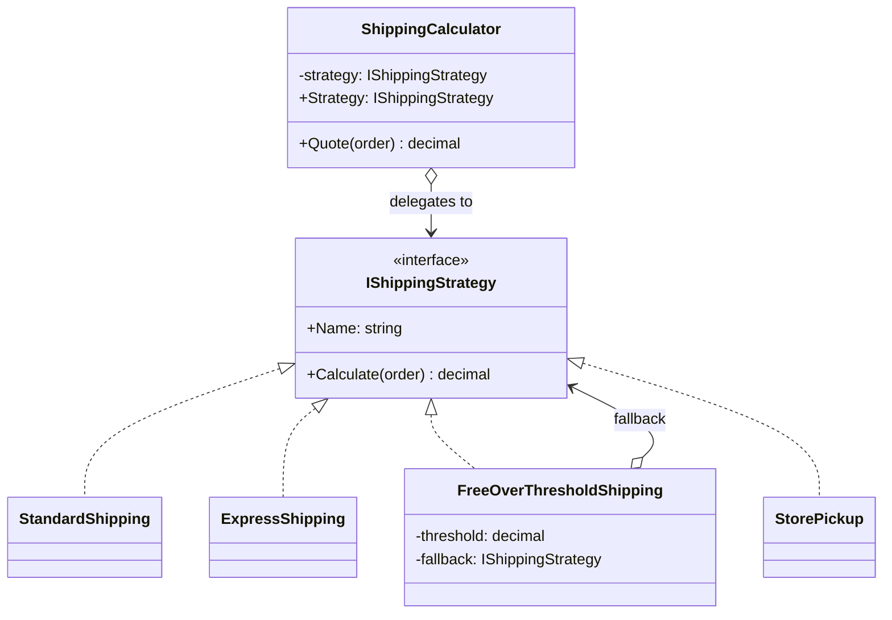

# Strategy

> **Category:** Behavioral · **Also known as:** Policy
> **Difficulty:** ⭐ Beginner · **Frequency of use:** Very high

[← Back to the catalog](../../../README.md#the-catalog)

## Intent

Define a family of algorithms, put each one in its own class (or function), and make them
**interchangeable**. Strategy lets the algorithm vary independently from the code that uses it.

## The problem

You are building the checkout of an online shop. The first version only had standard shipping,
so the price was a one-liner. Then marketing asked for express shipping, then "free shipping over
$100", then store pickup. The checkout code now looks like this:

```csharp
decimal Shipping(Order order, string method)
{
    if (method == "standard") return 5 + 1.5m * order.WeightKg;
    else if (method == "express") return 15 + 3m * order.WeightKg;
    else if (method == "free-over-100") return order.Subtotal >= 100 ? 0 : 5 + 1.5m * order.WeightKg;
    else if (method == "pickup") return 0;
    throw new ArgumentException(method);
}
```

Every new method means editing (and re-testing) this function. Rules get duplicated (the
"free over $100" branch copies the standard formula), the function grows without limit, and the
checkout is coupled to every pricing rule in the company. This violates the
**Open/Closed Principle**: the code is not closed for modification.

## The solution

Extract each algorithm into its own object that implements a common interface
(`IShippingStrategy`). The checkout (the **context**) holds a reference to *one* strategy and
delegates the calculation to it. Adding a new shipping method means adding a new class — the
context never changes.



### Participants

| Participant | In our example | Responsibility |
|---|---|---|
| **Strategy** | `IShippingStrategy` | Common interface for all algorithms. |
| **Concrete Strategy** | `StandardShipping`, `ExpressShipping`, `FreeOverThresholdShipping`, `StorePickup` | One algorithm each. |
| **Context** | `ShippingCalculator` | Holds a strategy and delegates to it. Can switch strategies at runtime. |
| **Client** | `Program` / `main` | Chooses which strategy to plug into the context. |

## The example: shipping cost calculator

All four implementations model exactly the same thing and print exactly the same output:

- `StandardShipping`: $5.00 + $1.50 per kg.
- `ExpressShipping`: $15.00 + $3.00 per kg.
- `FreeOverThresholdShipping(100, StandardShipping)`: free if the subtotal is ≥ $100, otherwise
  delegates to the wrapped strategy. Note how strategies can **compose** other strategies.
- `StorePickup`: always $0.00.

The client prices two orders ($80 and $150, both 4 kg) with each strategy, reusing a single
`ShippingCalculator` and swapping its strategy at runtime.

### Implementations

| Language | Source | Run it (from the repo root) |
|---|---|---|
| C# / .NET 8 | [`csharp/`](csharp/) | `dotnet run --project patterns/behavioral/strategy/csharp` |
| TypeScript | [`typescript/shipping.ts`](typescript/shipping.ts), [`main.ts`](typescript/main.ts) | `npx tsx patterns/behavioral/strategy/typescript/main.ts` |
| React (TSX) | [`typescript/StrategyDemo.tsx`](typescript/StrategyDemo.tsx) | `npm run dev` → open the playground |
| Python 3.10+ | [`python/main.py`](python/main.py) | `python3 patterns/behavioral/strategy/python/main.py` |
| Go 1.23+ | [`go/main.go`](go/main.go) | `go run ./patterns/behavioral/strategy/go` |

### Expected output

<!-- output: expected_output.txt -->
```text
=== Strategy Pattern: Shipping cost calculator ===
Order: subtotal=$80.00, weight=4.0kg
  Standard         -> $11.00
  Express          -> $27.00
  Free over $100   -> $11.00
  Store pickup     -> $0.00
Order: subtotal=$150.00, weight=4.0kg
  Standard         -> $11.00
  Express          -> $27.00
  Free over $100   -> $0.00
  Store pickup     -> $0.00
```
<!-- /output -->

## Code walkthrough

The heart of the pattern is tiny — an interface and a context that delegates:

```csharp
public interface IShippingStrategy
{
    string Name { get; }
    decimal Calculate(Order order);
}

public sealed class ShippingCalculator(IShippingStrategy strategy)
{
    public IShippingStrategy Strategy { get; set; } = strategy;
    public decimal Quote(Order order) => Strategy.Calculate(order);
}
```

The client decides *which* algorithm runs; the context only knows *that* one runs:

```csharp
var calculator = new ShippingCalculator(new StandardShipping());
calculator.Strategy = new ExpressShipping();   // swap at runtime
var cost = calculator.Quote(order);
```

### Language notes

- **C#:** Strategies are usually registered in the DI container (`services.AddScoped<IShippingStrategy, ExpressShipping>()`)
  or resolved by key with keyed services (`AddKeyedScoped`, .NET 8+). A `Func<Order, decimal>` delegate
  is a perfectly valid lightweight strategy when no state or name is needed.
- **TypeScript / React:** Functions are first-class, so a strategy is often just a function
  (`type ShippingFn = (order: Order) => number`). In React, the selected strategy is simply
  **state** or a **prop** (e.g. a `sortFn` or `renderItem` prop); the component delegates instead of
  branching. See [`StrategyDemo.tsx`](typescript/StrategyDemo.tsx).
- **Python:** `typing.Protocol` gives structural typing, so strategies do not need to inherit
  from a base class. Plain functions or `functools.partial` objects are idiomatic strategies too
  (think of the `key=` argument of `sorted`).
- **Go:** Interfaces are satisfied implicitly. Small single-method strategies are often expressed
  as a function type (`type ShippingFunc func(Order) int64`), like `sort.Slice`'s `less` function.
  The example stores money in cents (`int64`) to avoid floating-point rounding.

## When to use it

- You have **several variants of an algorithm** and want to choose one at runtime (pricing rules,
  tax calculation, sorting, compression, validation, retry/backoff policies, routing).
- A class has a big `if/else` or `switch` that selects behavior by a type code.
- You want to **isolate business rules** from the code that uses them, so each rule can be tested
  on its own.
- Different clients need different behaviors from the same component (e.g. a component that
  receives a sorting or filtering function as a parameter).

## When NOT to use it

- You only have **two variants that will never change** — a simple conditional is clearer.
- The algorithms need deep access to the context's private data; you would end up exposing too
  much state through the strategy interface.
- Clients would be forced to know about every strategy to pick one, and that knowledge does not
  belong to them (consider a factory or configuration-driven selection).

## Pros and cons

| ✅ Pros | ❌ Cons |
|---|---|
| Open/Closed: new algorithms without touching the context. | More types/objects to manage. |
| Replaces conditionals with polymorphism. | Clients must understand the differences between strategies to pick one. |
| Each algorithm is isolated and unit-testable. | Overkill when a lambda/function would do. |
| Algorithms can be swapped at runtime and composed. | Communication overhead if the strategy needs a lot of data from the context. |

## Real-world usages

- **.NET:** `IComparer<T>` passed to `List<T>.Sort`, `IEqualityComparer<T>` for `Dictionary<TKey,TValue>`,
  authentication handlers/schemes in ASP.NET Core.
- **JavaScript / React:** `Array.prototype.sort(compareFn)`; components that accept behavior via
  props such as a custom `filterOption` or render functions.
- **Python:** the `key=` function of `sorted()`/`list.sort()`; `json.dumps(default=...)`.
- **Go:** `sort.Slice(data, less)`, `slices.SortFunc`, and the `http.Handler` you plug into a server.

## Related patterns

- **[State](../state/README.md):** same structure, different intent. In State, the states know
  each other and trigger transitions; in Strategy, the client picks the algorithm and strategies
  are usually unaware of each other.
- **[Template Method](../template-method/README.md):** varies *parts* of an algorithm via
  inheritance (compile time); Strategy varies the *whole* algorithm via composition (runtime).
- **[Decorator](../../structural/decorator/README.md):** changes the "skin" of an object; Strategy changes its "guts".
- **[Factory Method](../../creational/factory-method/README.md):** often used to create the right strategy from configuration.
- **[Flyweight](../../structural/flyweight/README.md):** stateless strategies can be shared as flyweights.

## Exercises

1. Add a `WeekendSurchargeShipping` strategy that adds 20% to any other strategy (hint: compose it,
   like `FreeOverThresholdShipping`). Which pattern does that start to look like?
2. Replace the strategy classes with plain functions in TypeScript or Python. What do you lose?
3. Make the strategy selectable from a configuration string (`"express"`) without adding a
   `switch` to the context.
