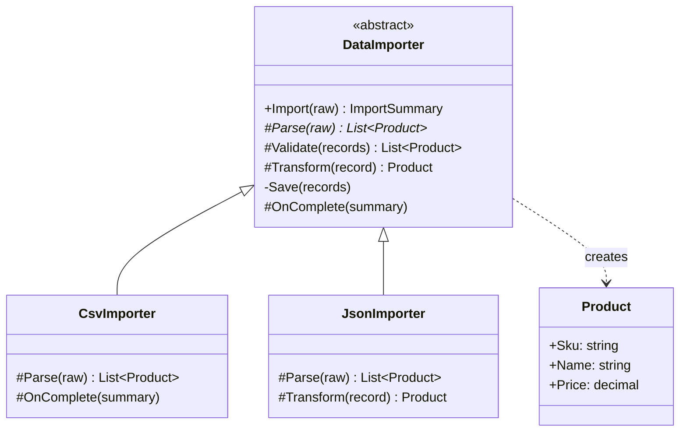

# Template Method

> **Category:** Behavioral · **Also known as:** —
> **Difficulty:** ⭐ Beginner · **Frequency of use:** High

[← Back to the catalog](../../../README.md#the-catalog)

## Intent

Define the **skeleton of an algorithm** in a base operation, deferring some steps to subclasses.
Template Method lets subclasses redefine certain steps of an algorithm **without changing its
structure**.

## The problem

A shop imports its product catalog from suppliers. One supplier sends CSV, another sends JSON. The
first two importers were written by copy and paste:

```csharp
void ImportCsv(string raw)
{
    var records = ParseCsvLines(raw);
    records = records.Where(r => r.Name != "" && r.Price >= 0).ToList(); // validation
    foreach (var r in records) catalog.Save(r);                         // save
    Console.WriteLine($"{records.Count} saved");                        // summary
}

void ImportJson(string raw)
{
    var records = JsonSerializer.Deserialize<List<Product>>(raw)!;
    records = records.Where(r => r.Name != "" && r.Price > 0).ToList();  // oops: > instead of >=
    foreach (var r in records) catalog.Save(r with { Sku = r.Sku.ToUpper() });
    Console.WriteLine($"{records.Count} saved");
}
```

Only the parsing (and a small transformation) really differs, yet the whole workflow is
duplicated. The copies have already drifted apart (the validation rule is different), and a
third format means a third copy. Changing the workflow — say, adding a summary e-mail — means
editing every importer.

## The solution

Move the workflow into a base class method, the **template method** `Import(raw)`, which calls
the steps in a fixed order. Steps that always differ are **abstract** (`Parse`). Steps with a
reasonable default are **overridable** (`Validate`). Optional extension points are **hooks**
that do nothing (or something trivial) by default (`Transform`, `OnComplete`). Steps that must
never change are private (`Save`). Subclasses fill in only what is different.



### Participants

| Participant | In our example | Responsibility |
|---|---|---|
| **Abstract Class** | `DataImporter` | Defines the template method `Import` and the steps: abstract `Parse`, default `Validate`, hooks `Transform` and `OnComplete`, common `Save`. |
| **Concrete Class** | `CsvImporter`, `JsonImporter` | Implements the abstract steps and overrides only the hooks it needs. |
| **Client** | `Program` / `main` | Calls the template method; never calls the steps directly. |

## The example: data importer

All four implementations model exactly the same thing and print exactly the same output.
`Import(raw)` always runs: **parse → validate → transform → save → onComplete**.

- `CsvImporter` parses `sku,name,price` lines (skipping the header) and **extends** the
  `OnComplete` hook: it calls the default summary and then sends a (simulated) report.
- `JsonImporter` parses a JSON array with each language's standard library and **overrides** the
  `Transform` hook to upper-case the SKU.
- The default `Validate` drops records with an empty name or a negative price and says why.
- `Save` is shared by everyone and cannot be overridden.

### Implementations

| Language | Source | Run it (from the repo root) |
|---|---|---|
| C# / .NET 8 | [`csharp/`](csharp/) | `dotnet run --project patterns/behavioral/template-method/csharp` |
| TypeScript | [`typescript/importers.ts`](typescript/importers.ts), [`main.ts`](typescript/main.ts) | `npx tsx patterns/behavioral/template-method/typescript/main.ts` |
| React (TSX) | [`typescript/TemplateMethodDemo.tsx`](typescript/TemplateMethodDemo.tsx) | `npm run dev` → open the playground |
| Python 3.10+ | [`python/main.py`](python/main.py) | `python3 patterns/behavioral/template-method/python/main.py` |
| Go 1.23+ | [`go/main.go`](go/main.go), [`go/importer.go`](go/importer.go) | `go run ./patterns/behavioral/template-method/go` |

### Expected output

```text
=== Template Method Pattern: Data importer ===
--- CsvImporter ---
[parse] 4 record(s) read
[validate] dropped bk-002: empty name
[validate] dropped bk-003: negative price -5.00
[save] bk-001  Clean Code       $32.50
[save] bk-004  Design Patterns  $45.00
[complete] 4 read, 2 dropped, 2 saved, total $77.50
[notify] import report sent to the catalog team
--- JsonImporter ---
[parse] 3 record(s) read
[validate] dropped el-300: empty name
[transform] el-100 -> EL-100
[transform] el-200 -> EL-200
[save] EL-100  USB-C cable      $9.99
[save] EL-200  Headphones       $59.90
[complete] 3 read, 1 dropped, 2 saved, total $69.89
```

## Code walkthrough

The template method is **not virtual**: subclasses can customize the steps but not their order.

```csharp
public ImportSummary Import(string raw)
{
    var records = Parse(raw);                        // abstract: must be implemented
    Console.WriteLine($"[parse] {records.Count} record(s) read");
    var valid = Validate(records);                   // virtual: has a default
    var transformed = valid.Select(Transform).ToList(); // hook: identity by default
    Save(transformed);                               // private: common to all
    var summary = new ImportSummary(/* ... */);
    OnComplete(summary);                             // hook: prints the summary by default
    return summary;
}
```

A concrete class only writes what is different. `JsonImporter` adds one hook:

```csharp
protected override Product Transform(Product record)
{
    var upper = record.Sku.ToUpperInvariant();
    Console.WriteLine($"[transform] {record.Sku} -> {upper}");
    return record with { Sku = upper };
}
```

This is the **Hollywood Principle** — "don't call us, we'll call you": the base class calls the
subclass's code, not the other way around.

### Language notes

- **C#:** Make the template method non-virtual (or `sealed override` if it overrides something)
  and the steps `protected abstract` / `protected virtual`. Records with `with` expressions make
  the transform hook non-destructive. `System.Text.Json` deserializes straight into the
  `Product` record.
- **TypeScript / React:** TypeScript has no `final` modifier, so "do not override `import()`" is
  a convention; `private save()` does prevent subclasses from replacing the common step, and
  `noImplicitOverride` forces `override` on every redefined step. In React, inheritance between
  components is discouraged; the same idea appears as a component or custom hook that owns the
  workflow and accepts the varying steps as **props/functions** (render props, `children`, slot
  props). See [`TemplateMethodDemo.tsx`](typescript/TemplateMethodDemo.tsx).
- **Python:** `import` is a keyword, so the template method is called `import_data`.
  `@typing.final` tells type checkers that subclasses must not override it, `@abstractmethod`
  marks `parse`, and a leading underscore (`_save`) marks the common step as private by
  convention. `json.loads(..., parse_float=Decimal)` keeps prices exact.
- **Go:** Go has no inheritance, so there is no base class to put the template in. The idiomatic
  translation inverts it: the varying steps become a small **interface** (`Parser`, with the one
  required step), optional hooks become **optional interfaces** (`Validator`, `Transformer`,
  `CompletionHook`) detected with a type assertion — the same trick the standard library uses
  for `io.WriterTo` or `http.Flusher` — and the template itself is a plain **function**,
  `Import(steps Parser, raw string)`, that nobody can override. Default steps are exported
  functions (`DefaultValidate`, `DefaultOnComplete`), so a concrete importer can "call super"
  explicitly, as `CsvImporter.OnComplete` does. `sort.Sort(data sort.Interface)` is the
  classic stdlib example of this shape. Embedding a struct does **not** give you virtual
  dispatch: a method on the embedded type cannot call an "overridden" method of the outer type.

## When to use it

- Several classes share the **same workflow** and differ only in some steps (importers/exporters,
  report generators, test fixtures with setup/teardown, request pipelines, game turns).
- You want to control **where** subclasses may extend an algorithm and prevent them from changing
  the rest.
- You are removing duplicated code from sibling classes: pull the common skeleton up and leave
  the differences as steps.

## When NOT to use it

- The variation is the whole algorithm, or must change at runtime — use
  [Strategy](../strategy/README.md) (composition) instead.
- The skeleton has many steps and many hooks; subclasses become hard to reason about ("which
  hooks do I need to override, and in which combination?").
- The language or framework favors composition over inheritance (Go, React components): pass the
  steps in as functions or interfaces instead.

## Pros and cons

| ✅ Pros | ❌ Cons |
|---|---|
| Removes duplicated workflow code; the skeleton lives in one place. | Relies on inheritance: the coupling between base and subclasses is tight. |
| Clear, controlled extension points (abstract steps vs. hooks). | The order of steps is fixed; clients cannot change it. |
| Subclasses stay small: they only contain what differs. | Easy to violate Liskov if a subclass overrides a step in a surprising way. |
| Hollywood Principle: the framework calls your code. | Many hooks make the flow hard to follow (it jumps between classes). |

## Real-world usages

- **.NET:** `System.IO.Stream` (`CopyTo`, `ReadAsync` built on the abstract `Read`/`Write`);
  `BackgroundService` (you implement `ExecuteAsync`, the base class handles start/stop);
  ASP.NET Core `Controller`'s `OnActionExecuting`/`OnActionExecuted` hooks.
- **JavaScript / React:** `HTMLElement` custom elements' lifecycle callbacks
  (`connectedCallback`, `disconnectedCallback`); React class components' lifecycle methods
  (`componentDidMount`, `render`).
- **Python:** `unittest.TestCase` (`setUp`, the test method, `tearDown`);
  `socketserver.BaseRequestHandler` (`setup`, `handle`, `finish`); `threading.Thread.run`.
- **Go:** `sort.Sort` running a fixed algorithm over the `Len`/`Less`/`Swap` steps of
  `sort.Interface`; `heap.Init`/`heap.Push` over `heap.Interface`.

## Related patterns

- **[Strategy](../strategy/README.md):** Template Method varies *parts* of an algorithm through
  inheritance (compile time); Strategy varies the *whole* algorithm through composition (runtime).
- **[Factory Method](../../creational/factory-method/README.md):** is often a step of a template
  method (a hook that creates an object).
- **[Builder](../../creational/builder/README.md):** a director runs a fixed sequence of steps
  over interchangeable builders — a composition-based cousin.
- **[Visitor](../visitor/README.md) / [Iterator](../iterator/README.md):** frequently combined
  with template methods in frameworks that walk structures.

## Exercises

1. Add an `XmlImporter` (use the standard library XML parser of your language). Which methods did
   you have to write?
2. Add a `Deduplicate` hook between validation and transform that removes repeated SKUs. Where
   does it go, and what is its default?
3. Rewrite the C# or TypeScript version without inheritance, Go-style: the template is a
   function that receives the steps. What do you gain and what do you lose?
