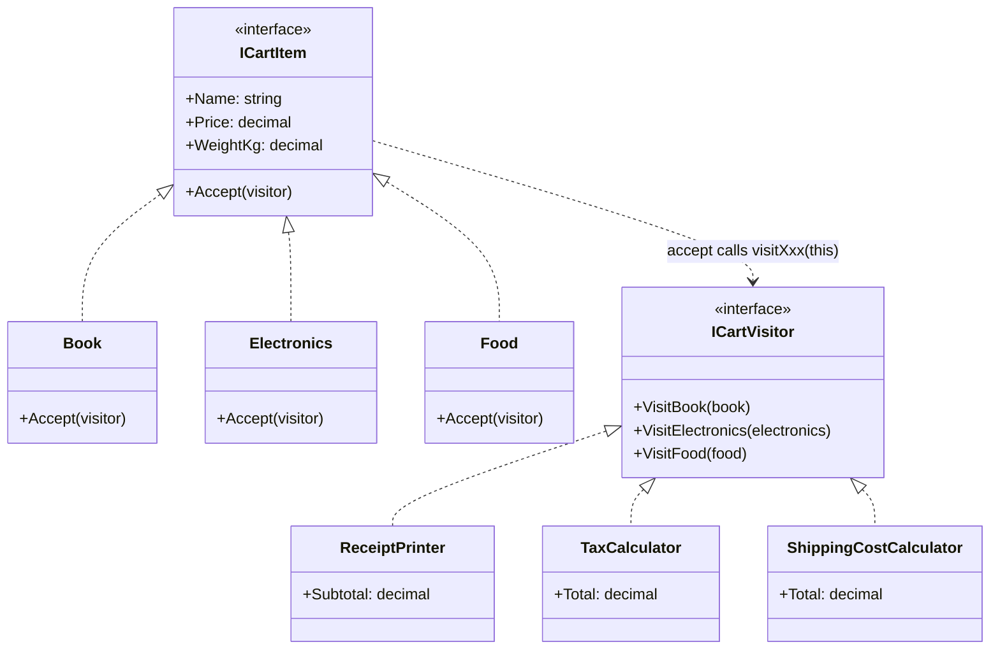

# Visitor

> **Category:** Behavioral · **Also known as:** Double dispatch
> **Difficulty:** ⭐⭐⭐ Advanced · **Frequency of use:** Low

[← Back to the catalog](../../../README.md#the-catalog)

## Intent

Represent an **operation to be performed on the elements of an object structure**. Visitor lets
you define a new operation without changing the classes of the elements on which it operates.

## The problem

A shopping cart holds books, electronics and food. Finance needs VAT per item (each product type
has a different rate), logistics needs shipping costs (each type has different rules), and the
front end needs a receipt. The obvious approach adds every operation to every item class:

```csharp
abstract class CartItem
{
    public abstract decimal Tax();            // finance
    public abstract decimal ShippingCost();   // logistics
    public abstract string ReceiptLine();     // front end
    // next quarter: CustomsDeclaration(), LoyaltyPoints(), CarbonFootprint() ...
}
```

The item classes become a dumping ground for unrelated concerns owned by different teams. Every
new operation means editing (and re-testing) every item class. The alternative — a function full
of `if (item is Book) ... else if (item is Electronics) ...` — is easy to get wrong: nothing tells
you when you forget a type.

## The solution

Put each operation in its own **visitor** class with one method per element type
(`VisitBook`, `VisitElectronics`, `VisitFood`). Each element gets a single, generic `Accept`
method that calls the visitor method matching its own type. Adding an operation now means adding
a visitor; the element classes never change again.



### Participants

| Participant | In our example | Responsibility |
|---|---|---|
| **Visitor** | `ICartVisitor` | Declares one `Visit` method per concrete element type. |
| **Concrete Visitor** | `ReceiptPrinter`, `TaxCalculator`, `ShippingCostCalculator` | Implements one operation for every element type; may accumulate state (totals) while visiting. |
| **Element** | `ICartItem` | Declares `Accept(visitor)`. |
| **Concrete Element** | `Book`, `Electronics`, `Food` | Implements `Accept` by calling the visitor method for its own type. |
| **Object Structure** | the cart (an array of items) | Lets a visitor walk over all its elements. |
| **Client** | `Program` / `main` | Creates visitors and runs them over the structure. |

### Double dispatch

Most mainstream languages pick the method to run based on the runtime type of **one** object
(the receiver): *single dispatch*. A visitor needs to choose based on **two** runtime types — the
kind of item *and* the kind of operation. Visitor fakes this with two single dispatches:

1. `item.Accept(visitor)` — dispatched on the item's runtime type (say, `Electronics`).
2. Inside `Electronics.Accept`, `visitor.VisitElectronics(this)` — dispatched on the visitor's
   runtime type (say, `TaxCalculator`). Here `this` has the static type `Electronics`, so the
   right overload is chosen at compile time.

The result: `TaxCalculator.VisitElectronics` runs, without a single `if` or cast.

## The example: shopping cart tax & shipping

All four implementations model exactly the same thing and print exactly the same output. The
cart contains a book, two electronics items and two food items, each with a price and a weight.
Three visitors walk over the same cart:

- `ReceiptPrinter`: one line per item (type, name, price, weight) and the subtotal.
- `TaxCalculator`: VAT by type — books 4%, electronics 21%, food 10% — rounded per item.
- `ShippingCostCalculator`: books ship at a flat $1.50; electronics cost $4.00 + $1.20/kg
  (insured); food costs $2.50/kg with a $3.00 minimum (refrigerated).

The client finally combines the three totals into a grand total.

### Implementations

| Language | Source | Run it (from the repo root) |
|---|---|---|
| C# / .NET 8 | [`csharp/`](csharp/) | `dotnet run --project patterns/behavioral/visitor/csharp` |
| TypeScript | [`typescript/cart.ts`](typescript/cart.ts), [`main.ts`](typescript/main.ts) | `npx tsx patterns/behavioral/visitor/typescript/main.ts` |
| React (TSX) | [`typescript/VisitorDemo.tsx`](typescript/VisitorDemo.tsx) | `npm run dev` → open the playground |
| Python 3.10+ | [`python/main.py`](python/main.py) | `python3 patterns/behavioral/visitor/python/main.py` |
| Go 1.23+ | [`go/main.go`](go/main.go), [`go/cart.go`](go/cart.go) | `go run ./patterns/behavioral/visitor/go` |

### Expected output

```text
=== Visitor Pattern: Shopping cart: tax & shipping ===
--- ReceiptPrinter ---
  [Book]        Clean Code       $32.50  0.80kg
  [Electronics] Headphones       $59.90  0.40kg
  [Food]        Coffee beans     $12.00  1.50kg
  [Electronics] Monitor         $199.00  5.50kg
  [Food]        Chocolate         $3.50  0.20kg
  Subtotal: $306.90
--- TaxCalculator ---
  Clean Code     books 4%             $1.30
  Headphones     electronics 21%     $12.58
  Coffee beans   food 10%             $1.20
  Monitor        electronics 21%     $41.79
  Chocolate      food 10%             $0.35
  Total tax: $57.22
--- ShippingCostCalculator ---
  Clean Code     flat rate               $1.50
  Headphones     $4.00 + $1.20/kg        $4.48
  Coffee beans   $2.50/kg, min $3.00     $3.75
  Monitor        $4.00 + $1.20/kg       $10.60
  Chocolate      $2.50/kg, min $3.00     $3.00
  Total shipping: $23.33
Grand total: $306.90 + $57.22 tax + $23.33 shipping = $387.45
```

## Code walkthrough

Each element's `Accept` is a one-liner that "tells the visitor who it is":

```csharp
public sealed record Electronics(string Name, decimal Price, decimal WeightKg) : ICartItem
{
    public void Accept(ICartVisitor visitor) => visitor.VisitElectronics(this);
}
```

A visitor groups one operation for all types in one class, and can keep state across the walk:

```csharp
public sealed class TaxCalculator : ICartVisitor
{
    public decimal Total { get; private set; }

    public void VisitBook(Book book) => Apply(book, "books 4%", 0.04m);
    public void VisitElectronics(Electronics electronics) => Apply(electronics, "electronics 21%", 0.21m);
    public void VisitFood(Food food) => Apply(food, "food 10%", 0.10m);
    // ...
}
```

The client's traversal never changes; only the visitor does:

```csharp
foreach (var item in cart) item.Accept(new TaxCalculator());
```

### Adding operations vs. adding element types

Visitor makes a deliberate trade-off (the "expression problem"):

| Change | With Visitor | With methods on the elements |
|---|---|---|
| Add an operation (e.g. `LoyaltyPointsCalculator`) | ✅ One new class; no element changes. | ❌ Edit every element class. |
| Add an element type (e.g. `GiftCard`) | ❌ Add `VisitGiftCard` to the interface and **every** visitor. | ✅ One new class. |

Use Visitor when the set of element types is **stable** and operations keep coming. The upside
of the "con" is that the compiler lists every visitor you must update when a type is added.

### Language notes

- **C#:** Overloading (`Visit(Book)`, `Visit(Food)`) is common, but distinct names are clearer
  and match other languages. A generic visitor (`ICartVisitor<TResult>` with
  `TResult Accept<TResult>(ICartVisitor<TResult> v)`) returns values instead of accumulating
  state. **Modern alternative:** a `switch` expression with type patterns over a closed hierarchy:
  `item switch { Book b => b.Price * 0.04m, Electronics e => e.Price * 0.21m, Food f => f.Price * 0.10m, _ => throw ... }`.
  It is shorter, but the compiler cannot prove exhaustiveness for open class hierarchies, so the
  discard arm is needed. Roslyn's `CSharpSyntaxVisitor` and LINQ's `ExpressionVisitor` are
  classic visitors.
- **TypeScript / React:** A visitor can be an object literal implementing `CartVisitor` (the React
  demo uses one to label items). **Modern alternative:** model items as a **discriminated
  union** (`{ kind: "book", ... } | { kind: "food", ... }`) and `switch (item.kind)`; with a
  `default: const never: never = item` branch the compiler flags any case you forget — exhaustive
  checking that classic OOP Visitor gets from its interface. In React, a component that renders
  a tree by node type is the same idea. See [`VisitorDemo.tsx`](typescript/VisitorDemo.tsx),
  where the cart is fixed and the user picks the operation.
- **Python:** `CartVisitor` is a `typing.Protocol`, so visitors need no base class. **Modern
  alternative:** structural pattern matching (Python 3.10+):
  `match item: case Book(): ... case Electronics(): ... case Food(): ...`.
  `functools.singledispatch` dispatches a function on the type of its first argument, and the
  standard library's `ast.NodeVisitor` finds `visit_<ClassName>` methods by name.
- **Go:** Visitor maps directly onto interfaces; the shared fields live in an embedded `Item`
  struct. **Modern alternative:** a **type switch**
  (`switch it := item.(type) { case *Book: ...; case *Food: ... }`), which is what most Go code
  uses; `go/ast.Walk` with an `ast.Visitor` is the standard library's visitor.

## When to use it

- You need to run **many unrelated operations** over a structure of objects (ASTs, document
  models, product catalogs, file systems, UI trees) and do not want to pollute their classes.
- The element hierarchy is **stable**, but new operations are added often.
- An operation needs to **accumulate state** across many elements (totals, symbol tables,
  generated code).

## When NOT to use it

- The element hierarchy changes often: every new type breaks every visitor.
- There are only one or two operations — put them on the elements.
- The language offers exhaustive pattern matching over a closed set of types (sum types /
  discriminated unions / sealed hierarchies): it gives the same separation with less ceremony.
- Visitors would need private data of the elements, forcing you to break encapsulation.

## Pros and cons

| ✅ Pros | ❌ Cons |
|---|---|
| Open/Closed for operations: add one without touching the elements. | Adding an element type forces changes to every visitor. |
| Single Responsibility: each operation lives in one class. | Elements must expose enough public state for visitors to work. |
| Visitors can accumulate state while walking a structure. | Double dispatch is unfamiliar and adds indirection. |
| The compiler reminds you to handle every element type. | Overkill for small hierarchies or few operations. |

## Real-world usages

- **.NET:** `System.Linq.Expressions.ExpressionVisitor`; Roslyn's `CSharpSyntaxVisitor` /
  `CSharpSyntaxWalker` used by analyzers and source generators.
- **JavaScript / React:** Babel plugins (`visitor: { Identifier(path) { ... } }`); ESLint rules,
  which return an object of node-type handlers.
- **Python:** `ast.NodeVisitor` / `ast.NodeTransformer`; `functools.singledispatch`.
- **Go:** `go/ast.Walk` and `ast.Inspect` with the `ast.Visitor` interface.

## Related patterns

- **[Composite](../../structural/composite/README.md):** visitors are commonly run over composite
  trees; the composite's `Accept` forwards the visitor to its children.
- **[Iterator](../iterator/README.md):** traverses a structure; Visitor defines what happens at
  each element (and can work across unrelated types).
- **[Interpreter](../interpreter/README.md):** an interpreter's AST is often evaluated, printed or
  type-checked by visitors.
- **[Command](../command/README.md):** both turn an operation into an object; a visitor is an
  operation over a whole structure.

## Exercises

1. Add a `LoyaltyPointsCalculator` visitor (1 point per $1 on books, 2 on food, none on
   electronics). How many existing files did you touch?
2. Add a `GiftCard` element type. List every file that had to change, and compare with exercise 1.
3. Rewrite `TaxCalculator` with pattern matching (C# `switch` expression, Python `match`, a TS
   discriminated union or a Go type switch). Then remove one case: which languages warn you?
