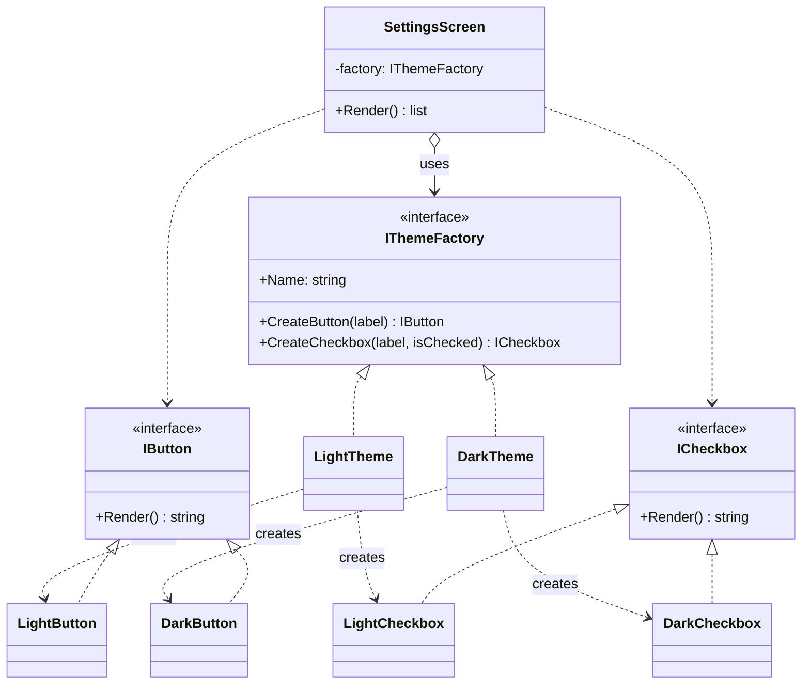

# Abstract Factory

> **Category:** Creational · **Also known as:** Kit
> **Difficulty:** ⭐⭐ Intermediate · **Frequency of use:** Medium-high

[← Back to the catalog](../../../README.md#the-catalog)

## Intent

Provide an interface for creating **families of related or dependent objects** without
specifying their concrete classes. The client picks a family once (by picking a factory) and is
then guaranteed that every object it creates belongs to that family.

## The problem

Your app supports a light and a dark theme. Every screen creates its own widgets, so theme
checks are sprinkled everywhere:

```csharp
IWidget[] RenderSettings(string theme) =>
[
    theme == "dark" ? new DarkCheckbox("Email alerts", true) : new LightCheckbox("Email alerts", true),
    theme == "dark" ? new DarkCheckbox("Weekly digest", false) : new LightCheckbox("Weekly digest", false),
    theme == "light" ? new LightButton("Save") : new DarkButton("Save"),
];
```

Every screen repeats the same conditionals, so adding a "high contrast" theme means editing every
screen. Worse, nothing stops a typo (or a forgotten branch) from putting a **light button on a
dark screen**: the products belong to families, but the code does not express that.

## The solution

Group the creation methods of one family into an interface — the **abstract factory**
`IThemeFactory` with `CreateButton()` and `CreateCheckbox()`. Each family gets a **concrete
factory** (`LightTheme`, `DarkTheme`) that only ever returns products of its own family. Client
code (`SettingsScreen`) receives a factory and talks exclusively to the abstract factory and the
abstract products (`IButton`, `ICheckbox`). Switching themes means passing a different factory;
mixing families becomes impossible through the factory.



### Participants

| Participant | In our example | Responsibility |
|---|---|---|
| **Abstract Factory** | `IThemeFactory` | Declares one creation method per product of the family. |
| **Concrete Factory** | `LightTheme`, `DarkTheme` | Create the products of one family. |
| **Abstract Product** | `IButton`, `ICheckbox` | Interfaces for each kind of product. |
| **Concrete Product** | `LightButton`, `LightCheckbox`, `DarkButton`, `DarkCheckbox` | The family-specific implementations. |
| **Client** | `SettingsScreen` | Uses only the abstract factory and abstract products. |

## The example: UI theme kit

All four implementations model exactly the same thing and print exactly the same output:

- Each widget's `Render()` returns a text mock-up plus its family's colors (e.g.
  `[x] Email alerts    (dark checkbox: tick #60a5fa)`).
- `SettingsScreen` renders two checkboxes and a Save button. The client renders it twice, with
  `LightTheme` and then `DarkTheme`, without changing a line of `SettingsScreen`.
- A preference string (`"dark"`/`"light"`) chooses the concrete factory once; everything that
  factory creates then follows.
- Finally, the client bypasses the factory and creates a `LightButton` and a `DarkCheckbox` by
  hand. A small `Layout.Compose` helper detects the mixed families and reports an error — exactly
  the bug the factory prevents by construction.

### Implementations

| Language | Source | Run it (from the repo root) |
|---|---|---|
| C# / .NET 8 | [`csharp/`](csharp/) | `dotnet run --project patterns/creational/abstract-factory/csharp` |
| TypeScript | [`typescript/themeKit.ts`](typescript/themeKit.ts), [`main.ts`](typescript/main.ts) | `npx tsx patterns/creational/abstract-factory/typescript/main.ts` |
| React (TSX) | [`typescript/AbstractFactoryDemo.tsx`](typescript/AbstractFactoryDemo.tsx) | `npm run dev` → open the playground |
| Python 3.10+ | [`python/main.py`](python/main.py) | `python3 patterns/creational/abstract-factory/python/main.py` |
| Go 1.23+ | [`go/main.go`](go/main.go) | `go run ./patterns/creational/abstract-factory/go` |

**Tests:** [C# (xUnit)](../../../tests/csharp/DesignPatterns.Tests/Creational/AbstractFactoryTests.cs) · [TypeScript (Vitest)](typescript/themeKit.test.ts) · [React (Testing Library)](typescript/AbstractFactoryDemo.test.tsx) · [Python (pytest)](python/test_main.py) · [Go (`go test`)](go/main_test.go)

### Expected output

<!-- output: expected_output.txt -->
```text
=== Abstract Factory Pattern: UI theme kit ===
Settings screen with LightTheme:
  [x] Email alerts    (light checkbox: tick #2563eb)
  [ ] Weekly digest   (light checkbox: tick #2563eb)
  [ Save ]            (light button: bg #ffffff, text #111827)
Settings screen with DarkTheme:
  [x] Email alerts    (dark checkbox: tick #60a5fa)
  [ ] Weekly digest   (dark checkbox: tick #60a5fa)
  [ Save ]            (dark button: bg #1f2937, text #f9fafb)
Picking the factory from a preference string:
  preference=dark  -> DarkTheme  -> DarkCheckbox
  preference=light -> LightTheme -> LightCheckbox
Mixing families by hand (bypassing the factory):
  error: cannot mix themes: LightButton is light, DarkCheckbox is dark
```
<!-- /output -->

## Code walkthrough

The abstract factory is just an interface with one method per product:

```csharp
public interface IThemeFactory
{
    string Name { get; }
    IButton CreateButton(string label);
    ICheckbox CreateCheckbox(string label, bool isChecked);
}

public sealed class DarkTheme : IThemeFactory
{
    public string Name => nameof(DarkTheme);
    public IButton CreateButton(string label) => new DarkButton(label);
    public ICheckbox CreateCheckbox(string label, bool isChecked) => new DarkCheckbox(label, isChecked);
}
```

The client never names a concrete widget, so it cannot get the family wrong:

```csharp
public sealed class SettingsScreen(IThemeFactory factory)
{
    public IReadOnlyList<string> Render() => Layout.Compose(
    [
        factory.CreateCheckbox("Email alerts", true),
        factory.CreateCheckbox("Weekly digest", false),
        factory.CreateButton("Save"),
    ]);
}
```

### Language notes

- **C#:** The concrete factory is typically registered once in the DI container
  (`services.AddSingleton<IThemeFactory, DarkTheme>()`) and injected wherever widgets are needed.
  To make mixing families a *compile-time* error, you can tag products with a family type
  parameter (`IButton<TFamily>`), at the cost of noisier signatures.
- **TypeScript / React:** The factory is a plain object implementing an interface. In React the
  natural home for an abstract factory is **context**: a provider near the root supplies the
  concrete factory and every themed component calls `useContext(ThemeFactoryContext).createButton(...)`.
  Toggling the theme swaps the whole family at once. See
  [`AbstractFactoryDemo.tsx`](typescript/AbstractFactoryDemo.tsx).
- **Python:** `abc.ABC` defines the abstract factory and abstract products; products are frozen
  dataclasses. Because classes are first-class, a "factory" can also be a simple mapping such as
  `{"button": DarkButton, "checkbox": DarkCheckbox}`, or a module that exposes the same
  functions as another module (swap the module, swap the family).
- **Go:** Abstract products and the factory are small interfaces; the concrete factories are
  empty structs. Shared widget fields live in an embedded `widgetBase` struct whose methods are
  promoted to every concrete widget. Interfaces embed `Widget` to share `Name`/`Theme`/`Render`.

## When to use it

- Your code must work with **several families of related products** and must not mix them
  (themes/skins, database providers, cloud vendors, OS-specific toolkits).
- You want to **switch whole families at once** (configuration, tenant, platform, test vs. prod).
- You want to hide concrete product classes from client code, exposing only interfaces.
- You find several [factory methods](../factory-method/README.md) that are always overridden
  together — they are a family waiting for a factory.

## When NOT to use it

- There is only one family, or products do not depend on each other — a factory method or plain
  constructors are simpler.
- You expect to add **new kinds of products** often: every new product type (e.g. `Slider`)
  means changing the abstract factory and *every* concrete factory.
- The "families" differ only in data (colors, sizes): passing a theme value object is enough.

## Pros and cons

| ✅ Pros | ❌ Cons |
|---|---|
| Products from one factory are guaranteed to be compatible. | Adding a new product kind changes every factory. |
| Client code is decoupled from concrete product classes. | Many interfaces and classes for a small feature. |
| Swap an entire family by changing one object. | Can be over-engineering when families differ only by data. |
| Open/Closed for new families: add a factory, touch nothing else. | Still needs a place (config, DI) to choose the concrete factory. |

## Real-world usages

- **.NET:** `System.Data.Common.DbProviderFactory` (`SqlClientFactory`, `NpgsqlFactory`, ...)
  creates matching `DbConnection`, `DbCommand` and `DbParameter` objects.
- **JavaScript / React:** design systems/component libraries that expose a theme through
  context (`ThemeProvider` in MUI or styled-components), so every component draws from the same
  family.
- **Python:** DB-API 2.0 drivers act as families (a driver module's `connect()` returns a
  connection that creates matching cursors), e.g. `sqlite3` vs. `psycopg`.
- **Go:** `database/sql/driver.Driver` → `Conn` → `Stmt`/`Tx`, all supplied by one driver
  (`pq`, `pgx`, `mysql`).

## Related patterns

- **[Factory Method](../factory-method/README.md):** abstract factories are often implemented
  with one factory method per product.
- **[Builder](../builder/README.md):** focuses on constructing one complex object step by step;
  Abstract Factory returns each product immediately and focuses on families.
- **[Prototype](../prototype/README.md):** a factory can be configured with prototypes and clone
  them instead of using subclasses per family.
- **[Singleton](../singleton/README.md):** concrete factories are stateless and frequently
  shared as single instances.
- **[Bridge](../../structural/bridge/README.md):** an abstract factory can create and configure a
  particular bridge implementation.
- **[Facade](../../structural/facade/README.md):** an abstract factory can be used instead of a
  facade to hide platform-specific classes.

## Exercises

1. Add a `HighContrastTheme` family. Which files did you touch? Now add a third product,
   `Slider`. Compare how many files each change touched.
2. In C# or TypeScript, make "light button next to dark checkbox" a **compile-time** error (hint:
   a generic family parameter or a branded type).
3. Replace the factory classes in Python with dictionaries of constructors. What do you lose in
   type safety and discoverability?
