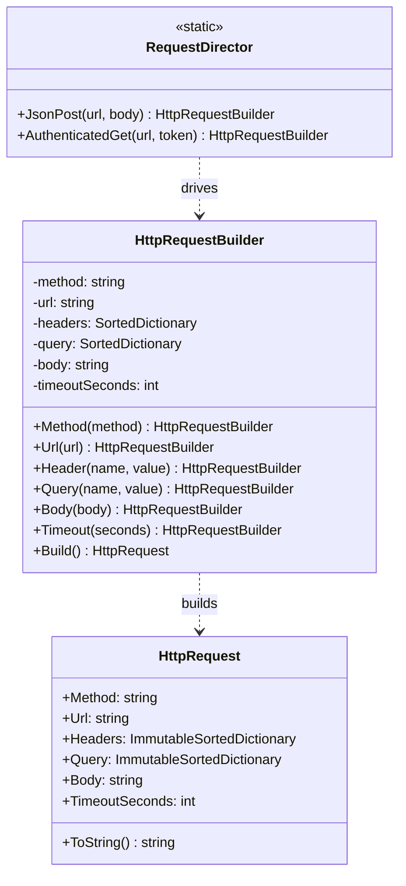

# Builder

> **Category:** Creational · **Also known as:** Fluent builder (the modern variant)
> **Difficulty:** ⭐⭐ Intermediate · **Frequency of use:** High

[← Back to the catalog](../../../README.md#the-catalog)

## Intent

Separate the **construction** of a complex object from its **representation**, so the same
construction process can be expressed step by step, validated once, and reused through
ready-made recipes.

## The problem

An HTTP request has a method, a URL, any number of headers and query parameters, an optional
body and a timeout. Most of these are optional, and some combinations are invalid (a `GET` with a
body). Putting everything in one constructor produces the classic **telescoping constructor**:

```csharp
new HttpRequest("GET", "https://api.example.com/users", null, null, null, 30);
new HttpRequest("POST", url, headers, null, "{\"sku\":\"A-42\"}", 30);
new HttpRequest("GET", url, null, query, "oops", 0);   // compiles, but is invalid
```

Positional arguments are unreadable (`null, null, null, 30`?), every new option adds yet another
overload or parameter, invalid combinations are only discovered at runtime (if at all), and if
you make the class mutable instead, half-built requests leak into the rest of the program.

## The solution

Move construction into a separate **builder** object with one method per step
(`Method`, `Url`, `Header`, `Query`, `Body`, `Timeout`). Each step returns the builder itself
(a *fluent interface*), so calls read like a sentence. `Build()` checks the whole combination
**once** and returns an **immutable** product. Common recipes live in a **director**
(`RequestDirector.JsonPost`, `AuthenticatedGet`) that drives the builder through a fixed sequence
of steps.



### Participants

| Participant | In our example | Responsibility |
|---|---|---|
| **Builder** | `HttpRequestBuilder` | Step-by-step interface to set the parts; validates in `Build()`. |
| **Concrete Builder** | `HttpRequestBuilder` | With a single product type, the builder is its own concrete builder. GoF uses several concrete builders when one process yields different representations. |
| **Product** | `HttpRequest` | The complex, immutable object being built. |
| **Director** | `RequestDirector` | Encapsulates recipes (sequences of steps) for common products. |
| **Client** | `Program` / `main` | Uses the builder directly or starts from a director recipe. |

## The example: HTTP request builder

All four implementations model exactly the same thing and print exactly the same output:

1. A `GET` built step by step. Headers and query parameters are added in arbitrary order; the
   product stores them **sorted** so the printout is deterministic.
2. `RequestDirector.JsonPost(url, body)` builds a JSON `POST` with the right headers.
3. `RequestDirector.AuthenticatedGet(url, token)` returns a *builder*, so the client adds more
   steps (query parameters, timeout) before calling `Build()`.
4. Three invalid requests: missing URL, `GET` with a body, zero timeout. `Build()` rejects each
   one with a clear error, and no invalid `HttpRequest` ever exists.
5. A builder is reused after `Build()`. The first request does not change, proving that each
   product is an independent immutable snapshot.

### Implementations

| Language | Source | Run it (from the repo root) |
|---|---|---|
| C# / .NET 8 | [`csharp/`](csharp/) | `dotnet run --project patterns/creational/builder/csharp` |
| TypeScript | [`typescript/httpRequest.ts`](typescript/httpRequest.ts), [`main.ts`](typescript/main.ts) | `npx tsx patterns/creational/builder/typescript/main.ts` |
| React (TSX) | [`typescript/BuilderDemo.tsx`](typescript/BuilderDemo.tsx) | `npm run dev` → open the playground |
| Python 3.10+ | [`python/main.py`](python/main.py) | `python3 patterns/creational/builder/python/main.py` |
| Go 1.23+ | [`go/main.go`](go/main.go) | `go run ./patterns/creational/builder/go` |

### Expected output

<!-- output: expected_output.txt -->
```text
=== Builder Pattern: HTTP request builder ===
1) Step by step with the fluent builder:
  GET https://api.example.com/users?page=2&sort=name
    Accept: application/json
    X-Request-Id: req-001
    timeout: 5s
    body: (none)
2) Director preset jsonPost(url, body):
  POST https://api.example.com/orders
    Accept: application/json
    Content-Type: application/json
    timeout: 30s
    body: {"sku":"A-42","qty":2}
3) Preset authenticatedGet(url, token) + extra steps:
  GET https://api.example.com/me?fields=name,email&lang=en
    Accept: application/json
    Authorization: Bearer demo-token-123
    timeout: 10s
    body: (none)
4) build() validates before creating the product:
  no url        -> error: url is required
  GET with body -> error: GET requests cannot have a body
  timeout 0     -> error: timeout must be positive
5) Built requests are immutable snapshots:
  first has 2 headers, second has 3 headers
```
<!-- /output -->

## Code walkthrough

Each step stores one part and returns the builder; `Build()` validates the *combination*:

```csharp
public HttpRequestBuilder Header(string name, string value) { _headers[name] = value; return this; }

public HttpRequest Build()
{
    if (string.IsNullOrEmpty(_url))
        throw new InvalidOperationException("url is required");
    if (_body is not null && _method is "GET" or "HEAD")
        throw new InvalidOperationException($"{_method} requests cannot have a body");
    if (_timeoutSeconds <= 0)
        throw new InvalidOperationException("timeout must be positive");
    return new HttpRequest(_method, _url,
        _headers.ToImmutableSortedDictionary(StringComparer.Ordinal),
        _query.ToImmutableSortedDictionary(StringComparer.Ordinal),
        _body, _timeoutSeconds);
}
```

The director captures a recipe but leaves the builder open for extra steps:

```csharp
var request = RequestDirector.AuthenticatedGet("https://api.example.com/me", "demo-token-123")
    .Query("fields", "name,email")
    .Timeout(10)
    .Build();
```

### Variants worth knowing

- **Telescoping constructors** (`HttpRequest(method)`, `HttpRequest(method, url)`,
  `HttpRequest(method, url, headers)`, ...) are the anti-pattern Builder replaces.
- **Step builder** (a.k.a. staged builder): each step returns a *different interface* that only
  exposes the legal next steps, e.g. `Request.Get()` → `IWithUrl.Url(...)` → `IOptional.Header(...).Build()`.
  The compiler then enforces "URL is required" — you cannot even call `Build()` without it — at
  the cost of one interface per stage.
- **Named/optional arguments** (C# object initializers, Python keyword arguments, TS option
  objects) remove the *readability* problem of telescoping constructors but not the *validation
  of combinations* or multi-step recipes.

### Language notes

- **C#:** `ImmutableSortedDictionary` with `StringComparer.Ordinal` makes the product truly
  immutable and deterministic; the `internal` constructor ensures only the builder creates it.
  For simpler cases, a `record` with `init` properties plus `required` members and `with`
  expressions often removes the need for a builder. `StringBuilder`, `UriBuilder` and
  `HostApplicationBuilder` are builders you use every day.
- **TypeScript / React:** Builder methods return `this` (typed as `this`, so subclasses keep
  fluent chaining) and use `#private` fields; the product is `Object.freeze`d with defensive
  `Map` copies. In React, form fields are naturally the builder's steps: the component replays
  them on a fresh builder each render and shows either the built request or the validation
  error. See [`BuilderDemo.tsx`](typescript/BuilderDemo.tsx). For plain data, an options object
  (`fetch(url, { method, headers, body })`) is often enough.
- **Python:** Keyword arguments with defaults usually make builders unnecessary for simple
  objects; Builder shines when you need multi-step recipes or validation of combinations. The
  product is a `@dataclass(frozen=True)` whose mappings are `types.MappingProxyType` read-only
  views. (Methods return the builder; `typing.Self` is available from Python 3.11.)
- **Go:** Builders return `*Builder` for chaining and `Build()` returns `(Product, error)` —
  Go's explicit error handling replaces exceptions. Unexported fields plus getters (and
  `maps.Clone`) keep the product immutable. Go also has the **functional options** idiom
  (`NewServer(addr, WithTimeout(5*time.Second), WithTLS(cfg))`), a popular alternative to
  builders.

## When to use it

- The object has **many optional parts** or configuration options (requests, queries, emails,
  documents, test fixtures).
- Some **combinations are invalid** and you want to validate them in one place before the object
  exists.
- You want the product to be **immutable** but still assemble it gradually.
- The same construction process should be reused through **recipes/presets** (director), or
  should produce different representations (e.g. the same steps building a request or a cURL
  command string).

## When NOT to use it

- The object has only a few required fields: a constructor (or a record) is clearer.
- Your language's named/optional arguments already make construction readable and there are no
  cross-field rules to validate.
- You would duplicate every product field in the builder for no gain — that is boilerplate, not
  design.

## Pros and cons

| ✅ Pros | ❌ Cons |
|---|---|
| Readable, self-documenting construction code. | Duplicates the product's fields in the builder. |
| Validates combinations once, in `Build()`; invalid objects never exist. | More code than a constructor for simple objects. |
| Allows immutable products assembled step by step. | Required parts are only checked at runtime (unless you use a step builder). |
| Recipes (director) are reusable and still extendable. | A mutable builder must not be shared across threads. |

## Real-world usages

- **.NET:** `StringBuilder`, `UriBuilder`, `DbConnectionStringBuilder`,
  `WebApplication.CreateBuilder()` / `HostApplicationBuilder`, `ImmutableList<T>.Builder`.
- **JavaScript / React:** query builders such as Knex (`knex('users').where(...).orderBy(...)`);
  `URLSearchParams` and `Headers` are built incrementally before a `fetch`.
- **Python:** SQLAlchemy's `select(User).where(...).order_by(...)`, `email.message.EmailMessage`
  assembled part by part, `argparse.ArgumentParser` configured step by step.
- **Go:** `strings.Builder`, `bytes.Buffer`, and `http.NewRequest` followed by `req.Header.Set(...)`;
  the functional-options idiom used by gRPC (`grpc.NewClient(target, opts...)`).

## Related patterns

- **[Abstract Factory](../abstract-factory/README.md):** creates *families* of products in one
  call; Builder constructs *one* complex product in many steps.
- **[Factory Method](../factory-method/README.md):** a director recipe is a named factory method
  that returns a pre-configured builder.
- **[Prototype](../prototype/README.md):** an alternative for "almost the same object again": clone
  a configured instance instead of replaying steps.
- **[Composite](../../structural/composite/README.md):** builders are often used to assemble
  composite trees (documents, UI trees, query ASTs).
- **[Singleton](../singleton/README.md):** stateless directors are sometimes singletons; here a
  static class/module plays that role.

## Exercises

1. Add a `ToCurl()` method that renders the same request as a `curl` command. Does that belong in
   the product or in a second "concrete builder"? Why?
2. Turn `HttpRequestBuilder` into a **step builder** so that forgetting the URL is a compile-time
   error in C# or TypeScript.
3. Rewrite the Go builder using the **functional options** idiom. Compare readability and how
   validation errors are reported.
