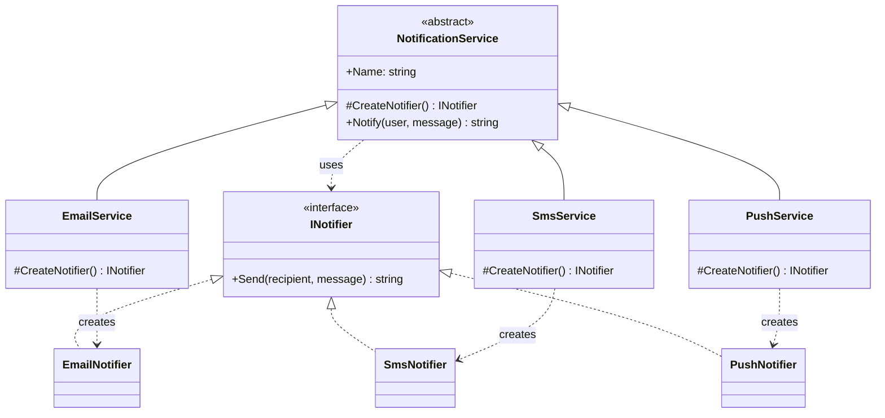

# Factory Method

> **Category:** Creational · **Also known as:** Virtual Constructor
> **Difficulty:** ⭐ Beginner · **Frequency of use:** High

[← Back to the catalog](../../../README.md#the-catalog)

## Intent

Define an interface for creating an object, but let **subclasses decide which class to
instantiate**. Factory Method lets a class defer instantiation to its subclasses, so the code that
*uses* a product is decoupled from the code that *chooses* it.

## The problem

Your app sends notifications. It started with e-mail only, so the service created an
`EmailNotifier` directly. Then product asked for SMS, then push notifications. Now the service
that should only care about "validate, personalize, deliver" looks like this:

```csharp
string Notify(User user, string message, string channel)
{
    if (string.IsNullOrWhiteSpace(message)) throw new ArgumentException("empty");
    var text = $"Hi {user.Name}, {message}";
    if (channel == "email") return new EmailNotifier().Send(user, text);
    else if (channel == "sms") return new SmsNotifier().Send(user, text);
    else if (channel == "push") return new PushNotifier().Send(user, text);
    throw new ArgumentException(channel);
}
```

The business logic is welded to every concrete notifier class. Adding WhatsApp means editing and
re-testing this method; tests cannot substitute a fake notifier without touching it; and the same
`if/else` tends to be copied wherever a notifier is needed.

## The solution

Move the `new` into a dedicated, overridable method — the **factory method** `CreateNotifier()`.
The abstract **creator** (`NotificationService`) keeps the business logic (`Notify`) and calls the
factory method whenever it needs a product. Each **concrete creator** (`EmailService`,
`SmsService`, `PushService`) overrides the factory method to return its own **concrete product**.
The business logic only sees the `INotifier` interface.



### Participants

| Participant | In our example | Responsibility |
|---|---|---|
| **Product** | `INotifier` | Interface of the objects the factory method creates. |
| **Concrete Product** | `EmailNotifier`, `SmsNotifier`, `PushNotifier` | The actual implementations (address choice, SMS truncation, ...). |
| **Creator** | `NotificationService` | Declares the factory method and contains business logic that uses its result. |
| **Concrete Creator** | `EmailService`, `SmsService`, `PushService` | Override the factory method to return a specific product. |
| **Client** | `Program` / `main` | Works with creators through the abstract `NotificationService` type. |

### Factory Method vs. "simple factory" (static factory)

The demo also contains `NotificationServices.FromConfig("sms")` (`serviceFromConfig`,
`service_from_config`, `ServiceFromConfig`). That is **not** the GoF Factory Method: it is a
*simple factory* — one function with a `switch` (or lookup table) that maps a key to a class.
The two are complementary:

| | Simple / static factory | Factory Method (GoF) |
|---|---|---|
| Shape | One function or static method with a `switch`/map | An overridable method on a creator class |
| Extending | Edit the function to add a case | Add a subclass; existing code is untouched |
| Who decides | The factory, based on a parameter | The subclass, by overriding |
| Typical use | Translate config/user input into an object | Let a framework/base class defer object creation |

Static factory methods like `TimeSpan.FromSeconds(5)` (C#) or `datetime.fromisoformat(...)` (Python) are a third,
unrelated idea: a *named constructor* on the class itself.

## The example: notification service

All four implementations model exactly the same thing and print exactly the same output:

- `NotificationService.Notify(user, message)` validates the message (must not be empty),
  personalizes it (`"Hi Alice, ..."`) and delivers it through the notifier returned by the factory
  method.
- `EmailNotifier` sends to the e-mail address, `PushNotifier` to the device id and `SmsNotifier`
  to the phone number, truncating texts longer than 32 characters.
- The client first calls the **same function** with three different creators, then lets a simple
  factory pick a creator from a configuration string (`"push"`, `"email"`, and the unknown
  `"fax"`), and finally shows that the shared validation rule lives in the creator.

### Implementations

| Language | Source | Run it (from the repo root) |
|---|---|---|
| C# / .NET 8 | [`csharp/`](csharp/) | `dotnet run --project patterns/creational/factory-method/csharp` |
| TypeScript | [`typescript/notifications.ts`](typescript/notifications.ts), [`main.ts`](typescript/main.ts) | `npx tsx patterns/creational/factory-method/typescript/main.ts` |
| React (TSX) | [`typescript/FactoryMethodDemo.tsx`](typescript/FactoryMethodDemo.tsx) | `npm run dev` → open the playground |
| Python 3.10+ | [`python/main.py`](python/main.py) | `python3 patterns/creational/factory-method/python/main.py` |
| Go 1.23+ | [`go/main.go`](go/main.go) | `go run ./patterns/creational/factory-method/go` |

### Expected output

```text
=== Factory Method Pattern: Notification service ===
Client code works only with the abstract NotificationService:
  EmailService -> EMAIL to alice@example.com: "Hi Alice, your order #1001 has shipped."
  SmsService   -> SMS to +1-555-0100: "Hi Alice, your order #1001 ha..."
  PushService  -> PUSH to device-a1b2: "Hi Alice, your order #1001 has shipped."
Config-driven selection (a simple factory picks the creator):
  channel=push   -> PushService
    PUSH to device-c3d4: "Hi Bob, your password was changed."
  channel=email  -> EmailService
    EMAIL to bob@example.com: "Hi Bob, your password was changed."
  channel=fax    -> error: unknown notification channel "fax"
Shared business rules live in the creator:
  SmsService   -> error: message must not be empty
```

## Code walkthrough

The creator owns the algorithm and leaves one step — "which notifier?" — to subclasses:

```csharp
public abstract class NotificationService
{
    protected abstract INotifier CreateNotifier();   // the factory method

    public string Notify(User user, string message)
    {
        if (string.IsNullOrWhiteSpace(message))
            throw new ArgumentException("message must not be empty");
        INotifier notifier = CreateNotifier();
        return notifier.Send(user, $"Hi {user.Name}, {message}");
    }
}

public sealed class SmsService : NotificationService
{
    protected override INotifier CreateNotifier() => new SmsNotifier();
}
```

The client depends only on the abstraction, so any creator — including a test double — fits:

```csharp
static void SendShippingUpdate(NotificationService service, User user) =>
    Console.WriteLine(service.Notify(user, "your order #1001 has shipped."));
```

### Language notes

- **C#:** The factory method is a `protected abstract` method; making it `protected virtual` with
  a default product is also common. In modern apps, the DI container often plays the creator role
  (`services.AddKeyedSingleton<INotifier, SmsNotifier>("sms")`, .NET 8+), and a
  `Func<INotifier>` delegate is a lightweight factory method.
- **TypeScript / React:** Classes are values, so the simple factory is a lookup table of
  constructors (`{ email: EmailService, ... } satisfies Record<string, new () => NotificationService>`)
  instead of a `switch`, and `Channel` is derived from its keys. In React you rarely subclass
  components; the same idea appears as a **factory prop** (`renderItem`, `createStore`) or a
  config value that chooses what to build. See [`FactoryMethodDemo.tsx`](typescript/FactoryMethodDemo.tsx).
- **Python:** `abc.ABC` + `@abstractmethod` makes the creator abstract; the product is a
  `typing.Protocol`, so notifiers need no common base class. Classes are first-class callables,
  so a `dict[str, type[NotificationService]]` is the idiomatic simple factory, and passing a class
  or a `Callable[[], Notifier]` often replaces subclassing entirely.
- **Go:** There is no inheritance, so the creator is a struct with a function field
  (`CreateNotifier func() Notifier`) that the business method calls, and each concrete creator is
  a constructor (`NewSmsService()`) that plugs in its own factory function. `NewXxx` constructor
  functions returning an interface are Go's everyday factory idiom.

## When to use it

- A class contains reusable logic but **cannot know in advance which concrete class** it must
  create (frameworks, libraries, plug-ins).
- You want subclasses (or configurations) to **extend which products are created** without
  editing the code that uses them.
- You want a single seam to substitute products in tests (override the factory method to return
  a fake).
- You want to reuse existing objects (pools, caches) instead of always calling `new` — the factory
  method can decide.

## When NOT to use it

- There is only one product and no realistic prospect of a second one — just call the constructor.
- A subclass per product is heavier than the problem: a constructor parameter, a delegate or a
  simple factory function is clearer.
- You need to create **families** of related products that must match — that is
  [Abstract Factory](../abstract-factory/README.md).

## Pros and cons

| ✅ Pros | ❌ Cons |
|---|---|
| Decouples business logic from concrete product classes. | One creator subclass per product can lead to parallel class hierarchies. |
| Open/Closed: new products via new subclasses, no edits to the creator. | More indirection than a plain `new` for simple cases. |
| Single Responsibility: creation code lives in one place. | Inheritance-based; in languages/frameworks favouring composition a delegate is often simpler. |
| Easy to substitute products in tests. | The client still has to pick a concrete creator somewhere (often a simple factory or DI). |

## Real-world usages

- **.NET:** `WebRequest.Create(uri)` returns an `HttpWebRequest`/`FtpWebRequest` depending on the
  scheme; `IHttpClientFactory.CreateClient()`.
- **JavaScript / React:** `document.createElement(tagName)` returns a different `HTMLElement`
  subclass per tag; `React.createElement`; `createContext`/`createStore`-style factory functions.
- **Python:** `logging.getLogger()` (with `logging.setLoggerClass` to change the product);
  `unittest.TestCase.defaultTestResult()`, an overridable method that creates the result object.
- **Go:** constructors returning interfaces such as `sha256.New() hash.Hash`, `gzip.NewWriter`,
  and `http.NewRequest`.

## Related patterns

- **[Abstract Factory](../abstract-factory/README.md):** often implemented as a set of factory
  methods, one per product of a family.
- **[Template Method](../../behavioral/template-method/README.md):** a factory method is frequently
  one step of a template method (`Notify` here is a tiny template method).
- **[Prototype](../prototype/README.md):** avoids the creator subclass hierarchy by cloning a
  pre-configured instance instead of overriding a method.
- **[Builder](../builder/README.md):** focuses on constructing one complex object step by step
  rather than choosing which class to instantiate.
- **[Strategy](../../behavioral/strategy/README.md):** a factory method (or simple factory) is a
  common way to create the right strategy from configuration.

## Exercises

1. Add a `WhatsAppService`/`WhatsAppNotifier` pair. Which existing files did you have to touch?
   Which would you have touched without the pattern?
2. Give `NotificationService` a *default* product by making the factory method `virtual`
   (non-abstract) and returning `EmailNotifier`. What are the trade-offs?
3. Replace the creator subclasses with a constructor parameter `Func<INotifier>` (or a callable /
   function field). Is it still the Factory Method pattern? What did you gain and lose?
