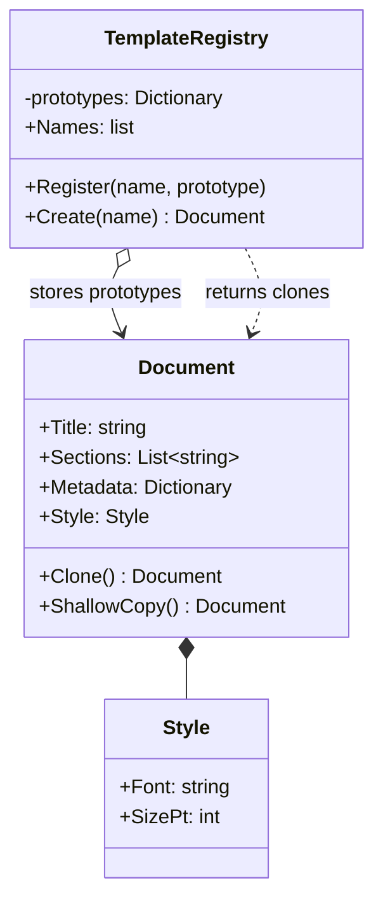

# Prototype

> **Category:** Creational · **Also known as:** Clone
> **Difficulty:** ⭐⭐ Intermediate · **Frequency of use:** Medium

[← Back to the catalog](../../../README.md#the-catalog)

## Intent

Specify the kinds of objects to create using a **prototypical instance**, and create new objects
by **copying (cloning)** that prototype instead of building them from scratch.

## The problem

Your app lets users start a new document from a template: an invoice, a quarterly report... Each
template has a title, a list of sections, metadata and a style. The first version builds every
template by hand wherever it is needed:

```csharp
Document NewInvoice() => new Document(
    "Invoice",
    ["Header", "Line items", "Totals"],
    new() { ["owner"] = "billing", ["status"] = "template" },
    new Style("Helvetica", 10));
```

The setup is duplicated in every place that needs an invoice, templates cannot be defined at
runtime (e.g. loaded from a file or created by an admin), and the client must know every concrete
detail. The obvious fix — "keep one configured invoice and copy it" — hides a trap: copying the
object with a plain assignment or a **shallow copy** shares the sections list, the metadata
dictionary and the style. Editing one user's document silently rewrites the template.

## The solution

Give the object a `Clone()` operation that returns a **deep copy**: a new document whose list,
dictionary and nested `Style` are copies too. Pre-configured prototypes live in a
**prototype registry** (`TemplateRegistry`) under a name; clients ask the registry for
`"invoice"` and get a fresh, independent clone, never the original.



### Participants

| Participant | In our example | Responsibility |
|---|---|---|
| **Prototype** | `Document` (with `Clone()`) | Declares and implements the cloning operation. |
| **Concrete Prototype** | the registered `"invoice"` and `"report"` documents | Pre-configured instances to copy. (GoF uses subclasses; here the variety is in the *data*, which is the common modern case.) |
| **Prototype Registry** | `TemplateRegistry` | Stores named prototypes and returns clones of them. |
| **Client** | `Program` / `main` | Asks the registry for a clone and customizes it. |

## The example: document templates

All four implementations model exactly the same thing and print exactly the same output:

- The registry holds two prototypes, `invoice` and `report` (it stores a clone on `Register`, so
  the caller's object cannot change the template later).
- The client clones `invoice` and fills it in (title, extra section, metadata, style). A fresh
  clone of `invoice` proves the prototype is untouched.
- Identity checks show that a deep clone shares **no** list, dictionary or style with its source.
- A shallow copy shares all three. After editing the copy (title, first section, a metadata entry
  and the font), the original shows every change except the title — strings are immutable values,
  but the collections and the `Style` object were shared by reference.
- Asking for an unknown template (`memo`) is an error.

### Implementations

| Language | Source | Run it (from the repo root) |
|---|---|---|
| C# / .NET 8 | [`csharp/`](csharp/) | `dotnet run --project patterns/creational/prototype/csharp` |
| TypeScript | [`typescript/documents.ts`](typescript/documents.ts), [`main.ts`](typescript/main.ts) | `npx tsx patterns/creational/prototype/typescript/main.ts` |
| React (TSX) | [`typescript/PrototypeDemo.tsx`](typescript/PrototypeDemo.tsx) | `npm run dev` → open the playground |
| Python 3.10+ | [`python/main.py`](python/main.py) | `python3 patterns/creational/prototype/python/main.py` |
| Go 1.23+ | [`go/main.go`](go/main.go) | `go run ./patterns/creational/prototype/go` |

**Tests:** [C# (xUnit)](../../../tests/csharp/DesignPatterns.Tests/Creational/PrototypeTests.cs) · [TypeScript (Vitest)](typescript/documents.test.ts) · [React (Testing Library)](typescript/PrototypeDemo.test.tsx) · [Python (pytest)](python/test_main.py) · [Go (`go test`)](go/main_test.go)

### Expected output

<!-- output: expected_output.txt -->
```text
=== Prototype Pattern: Document templates ===
Registered templates: invoice, report
Clone "invoice" and fill it in:
  Invoice #2026-001 | Georgia 11pt | sections=[Header, Line items, Totals, Notes] | metadata={client=ACME Corp, owner=billing, status=draft}
The "invoice" prototype is untouched:
  Invoice | Helvetica 10pt | sections=[Header, Line items, Totals] | metadata={owner=billing, status=template}
Deep clone shares nothing with its source:
  same sections: false, same metadata: false, same style: false
Shallow copy (what NOT to do):
  same sections: true, same metadata: true, same style: true
  copy:     Draft | Comic Sans 12pt | sections=[Cover page, Findings, Next steps] | metadata={owner=analytics, status=edited}
  original: Quarterly Report | Comic Sans 12pt | sections=[Cover page, Findings, Next steps] | metadata={owner=analytics, status=edited}
  -> only the title stayed independent; every shared reference leaked
Unknown template:
  error: no template named "memo"
```
<!-- /output -->

## Code walkthrough

A deep clone copies every mutable part explicitly; a shallow copy only copies references:

```csharp
public Document Clone() =>
    new(Title, [.. Sections], new Dictionary<string, string>(Metadata), Style with { });

public Document ShallowCopy() => (Document)MemberwiseClone();   // shares list, dictionary and style
```

The registry hands out clones, so nobody can corrupt a template:

```csharp
public void Register(string name, Document prototype) => _prototypes[name] = prototype.Clone();

public Document Create(string name) =>
    _prototypes.TryGetValue(name, out var prototype)
        ? prototype.Clone()
        : throw new KeyNotFoundException($"no template named \"{name}\"");
```

### Language notes

- **C#:** `ICloneable` exists, but its `object Clone()` neither says whether the copy is deep or
  shallow nor is it typed, so the .NET design guidelines recommend **not** implementing it in
  public APIs; a typed `Document Clone()` is clearer. `MemberwiseClone()` is the built-in shallow
  copy. Records give you `with` expressions (`style with { Font = "Georgia" }`), which create a
  copy with changes — but that copy is **shallow** too: a record holding a `List<T>` shares it.
  Immutable types (records with `ImmutableList<T>`) remove the need for deep copies altogether.
- **TypeScript / React:** `structuredClone(value)` deep-copies arrays, `Map`s, `Set`s, dates and
  plain objects, but it returns **plain objects**: class instances lose their prototype (methods)
  and functions cannot be cloned at all. That is why `Document.clone()` is written explicitly.
  Spread (`{ ...obj }`, `[...arr]`) is shallow. In React, state updates rely on *new* objects, so
  copying (usually shallow copies of the changed path) is everyday practice; sharing a nested
  object between two pieces of state is exactly the shallow-copy bug shown here. See
  [`PrototypeDemo.tsx`](typescript/PrototypeDemo.tsx), whose "shallow copy" checkbox makes edits
  leak into the source document.
- **Python:** `copy.copy()` is shallow and `copy.deepcopy()` is deep; classes customize them
  with `__copy__()` and `__deepcopy__(memo)` (the `memo` dict handles shared and cyclic
  references). `dataclasses.replace(obj, field=...)` is the shallow "copy with changes" for
  dataclasses, like C#'s `with`.
- **Go:** Assigning a struct copies its fields, but slices, maps and pointers are *headers* that
  still point at the same data, so `c := *d` is a shallow copy. A deep copy must clone each one
  explicitly: `slices.Clone`, `maps.Clone` (both shallow for their elements) and dereferencing
  the pointer. The demo uses `reflect.Value.Pointer()` to check whether two slices or maps share
  storage.

## When to use it

- Creating an object is **expensive or complex** (many settings, loaded from disk/network,
  computed), and you need many similar ones.
- The kinds of objects to create are decided **at runtime** (templates defined by users, loaded
  from configuration, plug-ins registering prototypes).
- You want to avoid a parallel hierarchy of factories just to produce pre-configured variants.
- You need snapshots/copies of an object's state (undo, "duplicate" commands, what-if edits).

## When NOT to use it

- Objects are cheap to construct and have few settings — call the constructor or a factory.
- Objects hold resources that cannot be duplicated meaningfully (open files, sockets, locks,
  database connections) or have identity that must stay unique.
- The object graph has cycles or shared references and deep copying it correctly would be
  harder than rebuilding it.
- Your data is immutable: you can simply share it, no copy needed.

## Pros and cons

| ✅ Pros | ❌ Cons |
|---|---|
| Clone pre-configured objects without knowing their concrete classes. | Deep cloning complex graphs (cycles, shared children) is tricky. |
| Removes repeated initialization code. | Each class must implement and maintain `Clone()` as fields are added. |
| New "kinds" of objects can be added at runtime by registering prototypes. | Shallow vs. deep copy bugs are subtle and silent. |
| Often cheaper than constructing from scratch. | Language built-ins (`ICloneable`, `structuredClone`) have surprising limits. |

## Real-world usages

- **.NET:** `ICloneable` on `Array`, `string` and `XmlNode` (`XmlNode.CloneNode(deep)`), `List<T>`
  copy constructors, record `with` expressions.
- **JavaScript / React:** JavaScript's object model is literally prototype-based
  (`Object.create(proto)`); `Node.cloneNode(deep)` in the DOM; `React.cloneElement`;
  `structuredClone`.
- **Python:** the `copy` module (`copy.copy`, `copy.deepcopy`) and the `__copy__`/`__deepcopy__`
  hooks; `dict.copy()`, `list.copy()`.
- **Go:** `slices.Clone`, `maps.Clone`, `bytes.Clone`, `(*http.Request).Clone(ctx)`, and
  `(*tls.Config).Clone()`.

## Related patterns

- **[Factory Method](../factory-method/README.md):** creates objects via subclasses; Prototype
  creates them by cloning an instance, avoiding a creator hierarchy.
- **[Abstract Factory](../abstract-factory/README.md):** can store a set of prototypes and clone
  them to produce products of a family.
- **[Builder](../builder/README.md):** builds a complex object step by step; Prototype copies one
  that is already built.
- **[Memento](../../behavioral/memento/README.md):** snapshots are often implemented by cloning
  the originator's state.
- **[Composite](../../structural/composite/README.md) / [Decorator](../../structural/decorator/README.md):**
  designs with many composed objects benefit from cloning whole structures instead of rebuilding them.

## Exercises

1. Add a `Logo` object with a `byte[]`/`bytes`/`Uint8Array` image to `Style`. Update `Clone()`
   in every language. Which language made it easy to forget?
2. Make `Document` immutable (records with `ImmutableList` in C#, frozen dataclasses with tuples in
   Python, `readonly` arrays in TS). Do you still need `Clone()`?
3. Let users save any document as a new template at runtime (`registry.Register("my-invoice", doc)`).
   Why does `Register` itself clone the document?
