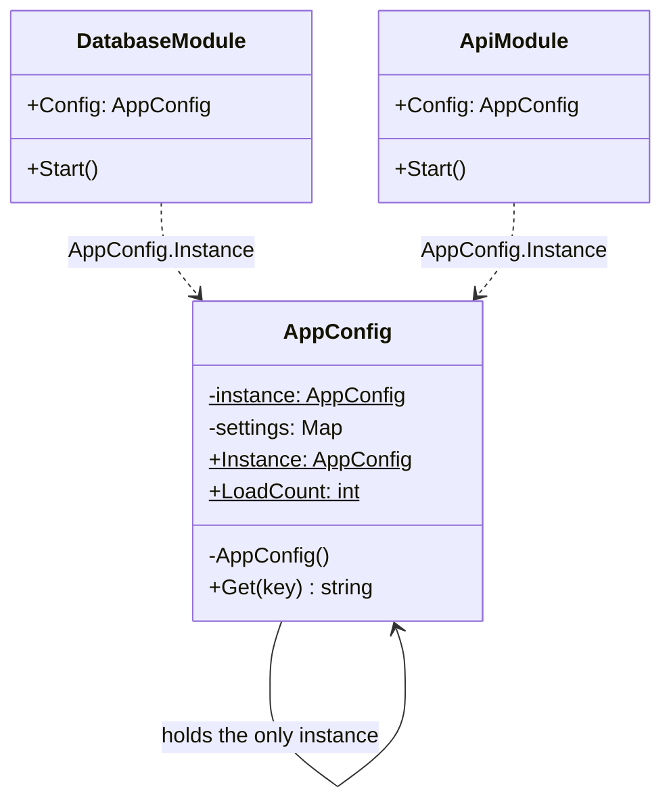

# Singleton

> **Category:** Creational · **Also known as:** —
> **Difficulty:** ⭐ Beginner · **Frequency of use:** High (and frequently overused)

[← Back to the catalog](../../../README.md#the-catalog)

## Intent

Ensure a class has **only one instance**, and provide a **global point of access** to it.

## The problem

Your application reads its configuration (app name, environment, connection limits, timeouts)
from files, environment variables and a secrets vault. Loading it is slow, and every module needs
it. The first version lets each module load its own copy:

```csharp
public class DatabaseModule
{
    private readonly AppConfig _config = AppConfig.LoadFromDisk();   // slow I/O
}

public class ApiModule
{
    private readonly AppConfig _config = AppConfig.LoadFromDisk();   // the same I/O, again
}
```

The configuration is loaded once per module (wasted time), and worse, the copies can **disagree**
if a file changes between two loads. You want exactly one configuration object, created on first
use, and shared by everybody — even when several threads ask for it at the same moment.

## The solution

Make the constructor **private** so nobody else can call `new`, keep the one instance in a
**static** field, and expose a static accessor (`Instance`) that creates it lazily the first
time and returns the same object every time after. Creation must be **thread-safe**: two threads
racing on the first access must not create two instances.



### Participants

| Participant | In our example | Responsibility |
|---|---|---|
| **Singleton** | `AppConfig` | Hides its constructor, stores its only instance and exposes it through a static accessor. |
| **Clients** | `DatabaseModule`, `ApiModule` | Obtain the instance through the accessor instead of creating one. |

## The example: application configuration

All four implementations model exactly the same thing and print exactly the same output:

- `AppConfig` "loads" its settings in its constructor and prints `[config] loading configuration...`
  — this line must appear **exactly once**.
- `DatabaseModule` and `ApiModule` each obtain the configuration on their own and use it to start.
- The demo compares the two references (`same instance: true`) and reads every setting through the
  shared instance with `get(key)`.
- Finally, 8 concurrent workers (tasks / threads / goroutines / async functions) all ask for the
  instance. Their results are collected first and printed afterwards, so the output is
  deterministic: one distinct instance, loaded once.

### Implementations

| Language | Source | Run it (from the repo root) |
|---|---|---|
| C# / .NET 8 | [`csharp/`](csharp/) | `dotnet run --project patterns/creational/singleton/csharp` |
| TypeScript | [`typescript/config.ts`](typescript/config.ts), [`main.ts`](typescript/main.ts) | `npx tsx patterns/creational/singleton/typescript/main.ts` |
| React (TSX) | [`typescript/SingletonDemo.tsx`](typescript/SingletonDemo.tsx) | `npm run dev` → open the playground |
| Python 3.10+ | [`python/main.py`](python/main.py) | `python3 patterns/creational/singleton/python/main.py` |
| Go 1.23+ | [`go/main.go`](go/main.go) | `go run ./patterns/creational/singleton/go` |

### Expected output

<!-- output: expected_output.txt -->
```text
=== Singleton Pattern: Application configuration ===
Booting modules...
[config] loading configuration...
DatabaseModule: opening pool with maxConnections=20 (production)
ApiModule: serving "Shop API" with timeoutSeconds=30
same instance: true
Settings (read through the shared instance):
  appName          = Shop API
  environment      = production
  maxConnections   = 20
  timeoutSeconds   = 30
8 concurrent workers asked for the config...
  distinct instances: 1
  times loaded: 1
```
<!-- /output -->

## Code walkthrough

In C#, `Lazy<T>` does all the hard work. Its default mode
(`LazyThreadSafetyMode.ExecutionAndPublication`) guarantees the factory runs once even under
contention:

```csharp
public sealed class AppConfig
{
    private static readonly Lazy<AppConfig> _instance = new(() => new AppConfig());

    private AppConfig() { /* load settings once */ }

    public static AppConfig Instance => _instance.Value;
    public string Get(string key) => _settings[key];
}
```

Before `Lazy<T>` existed, the classic hand-written version was **double-checked locking** — check,
lock, check again — with a `volatile` field so other threads never see a half-built object:

```csharp
private static volatile AppConfig? _instance;
private static readonly object _lock = new();

public static AppConfig Instance
{
    get
    {
        if (_instance is null)
        {
            lock (_lock)
            {
                _instance ??= new AppConfig();
            }
        }
        return _instance;
    }
}
```

It is easy to get subtly wrong, which is why `Lazy<T>` (or a plain `static readonly` field, which
the CLR initializes thread-safely) is preferred. Go gets the same guarantee from `sync.Once`:

```go
var (
	instance *AppConfig
	once     sync.Once
)

func GetConfig() *AppConfig {
	once.Do(func() { instance = &AppConfig{ /* load settings */ } })
	return instance
}
```

## Singleton is often an anti-pattern

Singleton is the best known GoF pattern and also the most criticized. Use it knowingly:

- **It is global mutable state in disguise.** Any code anywhere can reach `AppConfig.Instance`.
  Dependencies become invisible: `DatabaseModule`'s constructor says nothing about needing
  configuration, yet it cannot work without it. If the singleton holds mutable state, any part of
  the program can change behavior in any other part.
- **It hurts testability.** You cannot give one test a "staging" configuration and another test a
  "production" one; the instance survives between tests and leaks state, and parallel tests fight
  over it. Mocking a static accessor usually requires extra seams.
- **It mixes two responsibilities.** The class does its real job *and* controls its own lifetime.
  "How many instances exist" is a decision about how the application is *wired*, not about what the
  class *is*.
- **It is "one per process", not "one per anything you care about".** One per tenant, per request
  or per test is impossible without rewriting it.

**Prefer letting the composition root own the lifetime.** In modern code you almost always want the
*effect* of a singleton (one shared instance) without the *pattern* (a static accessor):

- **.NET:** register the class in the DI container with
  `builder.Services.AddSingleton<AppConfig>()` (or bind options with
  `builder.Services.Configure<AppOptions>(...)` and inject `IOptions<AppOptions>`). Classes receive
  it through their constructor, the container guarantees a single instance, and tests just pass a
  different object.
- **React:** create the value once at the top of the tree and provide it with **context**
  (`<ConfigContext value={config}>`, read with `useContext`). Components depend on "whatever the tree
  gives me", so tests and Storybook stories can provide another configuration.
- **Python / Go / TypeScript:** create one instance in `main` (or a module) and **pass it as an
  argument** to the code that needs it.

A singleton accessed directly is acceptable for things that are truly global, stateless or
read-only, and cheap to reason about: a logger, a clock abstraction's default, a cache of immutable
data, a hardware handle.

### Language notes

- **C#:** `Lazy<T>` or a `static readonly` field initialized in a static constructor are both
  thread-safe. Mark the class `sealed` so a subclass cannot add a second, public constructor. In
  ASP.NET Core, prefer `AddSingleton` and constructor injection over a static `Instance`.
- **TypeScript / React:** ES modules are evaluated **once** per program and cached, so a
  module-scoped `const config = loadConfig()` *is* a singleton. The example uses a class with a
  `private` constructor and a static getter to make the rule explicit. JavaScript is
  single-threaded, so no locking is needed; async "workers" interleave but never run inside the
  getter at the same time. In React, prefer context; see [`SingletonDemo.tsx`](typescript/SingletonDemo.tsx),
  which shows both. Beware that bundlers can duplicate a module (two copies of a package), giving
  you two "singletons".
- **Python:** the idiomatic singleton is a **module-level instance**: modules are imported once and
  cached in `sys.modules`, so `from config import settings` always returns the same object. The
  example, being a single script, shows the other common idiom: a `SingletonMeta` **metaclass** whose
  `__call__` returns the cached instance, guarded by a `threading.Lock` with a double check.
  Overriding `__new__` also works but `__init__` still runs on every call, a classic pitfall.
  `functools.cache` on a factory function is another lightweight option.
- **Go:** `sync.Once` (or `sync.OnceValue` since Go 1.21) is the standard tool. Go has no private
  constructors; in a real package you unexport the type or its fields so other packages can only
  call `GetConfig()`. Package-level variables initialized in `var` declarations or `init()` are also
  set up exactly once, before `main` runs.

## When to use it

- There must be **exactly one** instance of something for correctness: a hardware device handle, a
  process-wide registry, a connection to a single resource.
- The object is **expensive to create** and safe to share (immutable configuration, caches of
  read-only data).
- You need lazy, thread-safe initialization of a shared resource and you have no DI container (small
  scripts, libraries, CLI tools).

## When NOT to use it

- You only want "one shared instance" — let the **DI container or `main`** decide that and inject
  it.
- The object holds **mutable state** that many parts of the program change.
- You need different instances in tests, per tenant, per request or per user.
- As a convenient way to avoid passing parameters. That is hidden coupling, not a design.

## Pros and cons

| ✅ Pros | ❌ Cons |
|---|---|
| Guarantees a single instance. | Global state: hidden dependencies and action at a distance. |
| Global, convenient access point. | Hard to unit test and to run tests in parallel. |
| Lazy initialization: created only when first needed. | Violates Single Responsibility (does its job *and* manages its lifetime). |
| Saves repeated expensive initialization. | Needs care with multithreading; naive versions are racy. |

## Real-world usages

- **.NET:** `HttpClient` is meant to be shared (often via `IHttpClientFactory`); `ArrayPool<T>.Shared`;
  `StringComparer.Ordinal`; `EqualityComparer<T>.Default`; DI services registered with `AddSingleton`.
- **JavaScript / React:** any ES module-scoped object (an API client, a store created with Redux Toolkit's
  `configureStore` and exported from a module); React context used to share one instance down the tree.
- **Python:** modules themselves; `None`, `True`/`False` and `Ellipsis` are singleton objects; the
  root logger returned by `logging.getLogger()`.
- **Go:** `http.DefaultClient`, `http.DefaultServeMux`, the default logger behind `log.Println`;
  `sync.Once` / `sync.OnceValue` for lazy package-level setup.

## Related patterns

- **[Abstract Factory](../abstract-factory/README.md), [Builder](../builder/README.md),
  [Prototype](../prototype/README.md):** their factories/registries are often implemented as singletons.
- **[Facade](../../structural/facade/README.md):** usually only one facade object is needed, so it is
  often a singleton.
- **[Flyweight](../../structural/flyweight/README.md):** looks similar (shared instances), but a
  flyweight factory manages *many* shared instances keyed by intrinsic state; a singleton has exactly one.
- **[State](../../behavioral/state/README.md):** stateless state objects are frequently singletons.

## Exercises

1. Remove the static accessor: create the configuration once in `Program`/`main` and pass it to the
   modules through their constructors. What did you gain for testing? What did you lose?
2. In C#, replace `Lazy<T>` with your own double-checked locking. Then remove the inner check and
   explain which interleaving of two threads would load the configuration twice.
3. Turn `AppConfig` into a module-level instance in Python (`config.py`) and import it from two
   other files. How many times does `[config] loading configuration...` print, and why?
