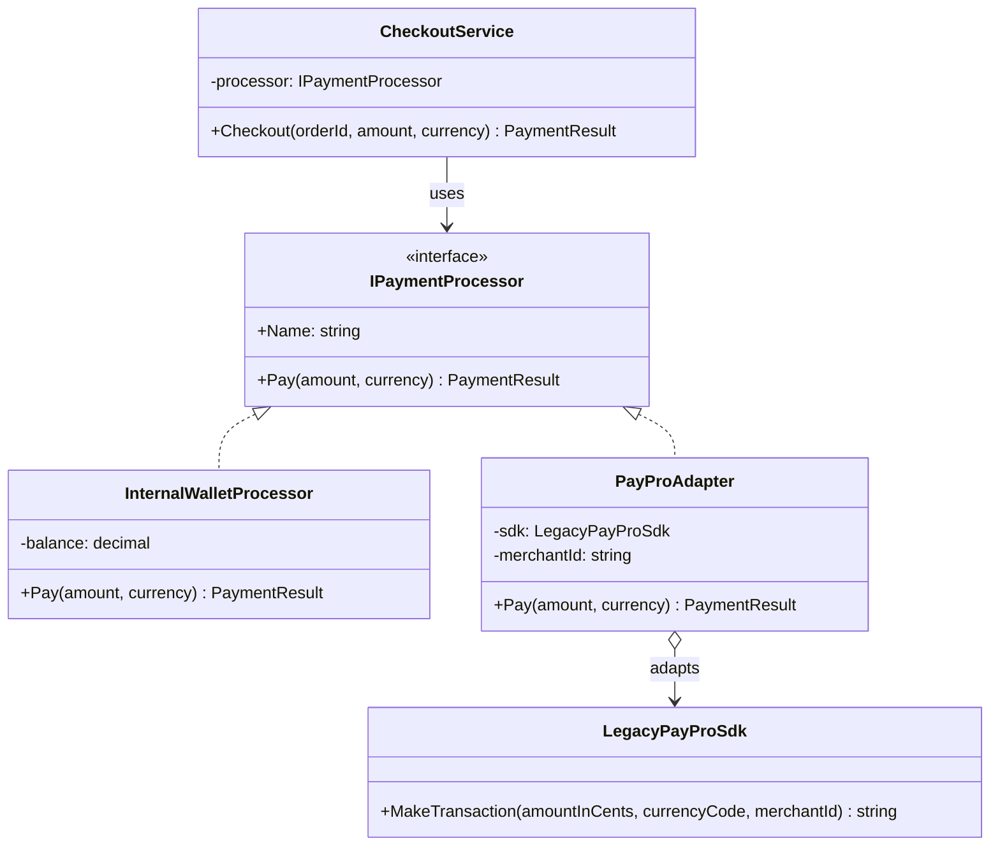

# Adapter

> **Category:** Structural · **Also known as:** Wrapper
> **Difficulty:** ⭐ Beginner · **Frequency of use:** Very high

[← Back to the catalog](../../../README.md#the-catalog)

## Intent

Convert the interface of a class into another interface that clients expect. Adapter lets classes
work together that could not otherwise because of **incompatible interfaces**.

## The problem

Your shop's checkout talks to payment processors through its own interface:
`Pay(amount, currency)` with decimal amounts, returning a `PaymentResult`. Now the business signs
a deal with **PayPro**, whose SDK you cannot modify. It speaks a completely different language:
amounts in integer **cents**, a **merchant id** on every call, and a `"code|reference"` **string**
as the response. The quick fix is to teach the checkout about PayPro:

```csharp
PaymentResult Checkout(Order order, string gateway)
{
    if (gateway == "wallet") return _wallet.Pay(order.Total, order.Currency);
    if (gateway == "paypro")
    {
        var cents = (int)Math.Round(order.Total * 100);
        var raw = _payProSdk.MakeTransaction(cents, order.Currency, "MERCHANT-42");
        var parts = raw.Split('|');
        return parts[0] == "00" ? new(true, parts[1], "Approved") : new(false, null, "Declined");
    }
    throw new ArgumentException(gateway);
}
```

Vendor details (cents, merchant ids, status codes) now leak into your business logic. Every new
gateway adds another branch, the conversion code gets copy-pasted wherever a payment happens, and
swapping vendors means touching the checkout. Your domain is coupled to someone else's API.

## The solution

Write an **adapter**: a small class that implements the interface your application expects (the
**target**) and internally calls the incompatible class (the **adaptee**), translating requests
and responses in both directions. The checkout keeps depending only on `IPaymentProcessor`; the
vendor's quirks are confined to one class.



### Participants

| Participant | In our example | Responsibility |
|---|---|---|
| **Target** | `IPaymentProcessor` | The interface the client is written against. |
| **Adaptee** | `LegacyPayProSdk` | Existing class with a useful but incompatible interface; cannot be changed. |
| **Adapter** | `PayProAdapter` | Implements the Target by translating calls to the Adaptee (and results back). |
| **Client** | `CheckoutService` | Collaborates with objects through the Target interface only. |
| *(native Target)* | `InternalWalletProcessor` | Already implements the Target; shows that adapted and native objects are interchangeable. |

### Class adapter vs object adapter

- **Object adapter** (used here): the adapter **holds a reference** to the adaptee (composition)
  and implements the target. It works with any subclass of the adaptee, can adapt objects created
  elsewhere, and is the only option in languages without multiple inheritance of implementation
  (C#, TypeScript, Go). Prefer it.
- **Class adapter:** the adapter **inherits** from the adaptee *and* implements the target
  (`class PayProAdapter : LegacyPayProSdk, IPaymentProcessor` in C#, or multiple inheritance in
  Python/C++). No extra object, and it can override adaptee behavior, but it is tied to one concrete
  class, exposes the adaptee's whole public API through the adapter, and does not work if the
  adaptee is `sealed`/final.

## The example: payment gateway integration

All four implementations model exactly the same thing and print exactly the same output:

- `InternalWalletProcessor` starts with a 100.00 balance and implements the target natively.
- `LegacyPayProSdk.makeTransaction(amountInCents, currencyCode, merchantId)` only supports `USD`
  and `EUR`, rejects amounts above 500.00, and answers `"00|PP-000001"` (approved), `"14|"`
  (unsupported currency) or `"51|"` (over the limit).
- `PayProAdapter` converts dollars to cents, injects the merchant id, parses the response string and
  maps each status code to a `PaymentResult` with a human-readable message.
- The very same `CheckoutService` code processes two orders with the wallet and three with PayPro
  (approved, unsupported currency, over the limit).

### Implementations

| Language | Source | Run it (from the repo root) |
|---|---|---|
| C# / .NET 8 | [`csharp/`](csharp/) | `dotnet run --project patterns/structural/adapter/csharp` |
| TypeScript | [`typescript/payments.ts`](typescript/payments.ts), [`main.ts`](typescript/main.ts) | `npx tsx patterns/structural/adapter/typescript/main.ts` |
| React (TSX) | [`typescript/AdapterDemo.tsx`](typescript/AdapterDemo.tsx) | `npm run dev` → open the playground |
| Python 3.10+ | [`python/main.py`](python/main.py) | `python3 patterns/structural/adapter/python/main.py` |
| Go 1.23+ | [`go/main.go`](go/main.go) | `go run ./patterns/structural/adapter/go` |

**Tests:** [C# (xUnit)](../../../tests/csharp/DesignPatterns.Tests/Structural/AdapterTests.cs) · [TypeScript (Vitest)](typescript/payments.test.ts) · [React (Testing Library)](typescript/AdapterDemo.test.tsx) · [Python (pytest)](python/test_main.py) · [Go (`go test`)](go/main_test.go)

### Expected output

<!-- output: expected_output.txt -->
```text
=== Adapter Pattern: Payment gateway integration ===
Checkout with Internal wallet
  Order A-1001: 49.99 USD
    [wallet] debit 49.99 USD (balance 100.00 -> 50.01)
    result: success=true, id=WAL-0001, message=Paid from wallet
  Order A-1002: 75.00 USD
    [wallet] insufficient balance: 50.01 < 75.00
    result: success=false, id=-, message=Insufficient wallet balance
Checkout with PayPro (adapted)
  Order A-1003: 49.99 USD
    [adapter] 49.99 USD -> 4999 cents, merchant MERCHANT-42
    [paypro-sdk] makeTransaction(4999, "USD", "MERCHANT-42") -> "00|PP-000001"
    result: success=true, id=PP-000001, message=Approved
  Order A-1004: 19.50 GBP
    [adapter] 19.50 GBP -> 1950 cents, merchant MERCHANT-42
    [paypro-sdk] makeTransaction(1950, "GBP", "MERCHANT-42") -> "14|"
    result: success=false, id=-, message=Currency not supported by PayPro
  Order A-1005: 750.00 USD
    [adapter] 750.00 USD -> 75000 cents, merchant MERCHANT-42
    [paypro-sdk] makeTransaction(75000, "USD", "MERCHANT-42") -> "51|"
    result: success=false, id=-, message=Declined: amount over limit
```
<!-- /output -->

## Code walkthrough

The adapter implements the target and wraps the adaptee. All the translation lives here:

```csharp
public sealed class PayProAdapter(LegacyPayProSdk sdk, string merchantId) : IPaymentProcessor
{
    public string Name => "PayPro (adapted)";

    public PaymentResult Pay(decimal amount, string currency)
    {
        var cents = (int)Math.Round(amount * 100m, MidpointRounding.AwayFromZero);   // request in
        var parts = sdk.MakeTransaction(cents, currency, merchantId).Split('|');
        var (code, reference) = (parts[0], parts[1]);

        return code switch                                                           // response out
        {
            "00" => new PaymentResult(true, reference, "Approved"),
            "14" => new PaymentResult(false, null, "Currency not supported by PayPro"),
            "51" => new PaymentResult(false, null, "Declined: amount over limit"),
            _ => new PaymentResult(false, null, $"Unknown PayPro status {code}"),
        };
    }
}
```

The client cannot tell a native processor from an adapted one:

```csharp
IPaymentProcessor wallet = new InternalWalletProcessor(100.00m);
IPaymentProcessor payPro = new PayProAdapter(new LegacyPayProSdk(), "MERCHANT-42");

new CheckoutService(wallet).Checkout("A-1001", 49.99m, "USD");
new CheckoutService(payPro).Checkout("A-1003", 49.99m, "USD");
```

### Language notes

- **C#:** object adapters with primary constructors are one-liners to wire up. Register the adapter
  in DI (`services.AddSingleton<IPaymentProcessor, PayProAdapter>()`) and the rest of the app never
  sees the SDK. A class adapter is possible only when the adaptee is not `sealed`
  (`class PayProAdapter : LegacyPayProSdk, IPaymentProcessor`).
- **TypeScript / React:** thanks to structural typing, any object with `name` and `pay` *is* a
  `PaymentProcessor`, so an adapter can even be an object literal or a function returning one. In
  React, adapters are common at the edges: wrapping a non-React widget or a callback-based SDK in a
  component or custom hook so the rest of the UI sees a React-friendly API. See
  [`AdapterDemo.tsx`](typescript/AdapterDemo.tsx).
- **Python:** the `Protocol` target means the adapter needs no base class. Because Python supports
  multiple inheritance, a class adapter (`class PayProAdapter(LegacyPayProSdk)`) is easy too, but
  the object adapter keeps the SDK's camelCase API from leaking into your codebase.
- **Go:** implicit interfaces make adapters especially light: a struct that holds the adaptee and
  has the right methods is enough. For single-method interfaces Go often uses a **function adapter**,
  such as `http.HandlerFunc`, which turns any `func(w, r)` into an `http.Handler`. Go has no decimal
  type, so the target takes `float64` dollars and implementations convert to `int64` cents right away.

## When to use it

- You want to use an existing class (third-party SDK, legacy module, generated client) whose
  interface does not match the one your code needs.
- You want to **isolate your domain from a vendor API** so the vendor can be replaced without
  touching business code (the "anti-corruption layer" of Domain-Driven Design).
- Several existing classes do similar things with different interfaces, and you want to use them
  interchangeably behind one interface.
- You need to make old code fit a new interface without modifying it (and its tests).

## When NOT to use it

- You control both sides: just change one of the interfaces instead of adding a translation layer.
- The interfaces differ so much in **semantics** (not just shape) that the adapter would have to
  invent behavior. That is a bigger integration problem, maybe a [Facade](../facade/README.md) or a
  dedicated service.
- You would only use the adapted class in one place and the conversion is a single line.

## Pros and cons

| ✅ Pros | ❌ Cons |
|---|---|
| Single Responsibility: conversion code lives in one place. | One more class (and indirection) per adaptee. |
| Open/Closed: new gateways via new adapters, no client changes. | Translation may be lossy (e.g. error details reduced to a message). |
| Shields the domain from vendor APIs and upgrades. | Hides performance costs of the conversion. |
| Native and adapted implementations are interchangeable and easy to fake in tests. | Over-applied, it creates wrappers around wrappers. |

## Real-world usages

- **.NET:** `StreamReader`/`StreamWriter` adapt a byte `Stream` to a text reader/writer;
  `Task.Factory.FromAsync` adapts the old Begin/End async pattern to `Task`; ADO.NET's
  `DbDataAdapter` (the name says it).
- **JavaScript / React:** Node's `util.promisify` adapts callback-style functions to promises;
  `Readable.fromWeb`/`Readable.toWeb` convert between Node and web streams; React wrapper
  components around non-React libraries (maps, charts, editors).
- **Python:** `io.TextIOWrapper` adapts a binary stream to a text stream; `csv.reader` accepts any
  iterable of lines; `socket.makefile()` gives a socket a file-like interface.
- **Go:** `http.HandlerFunc` adapts a function to the `http.Handler` interface; `bufio.NewReader`
  wraps any `io.Reader`; `strings.NewReader` and `bytes.NewReader` adapt a string/byte slice to
  `io.Reader`.

## Related patterns

- **[Bridge](../bridge/README.md):** similar structure, different timing. Bridge is designed up front
  so abstraction and implementation can vary independently; Adapter retrofits incompatible classes
  after the fact.
- **[Decorator](../decorator/README.md):** keeps the same interface and adds behavior; Adapter changes
  the interface.
- **[Proxy](../proxy/README.md):** keeps the same interface and controls access; Adapter changes the
  interface.
- **[Facade](../facade/README.md):** defines a *new, simpler* interface over a whole subsystem; Adapter
  makes one existing interface usable through another existing one.

## Exercises

1. Add a `StripeLikeSdk` with yet another API (e.g. `charge({ amount_minor, currency })` that throws
   exceptions on failure) and write its adapter. Did `CheckoutService` change?
2. Write the class-adapter version of `PayProAdapter` in C# or Python. What does the adapter now
   expose that it should not?
3. PayPro's codes are lossy. Extend `PaymentResult` with an `ErrorCode` enum in *your* vocabulary and
   map PayPro's codes to it inside the adapter.
