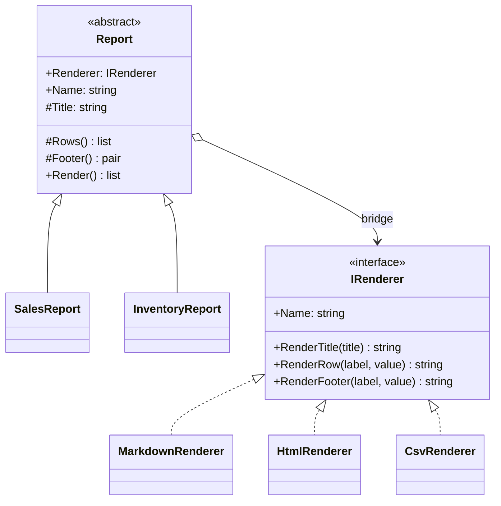

# Bridge

> **Category:** Structural · **Also known as:** Handle/Body
> **Difficulty:** ⭐⭐ Intermediate · **Frequency of use:** Medium

[← Back to the catalog](../../../README.md#the-catalog)

## Intent

**Decouple an abstraction from its implementation** so that the two can vary independently.
Instead of one inheritance tree that mixes two concerns, build two trees and connect them with a
reference (the "bridge").

## The problem

Your back office produces reports: a **sales** report and an **inventory** report. Each one must be
exported as **Markdown**, **HTML** and **CSV**. The first design uses inheritance for everything:

```csharp
abstract class Report { public abstract string Render(); }

class SalesMarkdownReport : Report { /* sales data + Markdown syntax */ }
class SalesHtmlReport : Report { /* sales data + HTML syntax */ }
class SalesCsvReport : Report { /* sales data + CSV syntax */ }
class InventoryMarkdownReport : Report { /* inventory data + Markdown syntax (again) */ }
class InventoryHtmlReport : Report { /* inventory data + HTML syntax (again) */ }
class InventoryCsvReport : Report { /* inventory data + CSV syntax (again) */ }
```

This is a **class explosion**: the number of classes is *reports × formats*. Today that is 2 × 3 = 6.
Add a JSON format and a customers report and it becomes 3 × 4 = 12; every new format must be written
once per report, and every new report once per format. The HTML escaping rules are copy-pasted into
every `*HtmlReport`, so a bug fixed in one survives in the others. Two independent dimensions of
change have been welded into one hierarchy.

## The solution

Split the two dimensions into **two hierarchies**:

- the **abstraction** (`Report` → `SalesReport`, `InventoryReport`): *what* to show — title, rows,
  footer;
- the **implementor** (`IRenderer` → `MarkdownRenderer`, `HtmlRenderer`, `CsvRenderer`): *how* to
  draw primitive pieces — a title, a row, a footer.

The abstraction **holds a reference** to an implementor and builds its high-level operation
(`Render()`) only from the implementor's primitives. Now the class count is *reports + formats*
(2 + 3 = 5, and 3 + 4 = 7 instead of 12), and any report can be combined with any renderer, even
switched at runtime.



### Participants

| Participant | In our example | Responsibility |
|---|---|---|
| **Abstraction** | `Report` | Defines the high-level interface (`Render`) and keeps a reference to an implementor. |
| **Refined Abstraction** | `SalesReport`, `InventoryReport` | Variants of the abstraction; supply the content. |
| **Implementor** | `IRenderer` | Interface for the low-level primitives (`RenderTitle`, `RenderRow`, `RenderFooter`). |
| **Concrete Implementor** | `MarkdownRenderer`, `HtmlRenderer`, `CsvRenderer` | One output format each. |
| **Client** | `Program` / `main` | Combines any abstraction with any implementor. |

## The example: reports × renderers

All four implementations model exactly the same thing and print exactly the same output:

- `SalesReport` lists revenue for three regions and a total (amounts with 2 decimals).
- `InventoryReport` lists units in stock for two products and the total units.
- `MarkdownRenderer`, `HtmlRenderer` and `CsvRenderer` know nothing about sales or inventory; they
  only know how to format a title, a `label/value` row and a footer.
- The client creates each report **once** and swaps its renderer at runtime, printing all
  6 combinations from 5 classes.

### Implementations

| Language | Source | Run it (from the repo root) |
|---|---|---|
| C# / .NET 8 | [`csharp/`](csharp/) | `dotnet run --project patterns/structural/bridge/csharp` |
| TypeScript | [`typescript/reports.ts`](typescript/reports.ts), [`main.ts`](typescript/main.ts) | `npx tsx patterns/structural/bridge/typescript/main.ts` |
| React (TSX) | [`typescript/BridgeDemo.tsx`](typescript/BridgeDemo.tsx) | `npm run dev` → open the playground |
| Python 3.10+ | [`python/main.py`](python/main.py) | `python3 patterns/structural/bridge/python/main.py` |
| Go 1.23+ | [`go/`](go/) | `go run ./patterns/structural/bridge/go` |

### Expected output

```text
=== Bridge Pattern: Reports x renderers ===
--- Sales report as Markdown ---
# Sales by region
- **North**: 12500.00
- **South**: 8300.50
- **West**: 10199.50
**Total: 31000.00**
--- Sales report as HTML ---
<h1>Sales by region</h1>
<p><strong>North:</strong> 12500.00</p>
<p><strong>South:</strong> 8300.50</p>
<p><strong>West:</strong> 10199.50</p>
<footer>Total: 31000.00</footer>
--- Sales report as CSV ---
report,Sales by region
North,12500.00
South,8300.50
West,10199.50
Total,31000.00
--- Inventory report as Markdown ---
# Inventory status
- **Keyboards**: 42 units
- **Monitors**: 7 units
**Total units: 49**
--- Inventory report as HTML ---
<h1>Inventory status</h1>
<p><strong>Keyboards:</strong> 42 units</p>
<p><strong>Monitors:</strong> 7 units</p>
<footer>Total units: 49</footer>
--- Inventory report as CSV ---
report,Inventory status
Keyboards,42 units
Monitors,7 units
Total units,49
2 reports x 3 renderers = 6 combinations from 5 classes (inheritance alone would need 6)
```

## Code walkthrough

The abstraction owns the bridge and expresses its algorithm only through implementor primitives:

```csharp
public abstract class Report(IRenderer renderer)
{
    public IRenderer Renderer { get; set; } = renderer;   // the bridge

    protected abstract string Title { get; }
    protected abstract IEnumerable<(string Label, string Value)> Rows();
    protected abstract (string Label, string Value) Footer();

    public IReadOnlyList<string> Render()
    {
        var lines = new List<string> { Renderer.RenderTitle(Title) };
        lines.AddRange(Rows().Select(row => Renderer.RenderRow(row.Label, row.Value)));
        var (label, value) = Footer();
        lines.Add(Renderer.RenderFooter(label, value));
        return lines;
    }
}
```

A refined abstraction only supplies content; a concrete implementor only supplies syntax:

```csharp
public sealed class InventoryReport(IRenderer renderer, IReadOnlyList<(string Product, int Units)> stock)
    : Report(renderer)
{
    protected override string Title => "Inventory status";
    protected override IEnumerable<(string Label, string Value)> Rows() =>
        stock.Select(s => (s.Product, $"{s.Units} units"));
    // ...
}

public sealed class HtmlRenderer : IRenderer
{
    public string RenderRow(string label, string value) => $"<p><strong>{label}:</strong> {value}</p>";
    // ...
}
```

The client connects the two halves, and can reconnect them at any time:

```csharp
var report = new SalesReport(new MarkdownRenderer(), sales);
report.Renderer = new CsvRenderer();   // same report, different implementation
```

### Language notes

- **C#:** the abstraction is an `abstract class` with a primary constructor receiving the
  implementor interface. In real applications the implementor is typically injected by the DI
  container, which is where the "pick the implementation" decision belongs.
- **TypeScript / React:** `abstract class` plus `protected abstract` members express the
  abstraction; renderers are plain classes (they could be object literals thanks to structural
  typing). In React the bridge often appears as a component that receives its "implementation" as a
  prop: a chart component with a pluggable rendering backend, or a list with a `renderItem` prop. See
  [`BridgeDemo.tsx`](typescript/BridgeDemo.tsx).
- **Python:** `ABC` for the abstraction (it has real shared behavior in `render`) and `Protocol` for
  the implementor (any object with the right methods is a renderer, no inheritance needed).
- **Go:** there is no inheritance, so the shared part of the abstraction lives in a `reportBase`
  struct that holds the `Renderer` and is **embedded** in `SalesReport` and `InventoryReport`. The
  implementors live in their own file, [`renderers.go`](go/renderers.go), to emphasize that they are
  a separate hierarchy.

## When to use it

- A class varies along **two (or more) independent dimensions** — e.g. shape × rendering API,
  report × format, notification × channel, remote control × device — and inheritance would multiply
  classes.
- You want to **switch implementations at runtime** (or per configuration) without touching the
  abstraction.
- You want to hide platform-specific implementation details from clients (UI toolkit backends,
  database drivers, graphics APIs).
- Both the abstraction and the implementation should be extensible by subclassing, independently.

## When NOT to use it

- There is only **one dimension** of variation: a plain interface (or a [Strategy](../../behavioral/strategy/README.md)) is enough.
- There is only one implementation and no realistic prospect of another: the extra indirection is
  speculative.
- The "implementor" interface cannot be made generic: if each abstraction needs special primitives
  from each implementor, the two hierarchies are not really independent.

## Pros and cons

| ✅ Pros | ❌ Cons |
|---|---|
| Avoids class explosion: *M + N* classes instead of *M × N*. | More indirection; harder to follow for small problems. |
| Abstraction and implementation evolve and are tested independently. | Designing a good implementor interface up front is hard. |
| Implementations can be swapped at runtime. | The implementor interface is a lowest common denominator across formats/platforms. |
| Open/Closed in both dimensions; clients see only the abstraction. | Overkill when one of the dimensions never actually varies. |

## Real-world usages

- **.NET:** `ILogger` (the abstraction your code uses) with pluggable `ILoggerProvider`s (console,
  debug, event log) behind it; ADO.NET code written against `DbConnection`/`DbCommand` with
  provider-specific implementations underneath.
- **JavaScript / React:** React itself: components describe *what* to render, while separate
  renderers (`react-dom`, `react-native`, `react-three-fiber`) decide *how*; all use the same
  reconciler.
- **Python:** the `logging` module separates `Logger` (what to log) from `Handler` (where/how to emit)
  and `Formatter`; DB-API 2.0 lets code written against connections/cursors run on many drivers.
- **Go:** `database/sql` (the abstraction) and `database/sql/driver` (the implementor interface
  that each database driver implements); `log/slog`'s `Logger` with interchangeable `slog.Handler`
  implementations (`TextHandler`, `JSONHandler`).

## Related patterns

- **[Adapter](../adapter/README.md):** structurally similar, but Adapter makes *existing*
  incompatible classes work together after the fact, while Bridge is designed *up front* to keep two
  dimensions apart.
- **[Strategy](../../behavioral/strategy/README.md):** the implementor looks like a strategy. The
  difference is intent: Bridge separates a whole parallel hierarchy of implementations from a
  hierarchy of abstractions; Strategy swaps one algorithm in one context.
- **[Abstract Factory](../../creational/abstract-factory/README.md):** can create and configure the
  right implementor (e.g. the right renderer family for a platform).
- **[Template Method](../../behavioral/template-method/README.md):** `Report.Render` is a template
  method whose steps are supplied by subclasses and drawn by the implementor.

## Exercises

1. Add a `JsonRenderer`. How many classes did you touch? Compare with the inheritance-only design.
2. Add a `CustomersReport` (top customers by revenue). Which renderer needed changes?
3. The HTML renderer does not escape `<` or `&` in labels. Fix it. Why is there exactly one place to
   fix in the Bridge design, but one per report (`SalesHtmlReport`, `InventoryHtmlReport`, ...) in the
   class-explosion design?
