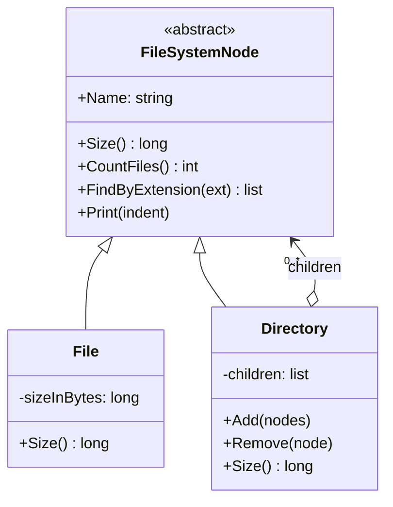

# Composite

> **Category:** Structural · **Also known as:** Object tree
> **Difficulty:** ⭐⭐ Intermediate · **Frequency of use:** High

[← Back to the catalog](../../../README.md#the-catalog)

## Intent

Compose objects into **tree structures** to represent part-whole hierarchies. Composite lets
clients treat **individual objects and compositions of objects uniformly**.

## The problem

You are writing a tool that reports disk usage for a project folder. A folder contains files, but
also other folders, which contain more files and folders, to any depth. Without a common
abstraction, every operation needs to know which kind of thing it is looking at:

```csharp
long TotalSize(object item)
{
    if (item is FileEntry file) return file.Bytes;
    if (item is FolderEntry folder)
    {
        long total = 0;
        foreach (var f in folder.Files) total += f.Bytes;
        foreach (var sub in folder.Folders) total += TotalSize(sub);
        return total;
    }
    throw new ArgumentException("Unknown item");
}
```

Now write the same type-checking recursion again for "count files", again for "find by
extension", again for "print the tree"... Every client re-implements the traversal, every new node
type (a symlink, a zip archive) breaks all of them, and folders need two separate child lists.

## The solution

Give files and directories a **common interface** (`FileSystemNode`) with the operations clients
need: `Size()`, `CountFiles()`, `FindByExtension()`, `Print()`. A **leaf** (`File`) answers
directly. A **composite** (`Directory`) holds a list of `FileSystemNode` children — files *or*
directories — and answers by **delegating to its children and combining the results**. Recursion
falls out naturally, and clients never check types.



### Participants

| Participant | In our example | Responsibility |
|---|---|---|
| **Component** | `FileSystemNode` | Common interface for all objects in the tree. |
| **Leaf** | `File` | Has no children; implements the operations directly. |
| **Composite** | `Directory` | Stores children, implements child management (`Add`, `Remove`) and implements operations by delegating to children. |
| **Client** | `Program` / `main` | Works with every node through the Component interface. |

### Transparency vs safety

Where do `Add`/`Remove` live? GoF discusses two options:

- **Safety** (used here): child management lives only in `Directory`. Calling `Add` on a `File` is a
  compile-time error, but clients that build trees must know they hold a `Directory`.
- **Transparency:** `Add`/`Remove` are declared on the component so all nodes look identical; a leaf
  then throws or ignores the call at runtime.

## The example: file system

All four implementations model exactly the same thing and print exactly the same output:

- A `project/` tree with 8 files in 4 directories (`src/components/` is nested two levels deep).
- `project.Print()` prints the whole tree with sizes; each directory's size is the sum of its
  children, computed recursively on demand.
- `Size()`, `CountFiles()` and `FindByExtension(".ts")` / `(".tsx")` are called on the root, and
  then on a single file and on a folder with **the same code**.
- Finally `assets/` is removed and the tree and totals are printed again.

### Implementations

| Language | Source | Run it (from the repo root) |
|---|---|---|
| C# / .NET 8 | [`csharp/`](csharp/) | `dotnet run --project patterns/structural/composite/csharp` |
| TypeScript | [`typescript/fileSystem.ts`](typescript/fileSystem.ts), [`main.ts`](typescript/main.ts) | `npx tsx patterns/structural/composite/typescript/main.ts` |
| React (TSX) | [`typescript/CompositeDemo.tsx`](typescript/CompositeDemo.tsx) | `npm run dev` → open the playground |
| Python 3.10+ | [`python/main.py`](python/main.py) | `python3 patterns/structural/composite/python/main.py` |
| Go 1.23+ | [`go/main.go`](go/main.go) | `go run ./patterns/structural/composite/go` |

**Tests:** [C# (xUnit)](../../../tests/csharp/DesignPatterns.Tests/Structural/CompositeTests.cs) · [TypeScript (Vitest)](typescript/fileSystem.test.ts) · [React (Testing Library)](typescript/CompositeDemo.test.tsx) · [Python (pytest)](python/test_main.py) · [Go (`go test`)](go/main_test.go)

### Expected output

<!-- output: expected_output.txt -->
```text
=== Composite Pattern: File system ===
project/ (12860 bytes)
  README.md (1200 bytes)
  package.json (800 bytes)
  src/ (5100 bytes)
    index.ts (300 bytes)
    app.ts (2400 bytes)
    components/ (2400 bytes)
      Header.tsx (1500 bytes)
      Footer.tsx (900 bytes)
  assets/ (5760 bytes)
    logo.png (5120 bytes)
    styles.css (640 bytes)
Total size: 12860 bytes
Files: 8
Find *.ts: index.ts, app.ts
Find *.tsx: Header.tsx, Footer.tsx
The same calls work on a leaf and on a folder:
  app.ts           -> 2400 bytes, 1 file(s)
  src              -> 5100 bytes, 4 file(s)
Removing assets/ from project/...
project/ (7100 bytes)
  README.md (1200 bytes)
  package.json (800 bytes)
  src/ (5100 bytes)
    index.ts (300 bytes)
    app.ts (2400 bytes)
    components/ (2400 bytes)
      Header.tsx (1500 bytes)
      Footer.tsx (900 bytes)
Total size: 7100 bytes, files: 6
```
<!-- /output -->

## Code walkthrough

The leaf answers directly; the composite delegates to its children and combines their answers:

```csharp
public sealed class File(string name, long sizeInBytes) : FileSystemNode(name)
{
    public override long Size() => sizeInBytes;
    public override int CountFiles() => 1;
}

public sealed class Directory(string name) : FileSystemNode(name)
{
    private readonly List<FileSystemNode> _children = [];

    public override long Size() => _children.Sum(child => child.Size());
    public override int CountFiles() => _children.Sum(child => child.CountFiles());
    public override IEnumerable<string> FindByExtension(string extension) =>
        _children.SelectMany(child => child.FindByExtension(extension));
}
```

The client does not care what it is holding:

```csharp
foreach (var node in new FileSystemNode[] { appTs, src })
    Console.WriteLine($"{node.Name} -> {node.Size()} bytes, {node.CountFiles()} file(s)");
```

### Language notes

- **C#:** an `abstract class` component with primary constructors keeps the leaf and composite tiny;
  LINQ's `Sum` and `SelectMany` express "combine the children" directly. Note the `using` aliases in
  `Program.cs`: `File` and `Directory` clash with `System.IO` types brought in by implicit usings.
- **TypeScript / React:** React's component tree *is* a composite: a component renders either
  host elements (leaves) or other components (composites), and `children` can be one node or many.
  The demo's `TreeNode` is a **recursive component** that renders itself for each child, exactly
  like `Directory.size()` calls `size()` on each child. See [`CompositeDemo.tsx`](typescript/CompositeDemo.tsx).
  In the core, `print()` returns lines instead of logging, so both the console and React can use it.
- **Python:** `ABC` with `@abstractmethod` defines the component; generator expressions make
  aggregation one-liners (`sum(child.size() for child in self._children)`). The method is named
  `print` to match the other languages; inside methods, `print(...)` still resolves to the builtin
  because class attributes are not in a method's lookup scope.
- **Go:** the component is a small interface, and both `*File` and `*Directory` satisfy it
  implicitly. `Directory.Remove` uses `slices.DeleteFunc` and compares interface values, which
  compare by pointer identity here. Go's own `io/fs` package models a file system with interfaces
  (`fs.FS`, `fs.DirEntry`) and `fs.WalkDir` for uniform traversal.

## When to use it

- You need to represent a **part-whole hierarchy** of arbitrary depth: file systems, UI widget
  trees, organization charts, menus and submenus, bills of materials, scene graphs, ASTs.
- You want clients to **ignore the difference** between single objects and groups of objects.
- Operations naturally **aggregate over children** (sizes, totals, prices, rendering, validation).

## When NOT to use it

- The structure is flat or has a fixed, shallow depth: a list or a two-level model is simpler.
- Leaves and composites have very **different interfaces**; forcing them into one creates many
  "not supported" methods.
- You need strong constraints on what can contain what (e.g. "an order line may not contain an
  order"); a uniform component interface makes such rules harder to enforce in the type system.

## Pros and cons

| ✅ Pros | ❌ Cons |
|---|---|
| Clients treat leaves and trees uniformly; no type checks. | The common interface can become too general. |
| Recursive operations are simple and local to each node class. | Hard to restrict which components a composite may contain. |
| Open/Closed: new node types plug in without changing clients. | Recomputing aggregates on deep trees can be costly (consider caching). |
| Natural fit for recursive UIs and data structures. | Transparency vs safety trade-off for child management. |

## Real-world usages

- **.NET:** WPF/WinUI visual and logical trees (`Panel` contains `UIElement`s, and a panel is a
  `UIElement`); `System.Linq.Expressions.Expression` trees; `IConfiguration` sections that contain
  other sections; `System.IO.DirectoryInfo`/`FileInfo` sharing the `FileSystemInfo` base class.
- **JavaScript / React:** the DOM (`Node` with `childNodes`, where an element and a text node share
  the `Node` interface); React element trees and `props.children`; recursive tree components.
- **Python:** `ast.AST` nodes; `xml.etree.ElementTree.Element` (an element contains elements);
  `pathlib.Path` treating files and directories through one type with `iterdir()`/`rglob()`.
- **Go:** `io/fs` with `fs.WalkDir`; `html.Node` in `golang.org/x/net/html` (first/next sibling
  tree); `go/ast` nodes walked uniformly with `ast.Inspect`.

## Related patterns

- **[Iterator](../../behavioral/iterator/README.md):** traverses a composite without exposing its
  structure (depth-first, breadth-first).
- **[Visitor](../../behavioral/visitor/README.md):** adds new operations over a composite tree
  without adding methods to every node class.
- **[Decorator](../decorator/README.md):** also recursive composition, but a decorator has exactly
  one child and adds responsibilities; a composite has many children and aggregates them.
- **[Chain of Responsibility](../../behavioral/chain-of-responsibility/README.md):** often runs along
  a composite's parent links (e.g. event bubbling in the DOM).
- **[Flyweight](../flyweight/README.md):** leaves can be shared flyweights to save memory in large trees.
- **[Builder](../../creational/builder/README.md):** handy for constructing complex composite trees.

## Exercises

1. Add a `Shortcut` leaf that points to another node and reports its own tiny size (e.g. 1 byte).
   Did `Directory` change?
2. Make `FindByExtension` return full paths (`src/components/Header.tsx`) instead of names. Which
   signature change is cleanest: a `prefix` parameter or a separate traversal?
3. Directory sizes are recomputed on every call. Add caching that is invalidated by `Add`/`Remove`.
   What extra link does each node now need?
