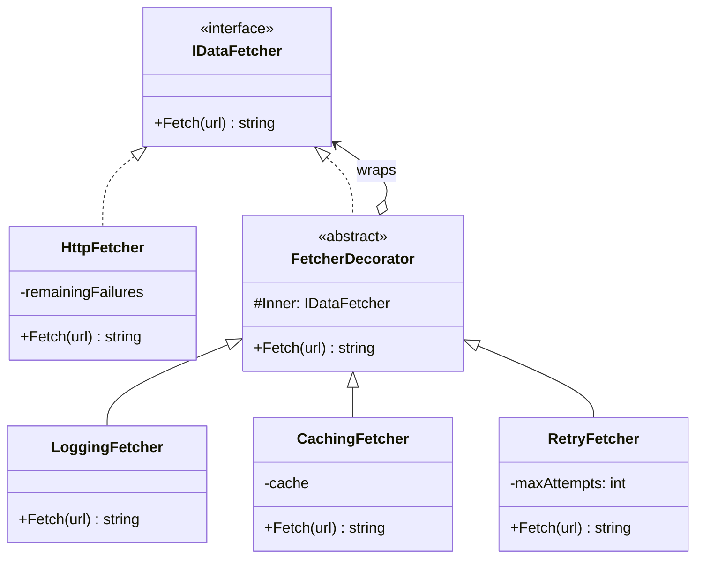

# Decorator

> **Category:** Structural · **Also known as:** Wrapper
> **Difficulty:** ⭐⭐ Intermediate · **Frequency of use:** High

[← Back to the catalog](../../../README.md#the-catalog)

## Intent

Attach additional responsibilities to an object **dynamically**, by wrapping it in another object
that has the same interface. Decorators provide a flexible alternative to subclassing for
extending functionality, and they can be **stacked** in any combination.

## The problem

Your app loads data from a flaky backend. You need logging for every call, a cache for repeated
URLs and automatic retries when the server answers `503`. The first attempt puts everything into
the fetcher itself:

```csharp
string Fetch(string url, bool log, bool cache, int retries)
{
    if (log) Console.WriteLine($"fetch {url}");
    if (cache && _cache.TryGetValue(url, out var hit)) return hit;
    for (var i = 1; ; i++)
    {
        try { var body = _http.Get(url); if (cache) _cache[url] = body; return body; }
        catch when (i < retries) { /* retry */ }
    }
}
```

Every concern is tangled with every other one, the flags multiply, and some services want logging
but no cache while others want retries only. The alternative — a subclass per combination
(`LoggingCachingRetryingFetcher`…) — explodes combinatorially: 3 concerns already give 7 classes.

## The solution

Give every concern its own small class that **implements the same interface** as the thing it
wraps and **holds a reference** to it. Each decorator does its bit of work before and/or after
delegating to the wrapped object. Because a decorator *is also* a `DataFetcher`, it can wrap
another decorator, so you compose behavior at runtime: `Logging(Caching(Retry(Http)))`.



### Participants

| Participant | In our example | Responsibility |
|---|---|---|
| **Component** | `IDataFetcher` | Interface shared by the real object and every wrapper. |
| **Concrete Component** | `HttpFetcher` | The object being decorated: a fake HTTP client. |
| **Decorator** | `FetcherDecorator` | Holds the wrapped component and forwards calls to it by default. |
| **Concrete Decorator** | `LoggingFetcher`, `CachingFetcher`, `RetryFetcher` | Add one responsibility each, before/after delegating. |
| **Client** | `Program` / `main` | Builds the stack and only talks to the outermost `IDataFetcher`. |

## The example: data fetcher with cross-cutting concerns

`HttpFetcher` is an in-memory fake: it prints `[http] GET <url>`, returns a canned JSON body, and
is configured to **fail the first N calls** for some URLs with `503 Service Unavailable`, so
retries are fully deterministic.

The client builds three stacks from the same building blocks:

- **Stack A — `Logging -> Caching -> Retry(3) -> Http`:** the first `/users` call misses the cache,
  the retry decorator absorbs two failures, and the body is cached. The second call is served from
  the cache without touching the network. The logger sees one call per client request.
- **Stack B — `Retry(3) -> Logging -> Http`:** the *same* decorators in a different order. Now
  logging is inside the retry loop, so it reports **every attempt**, and with no cache every client
  call would go to the network. **Order matters.**
- **Stack C — `Retry(2) -> Http`:** the server fails three times but we only allow two attempts,
  so the error propagates to the client.

### Implementations

| Language | Source | Run it (from the repo root) |
|---|---|---|
| C# / .NET 8 | [`csharp/`](csharp/) | `dotnet run --project patterns/structural/decorator/csharp` |
| TypeScript | [`typescript/fetchers.ts`](typescript/fetchers.ts), [`main.ts`](typescript/main.ts) | `npx tsx patterns/structural/decorator/typescript/main.ts` |
| React (TSX) | [`typescript/DecoratorDemo.tsx`](typescript/DecoratorDemo.tsx) | `npm run dev` → open the playground |
| Python 3.10+ | [`python/main.py`](python/main.py) | `python3 patterns/structural/decorator/python/main.py` |
| Go 1.23+ | [`go/main.go`](go/main.go) | `go run ./patterns/structural/decorator/go` |

### Expected output

```text
=== Decorator Pattern: Data fetcher with cross-cutting concerns ===
Stack A: Logging -> Caching -> Retry(3) -> Http
[log] fetch /users
[cache] miss /users
[http] GET /users
[retry] attempt 1/3 failed: 503 Service Unavailable, retrying
[http] GET /users
[retry] attempt 2/3 failed: 503 Service Unavailable, retrying
[http] GET /users
[cache] stored /users
[log] ok /users (25 chars)
result: {"users":["ada","linus"]}
[log] fetch /users
[cache] hit /users
[log] ok /users (25 chars)
result: {"users":["ada","linus"]}

Stack B: Retry(3) -> Logging -> Http
[log] fetch /users
[http] GET /users
[log] error /users: 503 Service Unavailable
[retry] attempt 1/3 failed: 503 Service Unavailable, retrying
[log] fetch /users
[http] GET /users
[log] error /users: 503 Service Unavailable
[retry] attempt 2/3 failed: 503 Service Unavailable, retrying
[log] fetch /users
[http] GET /users
[log] ok /users (25 chars)
result: {"users":["ada","linus"]}

Stack C: Retry(2) -> Http
[http] GET /orders
[retry] attempt 1/2 failed: 503 Service Unavailable, retrying
[http] GET /orders
[retry] attempt 2/2 failed: 503 Service Unavailable, giving up
error: 503 Service Unavailable
```

## Code walkthrough

The base decorator implements the interface and simply forwards. That gives every concrete
decorator a correct default and a single place where the "wrapping" lives:

```csharp
public abstract class FetcherDecorator(IDataFetcher inner) : IDataFetcher
{
    protected IDataFetcher Inner { get; } = inner;
    public virtual string Fetch(string url) => Inner.Fetch(url);
}
```

A concrete decorator adds behavior around `base.Fetch` — here, before *and* after the call:

```csharp
public sealed class CachingFetcher(IDataFetcher inner) : FetcherDecorator(inner)
{
    private readonly Dictionary<string, string> _cache = [];

    public override string Fetch(string url)
    {
        if (_cache.TryGetValue(url, out var cached)) return cached;   // short-circuit
        var body = base.Fetch(url);                                    // delegate
        _cache[url] = body;                                            // after
        return body;
    }
}
```

The client composes the stack. Reading from the outside in gives the order in which the
decorators see a request:

```csharp
IDataFetcher fetcher = new LoggingFetcher(
    new CachingFetcher(
        new RetryFetcher(new HttpFetcher(failFirst), maxAttempts: 3)));
```

In Go there is no inheritance, so the base decorator is a struct that concrete decorators
**embed**; the embedded `Fetch` is the forwarding default:

```go
type FetcherDecorator struct{ Inner DataFetcher }
func (d FetcherDecorator) Fetch(url string) (string, error) { return d.Inner.Fetch(url) }

type LoggingFetcher struct{ FetcherDecorator }
```

### Language notes

- **C#:** The BCL is full of decorators: `BufferedStream`, `GZipStream` and `CryptoStream` all
  wrap another `Stream`, and `new StreamReader(new GZipStream(new FileStream(...)))` is a decorator
  stack. In `HttpClient`, a `DelegatingHandler` wraps an `InnerHandler` — exactly this pattern —
  and `services.AddHttpClient(...).AddHttpMessageHandler<T>()` builds the chain for you. Libraries
  such as Scrutor add `services.Decorate<IService, CachingService>()` to the DI container.
- **TypeScript / React:** Classes work as shown, but the same idea is often written as functions
  that take and return a fetcher (`const withRetry = (f: Fetch, n: number): Fetch => ...`).
  In React, a **higher-order component** (`withFrame(Component)`) decorates a component with
  extra markup or behavior, and **custom hooks** compose cross-cutting logic around data fetching.
  [`DecoratorDemo.tsx`](typescript/DecoratorDemo.tsx) uses both: a `useFetcher` hook builds the
  decorator stack from checkboxes, and a `withFrame` HOC wraps the trace panel. (TypeScript's own
  `@decorator` syntax is a language feature for annotating classes and members — related in
  spirit, but not the GoF pattern.)
- **Python:** The `@decorator` syntax wraps a **function** with another function at definition
  time (`@functools.lru_cache`, `@functools.wraps`, retry decorators from libraries). It shares the
  name and the "wrap and delegate" idea, but the GoF pattern wraps **objects at runtime** behind
  a shared interface and can be reconfigured per instance. Use `@` for per-function concerns and
  the object pattern when the stack must be assembled dynamically.
- **Go:** The idiom is everywhere: `http.Handler` middleware (`func(next http.Handler) http.Handler`)
  and `http.RoundTripper` wrappers for `http.Client.Transport` are decorators, as are `bufio.Reader`
  and `gzip.Reader` around an `io.Reader`. Struct embedding provides the forwarding base for free.

## When to use it

- You need to add responsibilities to **individual objects**, dynamically and transparently,
  without affecting other objects of the same class.
- You have **orthogonal concerns** (logging, caching, retries, metrics, authorization,
  compression, encryption) that should be combinable in any order.
- Extension by subclassing is impractical (combinatorial explosion) or impossible (sealed/final
  classes, third-party types you only know through an interface).

## When NOT to use it

- There is only **one fixed combination** of behaviors — just write it.
- The component interface is **large**: every decorator must forward every member, which is
  tedious and error-prone (unless the language helps, as Go embedding does).
- Code relies on the **identity or concrete type** of the object (`is HttpFetcher` checks); a
  decorator is a different object and breaks those checks.
- The order of wrappers is subtle and the team will get it wrong — a builder or a pipeline with
  explicit ordering may be clearer.

## Pros and cons

| ✅ Pros | ❌ Cons |
|---|---|
| Add or remove responsibilities at runtime, per object. | Many small objects; stack traces and debugging get deeper. |
| Combine behaviors freely instead of one subclass per combination. | **Order matters** and is easy to get wrong (see Stack A vs. B). |
| Single Responsibility: each concern lives in its own class. | Hard to remove a specific wrapper from the middle of a stack. |
| Open/Closed: new concerns without touching existing classes. | Identity checks and type tests see the wrapper, not the wrapped object. |

## Real-world usages

- **.NET:** `System.IO.BufferedStream`, `GZipStream`, `CryptoStream` wrapping a `Stream`;
  `DelegatingHandler` in the `HttpClient` pipeline; `Polly` resilience handlers added via
  `AddHttpMessageHandler`/`AddResilienceHandler`.
- **JavaScript / React:** higher-order components such as `React.memo(Component)` and Redux's
  classic `connect(...)(Component)`; Express/Koa middleware wrapping request handling.
- **Python:** `functools.lru_cache` and `functools.cache` (function decorators);
  `io.BufferedReader` and `io.TextIOWrapper` wrapping a raw binary stream.
- **Go:** `http.Handler` middleware (e.g. `http.StripPrefix`, `http.TimeoutHandler`),
  custom `http.RoundTripper`s, `bufio.NewReader(r)` and `gzip.NewReader(r)` around an `io.Reader`.

## Related patterns

- **[Proxy](../proxy/README.md):** same structure (a wrapper with the same interface), different
  intent. A proxy **controls access** to its subject and usually manages its lifecycle; a decorator
  **adds behavior** and is composed by the client.
- **[Adapter](../adapter/README.md):** changes an object's *interface*; a decorator keeps the
  interface and changes *behavior*.
- **[Composite](../composite/README.md):** a decorator is like a composite with exactly one child,
  but its purpose is adding responsibilities, not aggregating objects.
- **[Chain of Responsibility](../../behavioral/chain-of-responsibility/README.md):** also a chain
  of wrappers; there any link may stop the request, while a decorator normally always delegates.
- **[Strategy](../../behavioral/strategy/README.md):** a decorator changes the "skin" of an object;
  a strategy changes its "guts".

## Exercises

1. Add a `TimingFetcher` that reports how long each call took using an **injected fake clock**
   (so output stays deterministic). Where in the stack does it give the most useful number?
2. Put `CachingFetcher` *inside* `RetryFetcher` in Stack A. Does anything change for the client?
   What happens if the cache stored errors too?
3. Rewrite the decorators as plain functions (`(DataFetcher) -> DataFetcher`) in TypeScript or
   Python and build the same three stacks. What do you gain and what do you lose?
