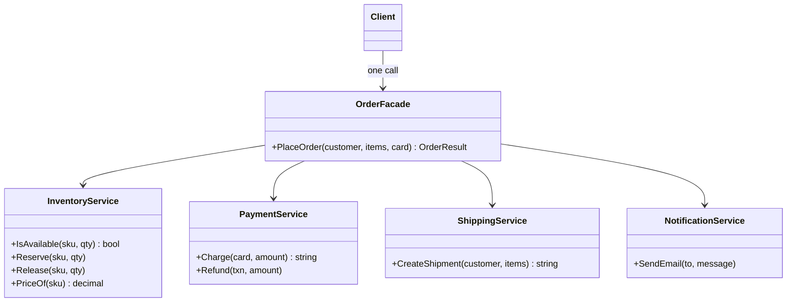

# Facade

> **Category:** Structural · **Also known as:** —
> **Difficulty:** ⭐ Beginner · **Frequency of use:** Very high

[← Back to the catalog](../../../README.md#the-catalog)

## Intent

Provide a **unified, simplified interface** to a set of interfaces in a subsystem. A facade
defines a higher-level operation that makes the subsystem easier to use, without hiding it from
clients that really need the details.

## The problem

Placing an order in an online shop touches four services: inventory, payment, shipping and
notifications. Every place that can place an order — the web checkout, the mobile API, the admin
"re-order" button — ends up repeating the same orchestration:

```csharp
// In the checkout controller... and in the mobile API... and in the admin tool...
foreach (var item in cart)
{
    if (!inventory.IsAvailable(item.Sku, item.Quantity)) { /* undo what? */ return Error(); }
    inventory.Reserve(item.Sku, item.Quantity);
}
var total = cart.Sum(i => inventory.PriceOf(i.Sku) * i.Quantity);
payment.Charge(card, total);
var tracking = shipping.CreateShipment(customer, cart);
notification.SendEmail(customer.Email, $"Order confirmed, tracking {tracking}");
```

Each copy must get the order of the steps right and remember to **release reservations** when an
item is out of stock. Some copies forget; others drift apart. Every client is coupled to four
services and their quirks, so changing the payment provider means touching all of them.

## The solution

Put the orchestration in **one class** — the facade — with a single, intention-revealing method:
`OrderFacade.PlaceOrder(customer, items, card)`. It calls the subsystems in the right order,
handles rollback, and returns one simple result. Clients depend on the facade only; the
subsystems do not know the facade exists and remain available for clients that need more
control.



### Participants

| Participant | In our example | Responsibility |
|---|---|---|
| **Facade** | `OrderFacade` | Knows which subsystem does what and in which order; offers one simple operation and handles rollback. |
| **Subsystem classes** | `InventoryService`, `PaymentService`, `ShippingService`, `NotificationService` | Do the real work. Unaware of the facade; still usable directly. |
| **Client** | `Program` / `main` | Calls `PlaceOrder` and reads an `OrderResult`. |

## The example: e-commerce order placement

Each subsystem prints the step it performs (indented), so you can see everything the facade
orchestrates behind a single call:

1. **Order 1** (Alice: 2 keyboards, 1 mouse) succeeds: each item is checked and reserved, the card
   is charged $189.97, a shipment is created and a confirmation e-mail is sent.
2. **Order 2** (Bob: 1 monitor, 5 webcams) fails: the monitor is reserved, but only 3 webcams are
   left. The facade **rolls back** the monitor reservation, e-mails Bob, and returns an error
   result — no charge, no shipment.

The final stock line proves the rollback: the monitor count is back to 5.

### Implementations

| Language | Source | Run it (from the repo root) |
|---|---|---|
| C# / .NET 8 | [`csharp/`](csharp/) | `dotnet run --project patterns/structural/facade/csharp` |
| TypeScript | [`typescript/shop.ts`](typescript/shop.ts), [`main.ts`](typescript/main.ts) | `npx tsx patterns/structural/facade/typescript/main.ts` |
| React (TSX) | [`typescript/FacadeDemo.tsx`](typescript/FacadeDemo.tsx) | `npm run dev` → open the playground |
| Python 3.10+ | [`python/main.py`](python/main.py) | `python3 patterns/structural/facade/python/main.py` |
| Go 1.23+ | [`go/`](go/) | `go run ./patterns/structural/facade/go` |

### Expected output

```text
=== Facade Pattern: E-commerce order placement ===
Order 1: Alice buys 2 x keyboard, 1 x mouse
  [inventory] check keyboard x2: ok (10 in stock)
  [inventory] reserved keyboard x2
  [inventory] check mouse x1: ok (5 in stock)
  [inventory] reserved mouse x1
  [payment] charged $189.97 to card ending 4242 (TXN-1001)
  [shipping] shipment SHP-5001 created for Alice (3 items)
  [email] to alice@example.com: Order confirmed, total $189.97, tracking SHP-5001
Result: success=true, total=$189.97, tracking=SHP-5001

Order 2: Bob buys 1 x monitor, 5 x webcam
  [inventory] check monitor x1: ok (5 in stock)
  [inventory] reserved monitor x1
  [inventory] check webcam x5: only 3 in stock
  [inventory] released monitor x1 (rollback)
  [email] to bob@example.com: Order failed: webcam is out of stock
Result: success=false, error=webcam is out of stock (requested 5, available 3)

Stock after both orders: keyboard=8, mouse=4, monitor=5, webcam=3
```

## Code walkthrough

The facade receives its subsystems (so they can be faked in tests) and exposes one method:

```csharp
public sealed class OrderFacade(
    InventoryService inventory, PaymentService payment,
    ShippingService shipping, NotificationService notification)
{
    public OrderResult PlaceOrder(Customer customer, IReadOnlyList<OrderItem> items, string cardNumber)
    {
        var reserved = new List<OrderItem>();
        foreach (var item in items)
        {
            if (!inventory.IsAvailable(item.Sku, item.Quantity))
            {
                foreach (var r in reserved) inventory.Release(r.Sku, r.Quantity);   // rollback
                notification.SendEmail(customer.Email, $"Order failed: {item.Sku} is out of stock");
                return new OrderResult(false, 0m, null, $"{item.Sku} is out of stock ...");
            }
            inventory.Reserve(item.Sku, item.Quantity);
            reserved.Add(item);
        }
        var total = items.Sum(i => inventory.PriceOf(i.Sku) * i.Quantity);
        payment.Charge(cardNumber, total);
        var tracking = shipping.CreateShipment(customer, items);
        notification.SendEmail(customer.Email, $"Order confirmed, total ${total:0.00}, tracking {tracking}");
        return new OrderResult(true, total, tracking, null);
    }
}
```

The client code shrinks to one call and one result to inspect:

```csharp
var result = shop.PlaceOrder(customer, items, "4242 4242 4242 4242");
Console.WriteLine(result.Success ? $"tracking={result.Tracking}" : $"error={result.Error}");
```

Note that the facade adds no new behavior of its own: every real step is done by a subsystem.
Its value is **knowing the workflow** — the order of calls and how to undo them.

### Language notes

- **C#:** Facades are typically application services registered in DI
  (`services.AddScoped<OrderFacade>()`) and called from controllers or minimal-API endpoints. The
  subsystems are injected as interfaces so the facade is unit-testable. `System.IO.File` is a
  classic static facade: `File.ReadAllText(path)` hides `FileStream`, `StreamReader` and encoding
  detection.
- **TypeScript / React:** A facade is often just a **module** exporting a few functions (an `api.ts`
  that hides `fetch`, headers, retries and JSON parsing). In React, a custom hook such as
  `useCheckout()` is a facade for components: it hides several services and state updates behind
  one function. [`FacadeDemo.tsx`](typescript/FacadeDemo.tsx) keeps one facade per component and
  calls only `placeOrder`. A discriminated union (`{ success: true, ... } | { success: false, error }`)
  makes the result type-safe.
- **Python:** Modules are natural facades: `shutil.copytree` or `subprocess.run` wrap lower-level
  `os` and `Popen` calls. A plain class with injected collaborators (as here) is the idiomatic
  OOP version; `dataclass(frozen=True)` keeps the result simple.
- **Go:** Packages *are* facades: export one high-level function and keep the helpers unexported.
  `http.Get(url)` is a facade over `http.Client`, `http.Request` and `http.Transport`. The example
  splits the subsystems into `subsystems.go` to make the boundary visible.

## When to use it

- A subsystem is **complex or fine-grained** and most clients only need a few common workflows.
- You want to **decouple clients** from subsystem details so the subsystem can evolve (or be
  replaced) without touching every caller.
- The same **multi-step orchestration** (with error handling and rollback) is duplicated across
  several callers.
- You want to **layer** a system: each layer exposes a facade to the layer above.

## When NOT to use it

- The subsystem is already simple; a facade would only add a pass-through layer.
- Clients genuinely need **fine-grained control** over every step — give them the subsystem.
- The facade starts accumulating business rules, state and dozens of methods: it is turning into a
  **god object**. Split it into several focused facades.

## Pros and cons

| ✅ Pros | ❌ Cons |
|---|---|
| Clients are shielded from subsystem complexity. | Can become a god object coupled to everything. |
| Weak coupling: subsystems can change behind the facade. | Another layer to maintain and to keep in sync with the subsystems. |
| One place for orchestration, ordering and rollback. | May hide useful capabilities if clients are *forced* through it. |
| Subsystems stay accessible for advanced use. | Easy to overuse as a dumping ground for "misc" logic. |

## Real-world usages

- **.NET:** `System.IO.File` / `Directory` static helpers; `HttpClient.GetStringAsync` over the
  handler pipeline; `WebApplication.CreateBuilder(args)` in ASP.NET Core, which sets up
  configuration, logging, DI and the host in one call.
- **JavaScript / React:** `fetch` itself is a facade over the network stack; jQuery's `$.ajax`
  historically wrapped `XMLHttpRequest`; data-fetching hooks such as TanStack Query's `useQuery`
  hide caching, deduplication and refetching behind one hook.
- **Python:** `requests.get(url)` over sessions, adapters and connection pools; `subprocess.run`
  over `Popen`; `shutil` functions over `os` primitives.
- **Go:** `http.Get` and `http.ListenAndServe` over `http.Client`/`http.Server`;
  `os.ReadFile` over `os.Open` + `io.ReadAll`.

## Related patterns

- **[Adapter](../adapter/README.md):** both wrap existing code, but an adapter makes **one** object
  fit an interface a client *already expects*, while a facade defines a **new, simpler** interface
  over **many** objects. An adapter is about compatibility; a facade is about simplicity.
- **[Mediator](../../behavioral/mediator/README.md):** both centralize collaboration among
  objects. A facade is **one-directional** — the client calls the facade, the facade calls the
  subsystems, and the subsystems don't know it exists. A mediator coordinates **peers** that know
  the mediator and talk *through* it in both directions.
- **[Abstract Factory](../../creational/abstract-factory/README.md):** can be used with a facade to
  create subsystem objects in a platform-independent way.
- **[Singleton](../../creational/singleton/README.md):** often only one facade instance is needed
  (in modern code, a singleton lifetime in the DI container).
- **[Proxy](../proxy/README.md):** a proxy keeps the *same* interface as one object; a facade
  offers a *different, simpler* one over many.

## Exercises

1. Make `PaymentService.Charge` fail for a specific card number and extend the facade so it
   releases all reservations (and, if needed, calls `Refund`) when payment is declined.
2. Introduce interfaces for the four subsystems and write a unit test for `OrderFacade` using
   fakes. What did the facade make easier to test?
3. Add a second facade method, `CancelOrder(tracking)`. Which subsystems does it need? Does the
   facade start to feel too big — and how would you split it?
