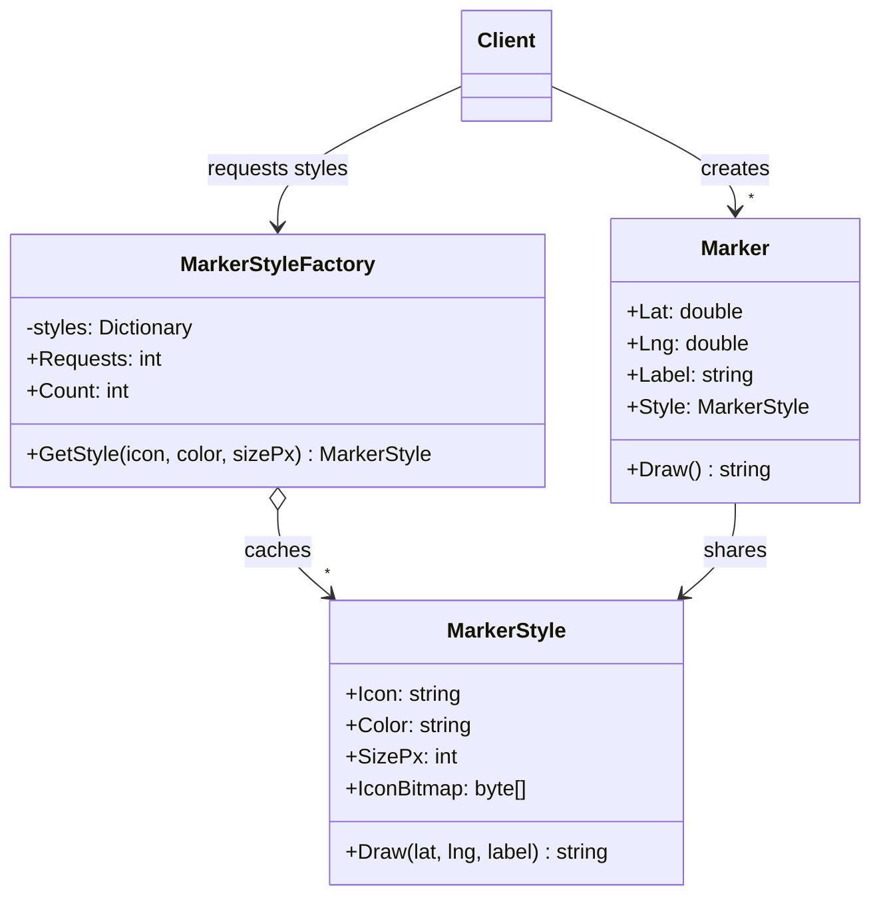

# Flyweight

> **Category:** Structural · **Also known as:** Cache (of shared objects)
> **Difficulty:** ⭐⭐ Intermediate · **Frequency of use:** Low

[← Back to the catalog](../../../README.md#the-catalog)

## Intent

Use **sharing** to support large numbers of fine-grained objects efficiently. Split each object's
state into **intrinsic** state (shared, immutable, stored in the flyweight) and **extrinsic** state
(unique per object, kept outside and passed in when needed).

## The problem

A map application shows points of interest. Each marker has a position and a label, plus a style:
an icon name, a color, a size — and a **decoded icon bitmap** of about 20 KB. The naive design
gives every marker its own copy of everything:

```csharp
public sealed class Marker(double lat, double lng, string label, string icon, string color, int size)
{
    public byte[] IconBitmap { get; } = LoadAndDecode(icon, color, size);   // ~20 KB, every time!
    // ...
}

for (var i = 0; i < 10_000; i++) markers.Add(new Marker(lat, lng, label, "restaurant", "red", 32));
```

Ten thousand markers allocate ten thousand identical bitmaps — about 190 MB — even though there
are only **three** distinct styles on the map. Loading is slow, memory explodes, and the garbage
collector is busy for nothing.

## The solution

Move the heavy, repeated, **immutable** part of the marker into a separate `MarkerStyle` object
(the flyweight) and make sure each distinct style exists **once**, via a `MarkerStyleFactory` that
caches styles by key. A `Marker` (the context) keeps only what is unique to it — latitude,
longitude, label — plus a **reference** to a shared style. Operations on the flyweight receive the
extrinsic state as parameters: `style.Draw(lat, lng, label)`.



### Participants

| Participant | In our example | Responsibility |
|---|---|---|
| **Flyweight** | `MarkerStyle` | Holds the intrinsic, immutable state (icon, color, size, bitmap). Receives extrinsic state as method parameters. |
| **Flyweight Factory** | `MarkerStyleFactory` | Creates flyweights on demand and returns the cached instance for an existing key. |
| **Context** | `Marker` | Stores the extrinsic state (lat, lng, label) and a reference to a flyweight. |
| **Client** | `Program` / `main` | Asks the factory for styles and creates the markers. |

## The example: map markers

The client creates **10,000 markers** on a deterministic grid, cycling through three styles
(`restaurant/red/32px`, `hotel/blue/32px`, `fuel/green/24px`). The factory prints a line only when
it really creates a style — three times — even though it receives 10,000 requests.

The memory estimate uses fixed, made-up sizes so it is the same in every language:
icon bitmap = 20,000 B, style fields = 64 B, marker fields = 40 B. Without the flyweight, every
marker carries its own style; with it, 10,000 small markers share 3 styles — a 99.77% saving.

Finally a few markers are drawn, and the client checks that markers #0 and #3 point to the
**same** style object.

### Implementations

| Language | Source | Run it (from the repo root) |
|---|---|---|
| C# / .NET 8 | [`csharp/`](csharp/) | `dotnet run --project patterns/structural/flyweight/csharp` |
| TypeScript | [`typescript/markers.ts`](typescript/markers.ts), [`main.ts`](typescript/main.ts) | `npx tsx patterns/structural/flyweight/typescript/main.ts` |
| React (TSX) | [`typescript/FlyweightDemo.tsx`](typescript/FlyweightDemo.tsx) | `npm run dev` → open the playground |
| Python 3.10+ | [`python/main.py`](python/main.py) | `python3 patterns/structural/flyweight/python/main.py` |
| Go 1.23+ | [`go/main.go`](go/main.go) | `go run ./patterns/structural/flyweight/go` |

**Tests:** [C# (xUnit)](../../../tests/csharp/DesignPatterns.Tests/Structural/FlyweightTests.cs) · [TypeScript (Vitest)](typescript/markers.test.ts) · [React (Testing Library)](typescript/FlyweightDemo.test.tsx) · [Python (pytest)](python/test_main.py) · [Go (`go test`)](go/main_test.go)

### Expected output

<!-- output: expected_output.txt -->
```text
=== Flyweight Pattern: Map markers ===
[factory] new style: restaurant/red/32px
[factory] new style: hotel/blue/32px
[factory] new style: fuel/green/24px
Created 10000 markers with 10000 style requests
Style objects created: 3
Memory estimate (icon=20000 B, style fields=64 B, marker fields=40 B):
  without flyweight: 10000 x (20000 + 64 + 40) = 201040000 B (191.73 MB)
  with flyweight:    10000 x 40 + 3 x (20000 + 64) = 460192 B (0.44 MB)
  saved: 99.77%
Rendering a few markers:
  #0: draw restaurant icon (red, 32px) at (40.0000, -3.0000) label "Place 0"
  #1: draw hotel icon (blue, 32px) at (40.0100, -3.0000) label "Place 1"
  #2: draw fuel icon (green, 24px) at (40.0200, -3.0000) label "Place 2"
  #3: draw restaurant icon (red, 32px) at (40.0300, -3.0000) label "Place 3"
  #9999: draw restaurant icon (red, 32px) at (40.9900, -3.9900) label "Place 9999"
Markers #0 and #3 share one style object: true
```
<!-- /output -->

## Code walkthrough

The flyweight is immutable and takes the extrinsic state as parameters:

```csharp
public sealed class MarkerStyle(string icon, string color, int sizePx)
{
    public string Icon { get; } = icon;
    public string Color { get; } = color;
    public int SizePx { get; } = sizePx;
    public byte[] IconBitmap { get; } = new byte[Sizes.IconBitmapBytes];

    public string Draw(double lat, double lng, string label) => $"draw {Icon} icon ... at ({lat:0.0000}, {lng:0.0000}) ...";
}
```

The factory guarantees one instance per key:

```csharp
public MarkerStyle GetStyle(string icon, string color, int sizePx)
{
    Requests++;
    var key = $"{icon}/{color}/{sizePx}px";
    if (!_styles.TryGetValue(key, out var style))
    {
        style = new MarkerStyle(icon, color, sizePx);
        _styles[key] = style;
    }
    return style;
}
```

The context is tiny — four fields — and delegates drawing to its shared style:

```csharp
public sealed record Marker(double Lat, double Lng, string Label, MarkerStyle Style)
{
    public string Draw() => Style.Draw(Lat, Lng, Label);
}
```

The crucial rule: **a flyweight must be immutable**. If one marker could change "its" style's
color, every marker sharing it would change too.

### Language notes

- **C#:** `string.Intern` and the compiler's interning of string literals are built-in flyweights.
  `ArrayPool<T>.Shared` and `MemoryPool<T>` reuse buffers (a pooling cousin of the idea). Making
  the context a `readonly record struct` instead of a class would remove the per-marker object
  header as well.
- **TypeScript / React:** JS engines already intern string literals and share hidden classes for
  objects of the same shape. In React, flyweights show up as **shared, hoisted constants**: style
  objects, icon components or configuration created once outside the component (or memoized with
  `useMemo`) and reused by thousands of rendered items, as in
  [`FlyweightDemo.tsx`](typescript/FlyweightDemo.tsx). List virtualization (rendering only visible
  rows) is the other half of the "many objects" solution.
- **Python:** `sys.intern()` interns strings, and CPython caches small integers (-5 to 256). A
  dictionary cache or `functools.cache` on a factory function is the idiomatic factory.
  `@dataclass(frozen=True)` makes the flyweight immutable, and `slots=True` on the context removes
  the per-instance `__dict__`, which matters when you have thousands of them.
- **Go:** Share flyweights by **pointer** (`*MarkerStyle`) and keep the context a small value type.
  Go 1.23 added the `unique` package (`unique.Make`), which canonicalizes comparable values so
  equal values share one copy — a standard-library flyweight factory.

## When to use it

- The application uses a **large number** of similar objects and memory is a real concern
  (measured, not imagined).
- Most of each object's state can be made **extrinsic**, and the remaining intrinsic state has
  **few distinct values**.
- Object identity does not matter to clients (they don't compare markers by reference to the
  style or mutate the shared part).

## When NOT to use it

- You have hundreds, not tens of thousands, of objects — the complexity isn't worth it.
- The intrinsic state is **mutable** or varies per object; sharing would cause spooky action at a
  distance.
- Computing or passing the extrinsic state is more expensive than the memory you save.
- The factory's cache would grow without bound (every object unique): you get the overhead with
  none of the sharing.

## Pros and cons

| ✅ Pros | ❌ Cons |
|---|---|
| Huge memory savings when many objects share state. | More complex code: state is split in two places. |
| Fewer allocations, less GC pressure, faster startup. | Callers must supply extrinsic state on every call. |
| Shared heavy resources (bitmaps, fonts, glyphs) are loaded once. | Flyweights must be immutable; easy to violate by accident. |
| Factory gives a single place to control creation. | Factory cache needs thread-safety and lifetime management in real apps. |

## Real-world usages

- **.NET:** `string.Intern`; shared immutable instances such as `Task.CompletedTask` and
  `Array.Empty<T>()`; WPF lets frozen `Freezable` objects (e.g. brushes) be shared across elements.
- **JavaScript / React:** string interning and hidden classes inside V8; module-level constants
  and icon components shared by every list item; text editors and canvases sharing glyph and style
  objects across characters.
- **Python:** `sys.intern`, the small-integer cache, and `None`/`True`/`False` singletons;
  `functools.lru_cache` used as a flyweight factory.
- **Go:** the `unique` package (`unique.Make[T]`, Go 1.23+); `sync.Pool` for reusing temporary
  objects (pooling rather than sharing, but the same memory-saving goal).

## Related patterns

- **[Composite](../composite/README.md):** leaf nodes of a composite tree (e.g. characters in a
  document) are often implemented as shared flyweights.
- **[Factory Method](../../creational/factory-method/README.md):** the flyweight factory is a
  factory that returns cached instances instead of always creating new ones.
- **[Singleton](../../creational/singleton/README.md):** a singleton is one shared instance per
  class; a flyweight factory keeps one shared instance **per key**.
- **[State](../../behavioral/state/README.md) and [Strategy](../../behavioral/strategy/README.md):**
  stateless state and strategy objects can be shared as flyweights.
- **[Proxy](../proxy/README.md):** a caching proxy also avoids repeated expensive work, but caches
  *results* of calls rather than sharing *objects*.

## Exercises

1. Add a "selected" highlight to markers. Is it intrinsic or extrinsic state? Implement it
   without breaking the sharing.
2. Make `MarkerStyleFactory` thread-safe (e.g. `ConcurrentDictionary.GetOrAdd` in C#,
   `sync.Mutex` or `sync.Map` in Go). Why can creation still happen twice, and does it matter?
3. Replace `Marker` with parallel arrays (`lats[]`, `lngs[]`, `labels[]`, `styleIds[]`). How does
   the memory estimate change, and what do you lose in readability?
