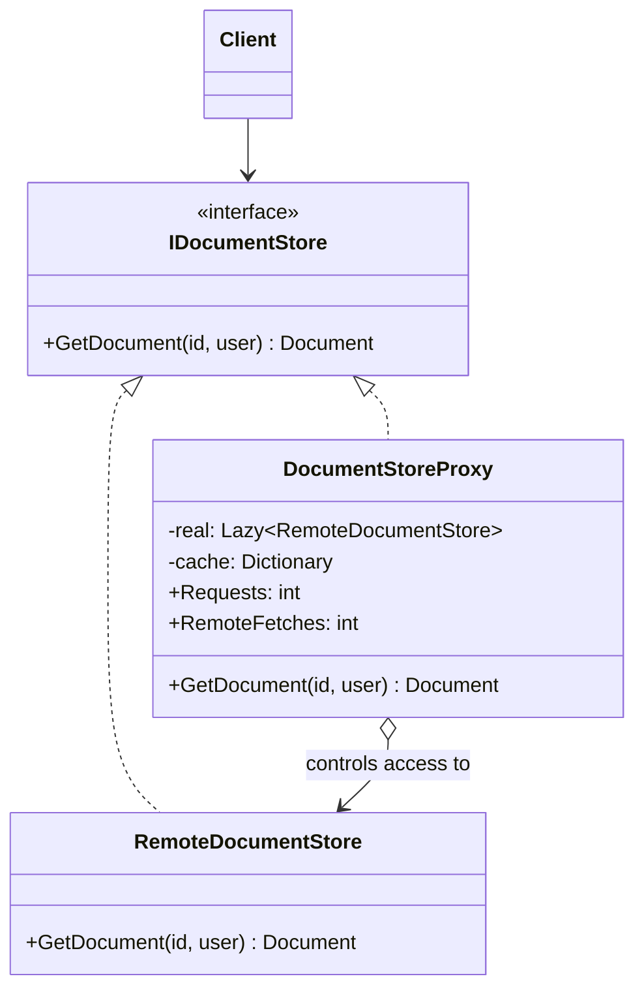

# Proxy

> **Category:** Structural · **Also known as:** Surrogate
> **Difficulty:** ⭐⭐ Intermediate · **Frequency of use:** High

[← Back to the catalog](../../../README.md#the-catalog)

## Intent

Provide a **surrogate or placeholder** for another object to **control access** to it. The proxy
has the same interface as the real object, so clients use it without knowing it is there.

## The problem

Your app reads documents from a remote document server. Connecting is slow, every read is a
network round trip, and some documents are confidential. Without a proxy, every caller has to
remember all of it:

```csharp
// Repeated in every screen that shows a document...
_store ??= new RemoteDocumentStore();                        // connect lazily (don't forget!)
if (!_cache.TryGetValue(id, out var doc))
{
    doc = _store.GetDocument(id, user);
    _cache[id] = doc;
}
if (user.Role == "viewer" && doc.Classification == "confidential")   // (forget this once = data leak)
    throw new UnauthorizedAccessException();
```

Lazy creation, caching and authorization are duplicated across callers, and a single caller that
skips the role check leaks confidential data. You cannot add these checks to
`RemoteDocumentStore` either: it may be a generated client or a third-party SDK.

## The solution

Create a `DocumentStoreProxy` that implements the **same interface** (`IDocumentStore`) as the
real store and **holds a reference** to it. Clients receive the proxy instead of the real object.
The proxy decides *when* and *whether* to forward each call: it creates the real store only when
first needed, serves repeated reads from a cache, and refuses unauthorized requests.



### Participants

| Participant | In our example | Responsibility |
|---|---|---|
| **Subject** | `IDocumentStore` | Common interface, so a proxy can stand in wherever the real subject is expected. |
| **Real Subject** | `RemoteDocumentStore` | The real, expensive object (connects on construction, fetches over the "network"). |
| **Proxy** | `DocumentStoreProxy` | Same interface; controls access: lazy creation, caching, authorization. |
| **Client** | `Program` / `main` | Works with an `IDocumentStore`; never knows a proxy is in between. |

### Kinds of proxy

The structure is always the same; what changes is *why* the proxy controls access:

| Kind | What it does | Example |
|---|---|---|
| **Virtual proxy** | Delays creating an expensive object until it is really needed. | Our proxy creates `RemoteDocumentStore` on the first request; ORMs lazy-load related entities. |
| **Protection proxy** | Checks permissions before forwarding. | Our proxy refuses confidential documents to viewers. |
| **Remote proxy** | Represents an object in another process or machine; hides the networking. | gRPC/WCF client stubs, Java RMI stubs. |
| **Caching proxy** | Stores results of expensive operations and reuses them. | Our proxy caches fetched documents; HTTP caching proxies. |
| **Logging proxy** | Records calls (arguments, timing) before forwarding. | The JS `Proxy` in our React demo. |
| **Smart reference** | Adds housekeeping when the object is accessed: reference counting, locking, freeing when unused. | C++ `shared_ptr`; `Rc`/`Arc` in Rust. |

## The example: document store proxy

`RemoteDocumentStore` prints `[remote] connecting to document server...` when it is constructed
and `[remote] fetching <id>` on every read. `DocumentStoreProxy` combines three kinds of proxy:

1. **Virtual:** the client creates the proxy, but no connection is opened until the first request.
2. **Caching:** `doc-1` is fetched once for alice and then served from cache to bob.
3. **Protection:** bob (a *viewer*) is denied the *confidential* `doc-2`. The check runs on
   every request, even for cached documents — alice (an *editor*) then reads `doc-2` from cache.

Four requests result in **one** connection and **two** remote fetches.

> In this example the proxy needs the document's classification to authorize, so it fetches
> first and checks afterwards. A real system would often check metadata or an ACL **before**
> touching the remote store; see exercise 2.

### Implementations

| Language | Source | Run it (from the repo root) |
|---|---|---|
| C# / .NET 8 | [`csharp/`](csharp/) | `dotnet run --project patterns/structural/proxy/csharp` |
| TypeScript | [`typescript/documents.ts`](typescript/documents.ts), [`main.ts`](typescript/main.ts) | `npx tsx patterns/structural/proxy/typescript/main.ts` |
| React (TSX) | [`typescript/ProxyDemo.tsx`](typescript/ProxyDemo.tsx) | `npm run dev` → open the playground |
| Python 3.10+ | [`python/main.py`](python/main.py) | `python3 patterns/structural/proxy/python/main.py` |
| Go 1.23+ | [`go/main.go`](go/main.go) | `go run ./patterns/structural/proxy/go` |

### Expected output

```text
=== Proxy Pattern: Document store proxy ===
Proxy ready, real store created: false
alice (editor) asks for doc-1
[proxy] cache miss doc-1
[proxy] creating the real store on first use
[remote] connecting to document server...
[remote] fetching doc-1
  -> "Q3 roadmap" (public)
bob (viewer) asks for doc-1
[proxy] cache hit doc-1
  -> "Q3 roadmap" (public)
bob (viewer) asks for doc-2
[proxy] cache miss doc-2
[remote] fetching doc-2
  -> access denied: viewer cannot read confidential doc-2
alice (editor) asks for doc-2
[proxy] cache hit doc-2
  -> "Merger plan" (confidential)
Stats: 4 requests, 2 remote fetches, real store created: true
```

## Code walkthrough

In C#, `Lazy<T>` gives the virtual-proxy behavior in one line; the factory runs on the first
access to `.Value`:

```csharp
private readonly Lazy<RemoteDocumentStore> _real = new(() => new RemoteDocumentStore());
```

The proxy method layers caching and protection around the delegation:

```csharp
public Document GetDocument(string id, User user)
{
    if (!_cache.TryGetValue(id, out var document))
    {
        document = _real.Value.GetDocument(id, user);   // virtual: created on first use
        _cache[id] = document;                          // caching
    }
    if (user.Role == "viewer" && document.Classification == "confidential")
        throw new AccessDeniedException($"{user.Role} cannot read confidential {id}");   // protection
    return document;
}
```

The client is written against the interface, so swapping the proxy for the real store (or the
other way round) needs no change in client code:

```csharp
IDocumentStore store = new DocumentStoreProxy();
var doc = store.GetDocument("doc-1", alice);
```

### Language notes

- **C#:** `Lazy<T>` (thread-safe by default) is the standard building block for virtual proxies.
  `System.Reflection.DispatchProxy` generates a proxy for *any* interface at runtime
  (`DispatchProxy.Create<IDocumentStore, MyProxy>()`), and libraries such as Castle DynamicProxy
  power mocking frameworks and interceptors. Entity Framework Core's lazy-loading proxies are
  virtual proxies for navigation properties.
- **TypeScript / React:** JavaScript has a built-in **`Proxy` object** that intercepts property
  access, calls and assignments on any object. [`documents.ts`](typescript/documents.ts) shows a
  generic logging proxy:

  ```ts
  export function withCallLogging<T extends object>(target: T, log: Log): T {
    return new Proxy(target, {
      get(obj, prop, receiver) {
        const value: unknown = Reflect.get(obj, prop, receiver);
        if (typeof value !== "function") return value;
        return (...args: unknown[]) => { log(`[js-proxy] ${String(prop)}(...)`); return value.apply(obj, args); };
      },
    });
  }
  ```

  Vue 3 and MobX build their reactivity on `Proxy`, and Immer uses it to record changes to a draft.
  In React, `React.lazy(() => import("./Heavy"))` is a virtual proxy for a component: a
  placeholder that loads the real one on first render. [`ProxyDemo.tsx`](typescript/ProxyDemo.tsx)
  keeps one proxy per component with `useMemo`.
- **Python:** `functools.cached_property` gives a lazy attribute in one decorator, used here for the
  virtual-proxy part. For a **generic** proxy, implement `__getattr__`, which Python calls only for
  attributes not found normally, and forward to the wrapped object:
  `def __getattr__(self, name): return getattr(self._target, name)`. `weakref.proxy` is a
  standard-library smart reference.
- **Go:** A proxy is a struct that implements the same interface and holds the real value. For
  thread-safe lazy creation use `sync.Once` or `sync.OnceValue` (Go 1.21+) instead of the simple
  `nil` check used in this single-threaded example. `httputil.ReverseProxy` is a remote proxy in
  the standard library.

## When to use it

- **Lazy initialization** of a heavyweight object that might not be needed (virtual proxy).
- **Access control** that must be enforced no matter which client calls (protection proxy).
- **Local representation of a remote object** that hides networking (remote proxy).
- **Caching, logging, metrics or rate limiting** around an object you cannot or should not modify.
- **Lifecycle management**: counting references, releasing the real object when nobody uses it.

## When NOT to use it

- The real object is cheap and has no access rules — the proxy is pure indirection.
- Clients need to know they are talking to a remote or cached object (e.g. to handle staleness or
  latency explicitly); hiding it can cause surprises.
- You want to **add several independent features** freely and in any combination — that is the
  Decorator's job.

## Pros and cons

| ✅ Pros | ❌ Cons |
|---|---|
| Controls the real object without clients knowing (same interface). | Extra indirection; responses may be slower (or stale, when cached). |
| Manages the real object's lifecycle (lazy creation, release). | Hidden behavior can surprise clients (a "simple" call may connect to a server). |
| Works even if the real object isn't ready or available. | Every member of the interface must be forwarded (unless generated dynamically). |
| Open/Closed: new proxies without changing the real subject or clients. | Caching proxies raise invalidation and consistency questions. |

## Real-world usages

- **.NET:** `Lazy<T>`; `DispatchProxy`; Entity Framework Core lazy-loading proxies
  (`UseLazyLoadingProxies`); gRPC generated client classes (remote proxies).
- **JavaScript / React:** the built-in `Proxy` and `Reflect` APIs; Vue 3 `reactive()`; Immer's
  `produce`; `React.lazy` for code-split components.
- **Python:** `functools.cached_property`; `weakref.proxy`; `unittest.mock.Mock` (records calls);
  `xmlrpc.client.ServerProxy` (remote proxy).
- **Go:** `httputil.ReverseProxy` and `httputil.NewSingleHostReverseProxy`; `sync.OnceValue` for
  lazy creation; interface-satisfying wrappers around `database/sql` drivers for tracing.

## Related patterns

- **[Decorator](../decorator/README.md):** structurally almost identical (a wrapper with the same
  interface). The difference is intent and control: a **decorator adds behavior** and is stacked
  by the **client** in any combination; a **proxy controls access** to its subject and usually
  manages the subject's **lifecycle** itself (here, the proxy creates the real store — the client
  never sees it).
- **[Adapter](../adapter/README.md):** gives a *different* interface to the wrapped object; a proxy
  keeps the *same* one.
- **[Facade](../facade/README.md):** simplifies a whole subsystem behind a new interface; a proxy
  stands in for a single object.
- **[Flyweight](../flyweight/README.md):** a caching proxy reuses *results*, while a flyweight
  factory shares *objects*.

## Exercises

1. Add a **logging proxy** as a separate class that wraps `DocumentStoreProxy`. Then try putting it
   *inside* (around the real store). What does each position log?
2. Change the protection proxy so it denies viewers **before** contacting the remote store, using
   a small, cheap classification index. Which output lines disappear?
3. Add an `UpdateDocument(id, title, user)` method to the interface. What must the caching part of
   the proxy do now, and who may call it?
